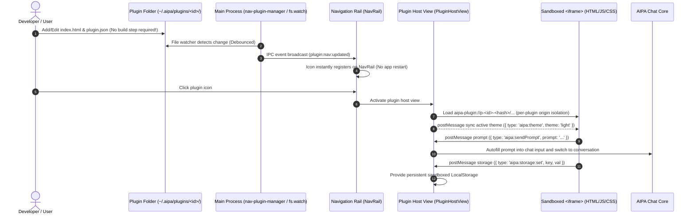
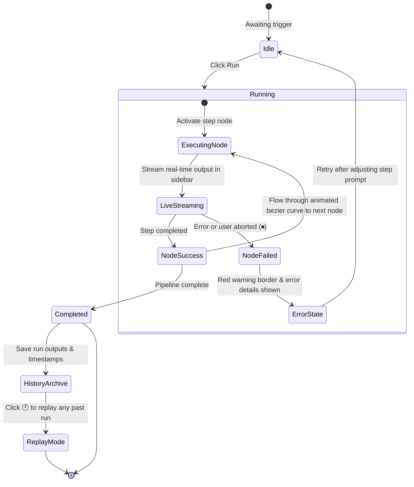
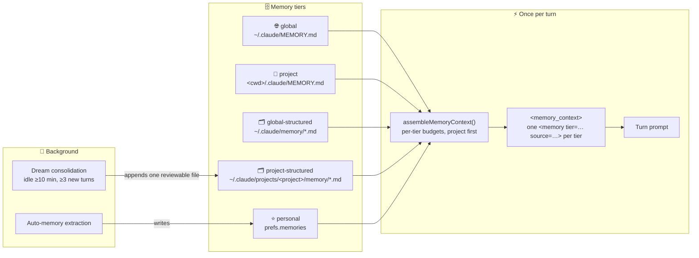

<p align="center">
  <h1 align="center">AIPA</h1>
  <p align="center">
    <strong>AI Personal Assistant — Your Always-On Desktop Agent Cockpit</strong><br/>
    Ask anything. Automate anything. Drive terminal and code, get things done.
  </p>
  <p align="center">
    
    
    
    
    
  </p>
</p>

---

AIPA is not a simple web-wrapper chat window. It is an **action-oriented desktop agent** that lives alongside you — reading and writing local files, executing shell commands, chaining tasks into automated workflows, and maintaining memory and preferences across sessions.

Under the hood, it drives **OpenAI Codex CLI** and **Claude Code CLI** as dual-core execution engines, packaged inside a finely tuned Electron + React cockpit with native multi-model support for OpenAI, Claude, DeepSeek, Ollama, and any OpenAI-compatible provider.

> 💡 **The CLI is the high-performance engine; AIPA is your intuitive cockpit.**

---

## 🏛️ System Architecture

```mermaid
graph TB
    subgraph Desktop["🖥️ User Desktop Environment (Windows 10/11)"]
        subgraph ElectronCockpit["🚀 AIPA Desktop Cockpit (Electron + React)"]
            subgraph Renderer["Renderer Layer (React 18 + Vite + Zustand)"]
                NavRail["Navigation Rail (NavRail)"]
                MainView["Main Content View (MainView)"]
                ChatPanel["Structured Chat / Tool Cards / LCS Diff"]
                OrgChart["Organization Chart"]
                EmpGallery["HR (People Ops)"]
                CanvasWorkflow["Canvas Workflow Editor"]
                PluginHost["Sandboxed Plugin Host"]
            end
            
            subgraph Preload["Isolation Layer (Preload / contextBridge)"]
                API["window.electronAPI (Type-safe IPC Bridge)"]
            end
            
            subgraph MainProcess["Main Process (Node.js CJS)"]
                PtyMgr["PTY Manager (node-pty ConPTY)"]
                CodexBridge["Codex Bridge (JSON-RPC 2.0 stdio)"]
                StreamBridge["Claude Bridge (NDJSON Stream)"]
                NavPluginMgr["Hot-Pluggable Plugin Watcher (fs.watch)"]
                ConfigMgr["Secure Config (DPAPI safeStorage)"]
                ClawdPet["Clawd Desktop Pet Integration"]
            end
        end

        subgraph Engines["⚡ Execution Engines & Providers"]
            CodexCLI["OpenAI Codex CLI (Rust Native Core · Primary Engine)"]
            ClaudeCLI["Claude Code CLI (Fallback Engine)"]
            LLMProviders["Multi-LLM Providers (OpenAI / Claude / DeepSeek / Ollama / Qwen)"]
        end

        subgraph LocalEnv["💻 Local Operating System"]
            Shell["Terminal Execution (PowerShell / Git Bash / CMD)"]
            FS["Workspace File System (Atomic Read/Write / Diffs)"]
            Git["Git Version Control / Worktree Isolation"]
            MemoryStore["Persistent Memory (~/.claude/projects / memdir)"]
        end
    end

    Renderer -->|postMessage / IPC| Preload
    Preload -->|IPC Channel| MainProcess
    MainProcess -->|JSON-RPC 2.0 stdio| CodexCLI
    MainProcess -->|NDJSON stdio| ClaudeCLI
    MainProcess -->|HTTP / SSE| LLMProviders
    CodexCLI --> Shell & FS & Git
    ClaudeCLI --> Shell & FS & Git & MemoryStore
```



---

## 🖥️ Desktop Cockpit Layout

AIPA adopts a modern **two-column layout** eliminating redundant intermediate lists. All core features open directly in the full-screen primary workspace:

```text
┌────────────────────────────────────────────────────────────────────────────────────────┐
│  AIPA — Desktop Agent Cockpit                                                    ─  □  ✕  │
├──────┬─────────────────────────────────────────────────────────────────────────────────┤
│ [🏢] │ Org Chart / Company Map → Department Roster                                     │
│ Dept │ ┌─────────────────────────────────────────────────────────────────────────────┐ │
│      │ │ 🤖 Assistant                                                                │ │
│ [👥] │ │ Refactoring module architecture...                                          │ │
│ HR   │ │ ┌─ 🛠️ Tool: Write (src/main/plugins/nav-plugin-manager.ts) ───────────────┐ │ │
│ [📁] │ │ │ + export interface NavPluginManifest { ... }                           │ │  │
│ Arch │ │ └────────────────────────────────────────────────────────────────────────┘ │  │
│      │ └─────────────────────────────────────────────────────────────────────────────┘ │
│      │                                                                                 │
│      │ ┌─ Employee Roster (HR)   ─────────────────────────────────────────────┐ │
│      │ │  ┌─────────┐   ┌─────────┐   ┌─────────┐   ┌─────────┐   ┌─────────┐        │ │
│      │ │  │ 👨‍💻 Coach  │   │ 👩‍🔬 Analyst│   │ 🎨 Creative│   │ 📚 Tutor │   │ ⚡ Productiv│   │ │
│ [📅] │ │  │ Writing │   │ Research│   │ Partner │   │ Academic│   │  Coach  │        │ │
│ Cal. │ │  └─────────┘   └─────────┘   └─────────┘   └─────────┘   └─────────┘        │ │
│      │ └─────────────────────────────────────────────────────────────────────────────┘ │
│ ───  │                                                                                 │
│ [📝] │ ┌─ Canvas Workflow Editor ────────────────────────────────────────────────────┐ │
│Notes │ │  [Node: Read Spec] ──(flowing line)──> [Node: Code Review] ──(done)──> [Done] │ │
│ [🔌] │ └─────────────────────────────────────────────────────────────────────────────┘ │
│Plugin│ ┌─ Interaction Input Area ────────────────────────────────────────────────────┐ │
│ [⚙️]  │ Status: ● Ready | Thinking: Medium | Perm: Accept Edits | Cost: $0.04    [🐱 Clawd]│
└──────┴─────────────────────────────────────────────────────────────────────────────────┘
```

---

## 🌟 Core Capabilities

| Module | Core Features | Visual Presentation |
|---|---|---|
| **💬 Chat & Execution** | Stream-JSON real-time stream, dual-model switching, collapsible thinking chain, auto-compaction; streamed deltas are appended per animation frame instead of rebuilding the message array, and list indexes, word counts and change parsing are cached per message — long conversations stay smooth | Structured tool cards, LCS color-coded diff view, task checklist, interactive permission dialog |
| **👥 HR (People Ops)** | Character persona illustrations, role-tailored attire/hairstyles, glowing status aura | The HR page shows Experts, Skills and Workflows as matching card grids (the standalone Skills panel was merged in): a skill card feeds its slash command into chat or opens the full SKILL.md, expert cards can be edited or recruited, workflow cards show step and run counts with hover edit/duplicate/delete and one-click run; a dashed card at the end creates a new item, with suggested presets below |
| **🏢 Org Chart** | Company-style department map, trunk→bus→drop connector lines, layout adapts to both container width and department count (centred single row / left-rail multi-row), per-department color and stable emoji; **company → department → team** across three levels, one section per applied template, a team strip always drawn under each card (a real sub-tree with its own bus and drops) and “open position” badges | Shows departments only (employees stay collapsed); clicking a card drills into that department's employee roster, and hovering offers direct recruit, a stats popover, employee export, or **deleting the department** (a confirm box outside the card giving the team count that will cascade with it); the HQ card likewise **deletes a whole company** — company, all its departments, and the teams beneath them, keeping the folders and sessions on disk). The roster itself renders each employee as a **little yellow helper** (one eye or two, height, hair and mouth hashed from the session id, always-on breathing, and a spinning halo plus typing arm while replying), with dimmed “open positions” standing in their own group until hired |
| **📁 Archive** | Company-wide task ledger: every session is filed under its **company / department / team**, derived live with no extra storage layer, filterable by organisation / time / archive state / free text, grouped by company with an explicit unassigned bucket | Reach it from the left nav’s “Archive” entry or `Ctrl+8`; each row shows the task title, its department · team, an employee short-hash, time and turn count, and opens that session on click; rows can be archived inline and exported as `aipa_archive_<date>.json` |
| **🎨 Canvas Workflows** | Multi-step prompt pipeline orchestration, topology graph, live output streaming, execution replay | Infinite zoom dot-grid canvas, animated bezier edge flow, inline step title rename |
| **🔌 Zero-Compile Plugins** | Vanilla HTML5+CSS+JS, sandboxed isolation, postMessage bridge SDK, dynamic directory watching, AI edit drawer | Real-time sidebar icon registration, zero-build instant reload, host developer toolbar (reload + built-in source preview: file tree with line numbers, one-click copy or reveal folder + **Edit**: chat with the AI in a right-hand drawer to change the plugin, reloaded automatically when a turn lands) |
| **🧩 Plugin Hub** | Unified plugin dashboard, 1-click launch, source inspection, and developer starter guide | Pre-installed at the bottom of NavRail, enables cross-plugin navigation; UI and plugin names follow the app language (EN/ZH) |
| **📅 Work Calendar Plugin** | Month view with cross-day task bars, drag-to-create tasks, AI-streamed weekly/monthly reports, GitHub & local-folder work sources, person-day tracking | One-click report generation from week badges, preview / regenerate / pull sources, file-backed storage with JSON import/export |
| **📝 Quick Notes Plugin** | Decoupled hot-pluggable plugin, live Markdown preview, category filters, pinning, AI prompt dispatch | Independent HTML micro-app, upper NavRail placement, Ctrl+3 / Ctrl+Shift+N shortcut bindings, bilingual |
| **🧠 Memory Hierarchy** | Five prompt tiers — global and project `MEMORY.md`, global and project structured memdir, and the personal store | 4-tab memory console (under Settings → Memory, `Ctrl+5`) plus a Dream tab; background consolidation turns idle conversations into appended, reviewable memory files; all five tiers are assembled once per turn into one labelled `<memory_context>` block under per-tier and total character budgets |
| **🐱 Clawd Pet** | Win32 desktop pet synced with AI thinking, execution, and idle moods; background attention bubbles for approvals, questions, failures and finished plugin jobs | Consolidated taskbar icons, smooth sprite animations, click-to-open bubbles while the window is unfocused, silent while it is focused; Settings → General → “Call Me Through the Pet” |
| **⚙️ Settings & Channels** | MCP tool servers, OpenClaw external channels, model keys, permissions consolidated | Streamlined into Settings (Settings → Plugins & MCP / Channels) — plugins and MCP servers share one page, and the AI Engine page moves provider config **above Model** (right under the API key pool and its “Add Key”), so keys are added and listed in the same block before you pick a model, keeping navigation clean; providers are now a **compact list** rather than cards — each row keeps only a health dot, name, model-count badge, a test-connection button and an enable toggle, and clicking a row slides a **config drawer** in from the right holding every field (connection mode / API key / auth token / base URL / fetch models / status), so the list always keeps the "what providers exist and how are they doing" overview; MCP configuration is engine-routed — the Codex engine writes `[mcp_servers.*]` tables to `~/.codex/config.toml` and feeds them back into `systemInit`, while Claude still uses `~/.claude/settings.json`; the Hooks page was removed (hooks are only read by the Claude CLI from `~/.claude/settings.json` and have no effect under the Codex engine); the Sandbox page and a batch of inputs whose writes were silently dropped by the settings whitelist (API Key Helper, output style, available models, file suggestions, status line, default shell, respect `.gitignore`, commit attribution, worktree, …) were removed too, leaving only settings that actually persist; on wide windows the General page flows its section cards into **two measured columns** (each 511–592 px, so inputs stay at a readable 478–559 px) inside a centred 1,200 px page column, falling back to one column below 1,180 px — which fills the width that used to sit empty to the right of a 660 px form |

Session handoffs land where they point: auto-resume, the welcome screen's continue button, the quick switcher, the command palette, and the tray / app menu now actually open the session instead of dispatching an “open this session” event into the void, and a lookup that fails raises a visible error rather than doing nothing.

---

## 🤖 One Cockpit, Two Engines

AIPA runs Codex as its primary engine and Claude Code as the fallback. The cockpit is deliberately engine-agnostic: the same tool cards, the same context meter and the same history should work whichever engine produced the turn. Codex had drifted into being a second-class citizen — the UI was there, but almost nothing populated it. This round closed that gap.

- **Telemetry comes from the protocol, not from guesses**: `thread/tokenUsage/updated` is normalized into the shape the renderer already reads (last-turn tokens plus `modelContextWindow`), so the context meter, the 85 % warning, the compact turn and the token badge finally populate under Codex. The app-server protocol exposes **no cost field**, so the cost badge stays empty there rather than showing an invented number
- **History actually opens**: Codex writes rollouts into date-sharded folders (`sessions/YYYY/MM/DD/rollout-*.jsonl`), not the flat directory the reader was looking in, and its entries (`userMessage` / `agentMessage` / `toolCall` / `reasoning`) are not the Claude shapes the renderer parses. Discovery now walks the tree, and a normalizer folds both the message and the event form into the renderer's existing schema — an old Codex conversation reopens with its prose, its thinking and its tool calls intact
- **Tool calls become cards**: the bridge used to pass the item *type* through as the tool name, which no card recognised, so Codex turns produced no tool cards at all. `commandExecution` becomes the Bash card (command, cwd, aggregated output, exit code), `fileChange` one diff card per file, `mcpToolCall` / `webSearch` / `imageView` their own cards, `plan` the checklist, `reasoning` the thinking block
- **Images reach the model**: attachments are sent as real `image` input parts. The protocol has no document variant, so a non-image attachment is announced in-band — "the engine cannot accept document attachments" — instead of silently shipping base64 into the prompt
- **Stop stops, then kills**: `turn/interrupt` first, with a 1.5 s grace before the process is force-killed, so an interrupted turn keeps its thread instead of taking the bridge down with it
- **Approvals use the protocol's real shapes**: the old code answered `{ decision: 'denied' }` to requests that no longer accept it and used the wrong shape for command / file-change / permission approvals — under the default on-request policy that would have blocked tool execution
- **Renaming is protocol-native**: the sidebar and header rename a Codex session through `thread/name/set`, so the name lands in Codex's own session index (`session_index.jsonl` and its state DB) instead of a local override, and it survives a restart. When no app-server owns the thread, a throwaway one is spawned just for the handshake — the index is writable only through the protocol
- **`developerInstructions` are sent on both paths**: `thread/start` and `thread/resume` carry them, so a resumed thread keeps the same standing instructions (persona, department handbook, plugin brief) instead of silently losing them
- **What is deliberately not supported**: under Codex, rewinding or editing an earlier message is not offered — `thread/rollback` exists in the binary but is marked deprecated and scheduled for removal, so the UI does not build on it. Document and file attachments are not supported either: the protocol's input variants are `text`, `image`, `localImage`, `audio`, `localAudio`, `skill` and `mention`, and `mention` does not carry the file or its path to the model. A non-image attachment is therefore announced as text rather than pretended into the prompt
- **Hidden helpers follow the active engine**: the prompt-suggestion chip and the "welcome back" summary no longer spawn the legacy Claude binary on every turn. One resolver picks Codex when the profile has Codex credentials, then an explicitly selected third-party provider, then the legacy CLI — and when none of them exists the feature turns itself off with a single startup log line instead of failing per keystroke. Session titles are derived locally now: the old code spawned the CLI for a `generate-session-title` subcommand that does not exist in the binary

---

## 🔌 Zero-Compilation Hot-Pluggable Plugins

AIPA introduces an accessible, zero-compilation plugin ecosystem. Authors write native HTML, CSS, and modern JavaScript without Node.js, Vite, or Webpack toolchains:



### Plugin Folder Layout
Place your tool inside `~/.aipa/plugins/<plugin-id>/`:
```text
~/.aipa/plugins/
├── welcome/               # 🧩 Plugin Hub (Pre-installed dashboard & developer starter)
│   ├── plugin.json
│   └── index.html
├── notes/                 # 📝 Quick Notes (Official hot-pluggable plugin, Markdown + AI dispatch)
│   ├── plugin.json
│   └── index.html
└── <custom-plugin>/       # 🛠️ Your Custom Micro-Tool (Zero-compilation)
    ├── plugin.json        # Manifest (ID, name, icon, location)
    ├── index.html         # Entry point (Pure HTML5)
    ├── style.css          # Styling (inherits host CSS variables)
    └── app.js             # Logic (communicates via window.postMessage)
```

### 🧩 Built-in Plugin Showcase
All three built-in plugins live in `src/main/plugins/builtin/` and are upgraded into `~/.aipa/plugins` whenever their version is bumped. The host passes the current UI language as `?lang=en|zh-CN`, and each plugin renders in English or Chinese accordingly; the left rail and plugin title bar use `nameEn` in English.

1. **Plugin Hub**: Provides an overview dashboard of installed plugins, one-click launching, source folder navigation in explorer or an in-app source preview with a file tree and line numbers, and a 3-step developer starter guide.
2. **Quick Notes**: Decoupled from hardcoded components into a hot-pluggable plugin featuring live Markdown editing/preview, category filtering (Work/Ideas/Study/Prompts/Todo), note pinning, and direct prompt dispatching to AI. Text now sits in a **760 px measure** (≈74 characters) centred in the pane — widening the window adds margin, not line length, and below 600 px a container query lets the title and toolbar wrap instead of squeezing — with a real type scale for headings, 13 px / 1.72 body text and spacing that collapses at the block edges. The preview path was rewritten from scratch after the old one was found to escape before parsing: blockquotes never rendered at all (`>` had already become `&gt;`), ordered lists, paragraph spacing, task checkboxes and code blocks were missing or wrong, and `**` inside a fenced block was eaten. It now handles headings, emphasis, inline code, quotes, ordered and unordered lists (with quotes nested inside items), checkboxes, rules and fenced code, with the code block's contents left literal.
3. **Work Calendar**: Migrated from a Feishu aPaaS full-stack app (NestJS + PostgreSQL + React) into a zero-compile plugin backed by host capabilities:
   - **Calendar**: Monday-first month view with lane-packed cross-day task bars; click or drag across days to create tasks, click a bar to edit/delete; a day panel lists the selected date's tasks.
   - **AI weekly/monthly reports**: The clock icon in each week column generates that week's report (material = tasks in the period + commits/file changes from bound work sources); the corner icon merges the month's weekly reports into a monthly report. Output streams and is saved automatically; the preview dialog offers *Pull sources*, *Regenerate* (overwrites in place), copy, and send-to-chat.
   - **Work sources**: GitHub repos (owner/repo or URL, branch, author filter, token) and local folders (native folder picker, file filter); pull the current week and inspect results. Deleting a source unbinds its tasks.
   - **Reminders**: The reminders from the former left-rail *Tasks* panel now live here — in N minutes, at a specific time, or recurring via cron. They are scheduled in the main process, so system notifications fire even when the plugin is closed; clicking one opens the Work Calendar. The old *Tasks* panel is removed; existing to-dos and reminders are imported into the Work Calendar on first launch, and `Ctrl+7` now opens the Work Calendar.
   - **Tasks / Reports / Person-days**: stat cards, filters and inline status changes; report history with edit and `.md` export; weekly person-day entries with "auto-generate from tasks" (5 workdays split in 0.5 steps) and a monthly per-week rollup.
   - **One palette, one screen**: the plugin ships its own stylesheet, which is how it drifted from the rest of the product — a lime-green selected tab, a saturated sky-blue task bar and a green "today" outline existed nowhere else in AIPA. Every colour now derives from a small set of custom properties matched to the app's indigo system, with a real dark palette rather than an invented one; task bars are tinted at 14 %, carry a 3 px inset edge, and are keyed by work source so one work stream reads as one colour across weeks. Row height dropped from 104 px to 88 px, which removes the nested scrollbar the calendar used to draw beside the window's own: at 1440×900 the entire month **and** the day panel are on screen, and at 1280×800 only the day panel falls below the fold. The week gutter reads `W40…W45` instead of a bare `09.28`
   - **Settings**: model and prompt templates (`{{period}}` / `{{material}}`), JSON import/export (tokens excluded). Generation follows the same routing as chat — a model owned by an enabled gateway / compatible provider uses that provider's credentials, otherwise Codex — and fails immediately with a clear message when neither is available.

### Host capabilities (`aipa:invoke`)
Plugins declare `permissions` in `plugin.json`, then call `postMessage({ type: 'aipa:invoke', requestId, method, payload })` and receive `{ type: 'aipa:response', requestId, ok, result | error }`. Permissions are checked in both PluginHostView and the main process.

| method | permission | Description |
|---|---|---|
| `data.get` / `data.set` | `storage` | File-backed storage at `~/.aipa/plugin-data/<pluginId>/<key>.json` (atomic writes) |
| `github.commits` | `network` | GitHub commits API from the main process (branch/author filter, token, 20s timeout) |
| `fs.pickFolder` / `fs.scanFolder` | `fs` | Native folder picker; scan files modified in a date range with `*.ext` filters (skips node_modules/.git etc.) |
| `ai.generate` / `ai.abort` | `ai` | One ephemeral generation streamed back via `aipa:ai:event` (delta/status/done/error). Routing matches chat: a model owned by an enabled gateway / compatible provider runs on that provider (Claude CLI with its base URL and token); otherwise a read-only Codex turn |
| `chat.ask` | `chat` | Ask the assistant a question and get the answer back as the invoke result — no UI, no session. The turn is private: an `internal-` bridge with a read-only permission mode and no persistence, so it publishes no `cli:*` events and leaves no archive entry. Routing matches chat / `ai.generate`. Default 60 s timeout (clamped to 5 s … 10 min), at most 2 turns in flight and 10 per minute per plugin; `visible: true` is refused with code `unsupported` for now |

A refusal carries a stable `code` alongside the message (`permission_denied`, `busy`, `rate_limited`, `timeout`, `failed`, …), so a plugin can branch instead of parsing prose. Worked example (manifest `"permissions": ["chat"]`):

```html
<script>
  let seq = 0
  function ask(prompt) {
    return new Promise((resolve, reject) => {
      const requestId = `ask-${++seq}`
      const onMessage = (e) => {
        const d = e.data
        if (!d || d.type !== 'aipa:response' || d.requestId !== requestId) return
        window.removeEventListener('message', onMessage)
        d.ok ? resolve(d.result.text) : reject(Object.assign(new Error(d.error), { code: d.code }))
      }
      window.addEventListener('message', onMessage)
      window.parent.postMessage({
        type: 'aipa:invoke',
        requestId,
        method: 'chat.ask',
        payload: { prompt, timeoutMs: 60000 },
      }, '*')
    })
  }

  // The answer belongs to the plugin; render it here, or hand it to the main
  // chat with aipa:sendPrompt if the user should keep reading it there.
  ask('Summarise these release notes in one sentence:\n…').then(console.log)
</script>
```

> Plugin pages are served from `aipa-plugin://p-<id>-<hash>/<absolute path>`, so relative asset paths (`./js/app.js`, `style.css`) keep working. Each plugin id maps to a fixed host, so its `localStorage` survives edits and folder moves; a plugin that needs to migrate older data can call `aipa:storage:get` on startup (the built-in Quick Notes plugin ships this one-time migration).

Multi-file plugins shipped with the app live in `electron-ui/src/main/plugins/builtin/<dir>/`, are copied to `dist` by `npm run build:plugins`, and installed into `~/.aipa/plugins/` on startup — only overwritten when the bundled version is newer. Plugin data in `plugin-data` survives upgrades.

### 🤖 AI edit drawer (`plugin:edit:*`)

To the right of **Source** in the plugin toolbar sits **Edit**: it slides an AI chat drawer in from the right, where you describe the change you want in plain language and the AI rewrites the plugin's files in place.

No new editing machinery is involved — a plugin is just HTML/CSS/JS on disk, so "chat your way to a plugin change" *is* an ordinary multi-turn conversation whose working directory is the plugin folder:

```text
┌─ Plugin host (PluginHostView) ──────────────────────────┬─ AI edit drawer ───────┐
│  [⟳ Reload] [</> Source] [✨ Edit] [✕]                   │  ✨ Edit with AI [📂][✕]│
│                                                          │  ┌──────────────────┐  │
│   (the plugin iframe keeps running; it reloads          │  │ make the header  │  │
│    automatically once an edit lands)                     │  │ dark             │  │
│                                                          │  └──────────────────┘  │
│                                                          │  🔧 read  index.html   │
│                                                          │  🔧 apply_patch …      │
│                                                          │  Header colours are    │
│                                                          │  now dark.             │
│                                                          │  ┌──────────────────┐  │
│                                                          │  │ Enter to send …  │  │
│                                                          └───────────────────────┘
```

- **Working directory = the plugin folder**: the main process starts one Codex session per plugin with `cwd` = `plugin.dirPath` (resolved from its own plugin scan, never from a renderer-supplied path), so the agent can read and rewrite that plugin's files. A standing brief constrains it to that folder, forbids changing the manifest `id`, and asks it to summarise each turn in a sentence or two.
- **Live**: every tool call in a turn (file reads, file edits) streams to the drawer over `plugin:edit:event` as a `🔧 tool + filename` line, and the prose answer streams the same way.
- **Applied immediately**: when a turn finishes the drawer asks the host to reload the iframe, so the plugin comes back running the new code — no manual reload.
- **Never covers the plugin**: the drawer is a **flex sibling** of the plugin frame, not an overlay — opening it squeezes the iframe into the remaining width, so the plugin stays fully visible and you can watch it while you describe the change.
- **Multi-turn and interruptible**: keep asking follow-ups in the same drawer (one session keeps the context); *Stop* calls `plugin:edit:abort`, closing the drawer ends the session. The session is ephemeral and **never** appears in chat history.
- **Channels**: `plugin:edit:start` (first message, opens the session) / `plugin:edit:send` (follow-up) / `plugin:edit:abort` / `plugin:edit:close`, with all events on `plugin:edit:event` (`delta` / `tool` / `status` / `done` / `error`). Unlike `ai.generate`, this is the *host* editing a plugin at the user's request, so the plugin does not need to declare the `ai` permission — the same trust level as the source preview.

---

## 🏢 Organization Chart

The Departments view is a **company map**: a company HQ node sits on top, a trunk drops from it into a horizontal bus, and a drop line connects each bus end to a department card; each department card in turn grows its own **team strip** beneath it. This level keeps the employees (sessions) collapsed, so "which departments exist, and which teams each of them carries" is readable at a glance.

With few departments (a single centred row, trunk dropping from the middle):

```text
                        ┌──────────────────────────┐
                        │      🏢  AIPA Company     │
                        │ 3 departments · 14 staff  │
                        └────────────┬─────────────┘
                                     │  trunk
              ┌──────────────────────┴──────────────────────┐  ← bus
              │                                             │
        ┌─────┴─────┐                                 ┌─────┴─────┐
        │🧪 R&D Center│                                │🎨 Design Lab│
        │  D:/projects│                                │  D:/design  │
        │👥 11  💬 3122│                               │ 👥 3  💬 2017│
        └───────────┘                                 └───────────┘
```

With more departments it switches to a **rail layout** (the trunk runs down the left through every row, one bus per row, and a drop line carries each bus into its card):

```text
  ┌─────────────┐
  │   AIPA HQ   │
  └──────┬──────┘
         │
         ├──────────┬───────────────┬───────────────┬
                    │               │               │
              ┌───────────┐  ┌─────────────┐  ┌───────────┐
              │R&D Center │  │ Design Lab  │  │ Marketing │
              └───────────┘  └─────────────┘  └───────────┘
         │
         ├──────────┬───────────────┬
                    │               │
              ┌───────────┐  ┌─────────────┐
              │  Finance  │  │    Legal    │
              └───────────┘  └─────────────┘
```

One level further down sit the department's own teams:

```text
                        ┌───────────────────┐
                        │   🚀 Engineering  │
                        │ 👥 5  💬 100  🎯 2 │  ← 🎯 = open positions
                        └─────────┬─────────┘
                                  │  trunk
                        ┌─────────┴─────────┐  ← bus
                        │                   │
                   ┌────┴────┐         ┌────┴────┐
                   │🔗Frontend│         │🔗Backend │
                   │ 3 · 1 open│        │ 2 · 1 open│
                   └─────────┘         └─────────┘
```

- **Adaptive layout**: the column count follows both the container width and the department count — up to 4 per row, switching into a dense mode at 9+ departments (up to 5 per row with tighter cards); a light set of departments sits centred under a mid-pane trunk, while a larger set switches to a left rail with one bus per row
- **One section per company**: apply several company templates and each gets its own section with its own HQ card. The HQ shows the **real company name** (Software Company, Content Studio, …) and the section totals cover that company alone — departments, staff (teams included) and messages. A legacy user's flat top-level departments land in the last section and look exactly as they did before
- **The team strip is always drawn**: every department card grows one beneath it (a department with no teams grows none) — a trunk out of the card's bottom centre, a horizontal bus, and a drop into the centre of every team chip. The chips are equal width (`(cardWidth - gaps) / n`, capped at 150px), so the bus can be placed without measuring the DOM; past three teams the rest collapse into a `+N` chip that opens that department's full roster. That count is not fixed: when a chip would fall under ~66px and start cutting names down the middle ("Personn / el"), the strip shows one team fewer and lets `+N` carry the rest — three chips nobody can read are worth less than two that can be The strip shares the cards' grid row (`rowGap: 0`), so cards in a row are always the same height and the trunk never starts in mid-air
- **A chip is an entry point**: it shows the team name and its employee count (plus “N open” when it has positions), and clicking it opens **that team's own roster**
- **Honest counting**: a card's stats cover only the sessions in that node's own directory (each team has its own), and open positions are shown as a separate faint badge — **never folded into the headcount**
- **Balanced rows**: departments are spread evenly across rows so the last row never ends up with a single stray card (5 departments become 3 + 2, not 4 + 1)
- **Auto-sizing cards**: 216–400px normally, 180–300px in dense mode; the chart reflows live as the window resizes, with no overflow and no dead space
- **Card contents**: an illustrated portrait, the department name, working directory, employee and message counts, last-active time, plus a pulsing dot when the department is active
- **The name gets two lines, never a "…"**: a department card *is* its name, so the name clamps to two lines instead of one (`Department of State Affairs` used to read `Department of State Af…`), every card reserves both lines whether or not it needs them — rows are equal height, and the folder line then sits at the same y across a row — and the full name is always in the tooltip. In the compact layout the name also keeps clear of the floating stats/delete buttons, which it previously ran under
- **Every node is a person**: departments, teams and the company HQ are drawn as portraits rather than icon squares — the HQ portrait wears a crown, and each built-in company template maps every one of its departments to a distinct face (hair silhouette, glasses and skin tone), so Product, Engineering and QA never look alike. A department you create by hand gets a face derived from its ID, which stays the same across reloads
- **Hover actions**: hovering a card reveals “+ Recruit” (start a new employee/session in that department) and “Enter ›”, plus a **delete** trash icon in the top-right corner
- **Deleting a department**: the trash opens a confirm box **outside** the card (the card clips its own overflow and cannot hold one). The box leads with the scale of what is about to go — “this department still has N teams; their records are removed as well” — and states that the **folder and the sessions in it stay on disk**: deleting drops the record only, descendant teams cascade with their parent, and the step stays recoverable
- **Deleting a whole company**: the HQ card carries a trash of its own in its hover actions, and one click takes the **entire section** — the company, every department under it, and every team under those. The confirm box counts them separately (“this company still has N departments and M teams; their records are removed as well”) so how far the cascade reaches is legible before the click. The legacy section holding an old install's flat top-level departments is a **grouping, not a node**, so it has no such button — there is no company there to delete
- **Click to drill in**: opens that department's employee roster, grouped by TODAY / YESTERDAY / THIS WEEK, listing **every employee (session)** in the department with search, export and recruit
- **An “Open positions” group**: while the node still carries positions, this section lists first, **above** the time groups — a dimmed, faceless figure with the job title and “Open”, sized exactly like a real employee so that hiring reads as one person walking into a seat rather than the whole row shifting. A single click hires it: that job description goes out as the first message, the real session appears and the ghost is gone. A position can also be removed outright, behind a two-step confirm
- **A seat is a role, not a placeholder**: positions can be added, edited and removed from the roster (`+ Add position`), and each one can name the **persona** it will be hired as — an emoji, a name, a model and a system prompt that already live in the persona store, referenced by id rather than copied, so editing a persona updates every seat that uses it. A seat that names no persona inherits the department's default one
- **A department has a handbook**: a short standing brief (conventions, hand-off expectations, where things live) prepended to the first message of every employee started there, inside a `<department_handbook>` block; the header's "Handbook" button carries a filled dot once one is set. It applies to new sessions only — an existing transcript is never rewritten behind the user's back
- **Who is on duty is visible**: hiring a seat applies that persona (model, system prompt, output style) before the first turn, records the session→persona mapping once the engine assigns a session id, and restores it when the conversation is reopened. Employee tiles and ghost seats both carry the persona chip; when the tile is too narrow the name keeps its width and the model gives up its own first
- **A department page is a team page**: teams have their own directory, so arriving from a team chip shows that team's own roster — the header carries a “Engineering › Team” breadcrumb with a back link, and a team bar in the page switches between teams without returning to the chart
- **Recruiting starts with a job description**: “+ Recruit” (or `N`) opens a dialog asking what this employee is responsible for and which skills it should bring. Its “✨ AI polish” button rewrites the draft into a clearer job description — streamed live into the field and stoppable at any point — and on confirm that text is sent as the employee's **first message**, so the employee starts working immediately. Left blank, it just creates an employee waiting for its first task
- **Stats popover**: the chart button on each card shows staff count, today's active, total messages, last active and the directory, and exports `<department>_employees.json`
- **Add department**: the toolbar’s “+ New Department” (or the `N` key) opens a panel whose “From template” entry applies a built-in **company template** in one step; you can also type a name and directory by hand and drill straight in

The roster you land on shows little yellow helpers, not cards — each employee stands on a shared floor line:

```text
   ◯      ◯      ◯          ◯      ◯
  /|\    /|\    /|\        /|\    /|\
  / \    / \    / \        / \    / \
 ──●──────●●─────○──────────●──────●─────   floor / colour-label glow
 one-eye  two-eye  tall    three hairs  short
 bald     tuft
                       ↑ replying: halo spinning, right arm typing
```

#### 🧩 Code layout

`components/departments/` is split by responsibility instead of by size: `DepartmentDashboard.tsx` only composes the chart — `header`, `deptView`, `roster`, `teams`, `stats` and `controls` are separate components, with the pure sorting / searching / pinning helpers in `data.ts`. `DepartmentPanel.tsx` likewise composes the sidebar out of `DeptPanelHeader`, `DeptRow`, `DeptRowMenu`, `DeptAddForm` and `DeptDeleteConfirm`. Company templates are **data** in `deptTemplates.data.ts`; the logic that previews and applies them (idempotent, depth-first) stays in `deptPresets.ts`.

### 🏗️ Company Templates

A fresh AIPA opens on an empty org chart, and building a company from nothing means inventing a dozen names, a dozen folders and an entire hierarchy. The templates turn that into one click: **pick a company type → pick a root folder → done**.

```text
┌─ 🏗️ Start from a company ────────────────────────────────────────────┐
│  ┌──────────────┐ ┌──────────────┐                                   │
│  │ </> Software │ │ ✍️ Content   │  ← five company types, each       │
│  │     Company  │ │    Studio    │    covering every function        │
│  └──────────────┘ └──────────────┘                                   │
│  ┌──────────────┐ ┌──────────────┐                                   │
│  │ 🛒 E-commerce│ │ ⚗️ Research  │                                   │
│  │     Company  │ │    Team      │                                   │
│  └──────────────┘ └──────────────┘                                   │
│  ┌───────────────────────────────┐                                   │
│  │ 🏛️ Imperial Court             │                                   │
│  └───────────────────────────────┘                                   │
│  ┌──────────────────────┐ ┌──────────────────────┐                   │
│  │📂 Use my existing    │ │⬚ Start blank         │                   │
│  │   folders            │ │                      │                   │
│  └──────────────────────┘ └──────────────────────┘                   │
│                                                                      │
│ About to create                                                      │
│  ● Software Company                                                  │
│    ● Product 2 open                                                  │
│    ● Design 1 open                                                   │
│      └ Design System 1 open                                          │
│    ● Engineering 1 open                                              │
│    …                                                                 │
│ Will create 9 departments · 3 teams · 13 open positions              │
│                                                                      │
│ Root folder  [ C:/Users/me/AIPA          ] [ Choose folder ]         │
│           Company folders are created inside this root, e.g.         │
│           “AIPA/Software Company/Engineering/Backend”                │
│                                                                      │
│                     [ Cancel ]  [ Create 12 nodes ]                  │
└───────────────────────────────────────────────────────────────────────┘
```

- **Five company types**: Software Company, Content Studio, E-commerce Company, Research Team and Imperial Court — each covering **every function a company actually needs**. The software one alone creates Product, Design, Engineering, QA, DevOps, Data, Security, Customer Success and Marketing, rather than a handful of departments in one field
- **The fifth is a working separation of powers**: the Imperial Court template is the classical 三省六部制 — the Secretariat (中书省) drafts the edict, the Chancellery (门下省) reviews it and may send it back, and the Department of State Affairs (尚书省) executes through its six ministries (Personnel, Revenue, Rites, War, Justice, Works). Nine departments, six teams and seventeen open positions in all, with the Censorate (御史台) standing outside that chain to report on the whole of it, the Court of Judicial Review and the Imperial Academy holding their own authority, and the remaining courts handling rites, receptions and the treasury. The separation is *working*, not decorative: the Chancellery can reject what the Secretariat wrote, and the Censorate reports on both
- **Company → department → team, all three levels at once**: a team is a subfolder (`~/AIPA/Software Company/Engineering/Backend/`) that owns employees and sessions just like a department
- **Positions hang first, work later**: the template also writes a job title and a job description onto every node, shown in the roster as a dimmed “open position”. **Applying a template makes zero model calls** — the session is only created when you click “Hire”, and that description becomes the employee's first message
- **Real folders on disk**: confirming creates the directories parent-first (defaulting to `~/AIPA`), so the nodes are immediately recruitable
- **Applying twice is idempotent**: a node whose folder already exists is skipped and honestly subtracted from the preview (greyed out); with nothing left to do the primary button greys out as “All already exist”
- **A second template is welcome**: the next company lands in a sibling folder under the same root and renders as a second section of the chart — the first company is untouched
- **Use my existing folders**: turns the directories your past sessions ran in into departments in one go — this used to happen silently in the background and is now an explicit choice
- **Start blank**: for building your own structure; the dialog will not come back
- **One dialog, three entry points**: the empty org chart, the org chart’s “New Department” panel and the sidebar’s add-department form all open it
- **Names follow the interface language, until you rename them**: a node created from a template keeps the template's bilingual original (`presetName`, `presetTitle`, `presetBrief`) alongside the resolved copy, so switching the UI language re-renders it. Renaming a node, or editing a single field of a position, detaches only that field — the user's wording is never overwritten by a later language switch. Directory paths and avatars deliberately keep their creation-time values, because the path is a real folder on disk. Records created before this change need no migration


- **Figurines instead of cards**: every employee is a little yellow helper — one pill-shaped body carrying both head and torso, goggles, denim overalls with a bib, black gloves and boots. The look is hashed from the session id: one eye or two, height, hair (three strands / one tuft / side part / bald), denim shade and mouth all vary, so the same employee always comes back as the same character and a department reads as a crowd of distinct helpers
- **Always-on breathing**: each figure breathes gently (a slight rise plus an occasional blink), phase-offset by its hash so a row never pulses in unison. While an employee is replying its breathing speeds up, its right arm starts typing and its halo spins — who is working is visible at a glance
- **Actions on the figure**: hover reveals a pin (local, same as the old cards) and a dismiss button behind a two-step confirm (Dismiss / Cancel); `Shift+click` cycles the session colour label, which also renders as the glow under the figure's feet

---

## 👥 HR (People Operations)

HR hangs under no department — it looks sideways at **everyone in the company**: three card grids side by side for Experts, Skills and Workflows. The roster of one particular department is reached by drilling into it from the org chart.

```text
┌──────────────────────────────────────────────────────────────────────┐
│ 👥 HR                                                                │
│ Manage the company's staff: experts are specialists you can switch   │
│ to in chat, skills are the prompt packages they carry, and workflows │
│ chain multi-step tasks into reusable pipelines.                      │
├──────────────────────────────────────────────────────────────────────┤
│ 🧑💼 Experts                                         [ + Recruit ]   │
│  Each expert owns a domain, with its own expertise, prompt, model.   │
│  ┌────────┐ ┌────────┐ ┌────────┐ ┌────────┐                         │
│  │  Coder │ │ Writer │ │Analyst │ │Product │ ← click to switch role  │
│  └────────┘ └────────┘ └────────┘ └────────┘                         │
│                                                                      │
│ 🧰 Skills                                           [ + New skill ]  │
│  Reusable prompt packages (SKILL.md), invoked by slash command.      │
│  ┌────────┐ ┌────────┐ ┌────────┐                                    │
│  │  Code  │ │ Weekly │ │  Doc   │                                    │
│  │ Review │ │ Report │ │Translat│                                    │
│  └────────┘ └────────┘ └────────┘                                    │
│                                                                      │
│ 🔀 Workflows                                       [ + New workflow ]│
│  Chains prompts into a pipeline that runs as a task queue.           │
│  ┌────────────────┐ ┌────────────────┐                               │
│  │ Weekly Report  │ │  Code Review   │ ← singleAgent / teamwork      │
│  └────────────────┘ └────────────────┘                               │
└──────────────────────────────────────────────────────────────────────┘
```

- **Experts are employees you can switch roles with**: each carries its own expertise, prompt and model, and clicking one moves the current chat into that role; the cards wear a theme-tinted backdrop and a role badge so the job is readable at a glance
- **A persona belongs to the conversation, not to the app**: switching persona in the chat header only changes the conversation it was switched in — prompt, model and output style are resolved at send time from that session's `sessionPersonaId`, so another open conversation keeps sending as its own persona. A new conversation inherits the persona currently selected in `prefs.activePersonaId`; reopening a session restores its recorded `aipa:session-persona:<id>` mapping. `prefs.personas` remains the global catalogue, referenced by id rather than copied. If the persona was deleted, the header shows an amber “missing” badge and the turn runs on the default settings instead of silently impersonating a surviving persona. Picking a different model in a persona conversation records a per-session override (`aipa:session-model:<id>`) that outranks the persona's model; the picker marks the override and offers a one-click return to the persona's own model, so the header never claims a model the turn will not use
- **Skills are the prompt packages an employee carries**: stored as `SKILL.md` and invoked from chat with a slash command; opening a card shows the full text, and a two-step confirm deletes it; the list is scanned once per root — the persisted working directory and the tab's cwd are normally the same folder, which used to count every project skill twice
- **Workflows chain multi-step tasks into reusable pipelines**: single-agent (`singleAgent`) and multi-agent (`teamwork`) flavours, sortable by recently updated / name / runs, and importable by pasting JSON from the clipboard
- **An empty section has no card**: when there are no skills (or experts, or workflows), the section drops its dashed placeholder entirely — the header keeps the single primary create action, and the suggested presets become the section body under a state-aware label (“Start from the marketplace · click to install”). A dashed card repeating a button that sits 12 px above it read as a broken card, and for a new user the honest next step is a ready-made skill rather than authoring a `SKILL.md`. The add card survives only inside a grid that already has content, where it is an affordance rather than an empty state — which keeps all three sections in one grammar
- **Getting there**: the “HR” entry in the left nav, or search “HR” in the command palette

## 📁 Archive (Task Ledger)

The Archive is the **company-wide ledger of work**: an employee is a session, so every row is a session, and its attribution is derived live from “the session's directory → the org node that owns it” rather than stored a second time — preferring the engine's real working directory (Codex) and falling back to `dirToSlug(node directory) === session projectSlug` (a Claude project folder is already named after that slug). Renaming a department directory cannot leave stale ownership behind. Which project, which department it was assigned to, which employee ran it, when, and over how many turns, all read in one place.

```text
┌──────────────────────────────────────────────────────────────────────┐
│ 📁 Archive        47 tasks · 2 companies · 12 this week      [Export]│
├──────────────────────────────────────────────────────────────────────┤
│ [ All orgs ▾ ] [All] [Today] [Week] [Month] [Show archived]          │
│                                                    🔍 Search…        │
├──────────────────────────────────────────────────────────────────────┤
│ 🏢 Software Company                                       14 tasks    │
│   Reconnect logic in pty-manager  R&D · Backend #a3f21c Today  18 turn│
│   Document the app-server protocol  R&D        #7d0e55 Yest.    6 turn│
│   Redo the palette and glass        Design · System #c91b02 Tue  24 tu│
│ 🏢 Content Studio                                          3 tasks    │
│   Ten candidate angles for the meeting  Editorial #9911ab Mon   9 turn│
│ 📁 Unassigned                                              2 tasks    │
│   A few one-off questions          D:/scratch  #4188aa Today    2 turn│
└──────────────────────────────────────────────────────────────────────┘
```

- **Derived live, no new storage**: departments and sessions are joined by `sessionMatchesDir(session, node directory, homeDir)` (real `cwd` first, slug comparison as the fallback); the department table still lives only in local storage, so the archive never becomes a second source of truth
- **Grouped by company (root node)**: a row shows the task, the employee and the time, with the owning “R&D · Backend” written as a small label after the title; every department and team of one company sits under one heading rather than fragmenting into three groups that cannot see each other. An “Unassigned” group always sits last, collecting sessions that ran outside every node directory instead of dropping them
- **Four filters**: organisation (all / each company / unassigned), time (all / today / this week / this month), whether archived rows show, and a search over titles and first prompts
- **Click a row to reopen that session**: it loads the conversation history and switches to the chat panel; opening from the Archive does not show the “back to department” button, since that button's destination is the department view — somewhere you never came from
- **Archive and export**: any row can be flagged archived from the row itself (hidden by default, filterable at any time); export writes `aipa_archive_<date>.json`, grouped by company with each task's department/team, carrying title, employee, session id, directory, turn count and timestamp
- **Opens instantly, however big the ledger gets**: the rows are windowed — a group still renders its real header and full-height card, but only the rows intersecting the viewport (plus an eight-row overscan) are mounted, with spacer blocks summing to the rest. On a 4,080-session ledger that took first paint from **1,845 ms to 76 ms** and the DOM from **81,641 nodes to 602**, with identical scroll height, identical last row, and 16.5 ms average frames while scrolling. Windowing the rows rather than the groups keeps the rounded card, the collapse and the inter-group spacing exactly as they were
- **A row is named after what you asked, not after what the CLI printed**: a transcript's `user` entries are not all things a human typed — the harness records slash commands, shell round-trips, hook output, image placeholders and background-task notices as user messages. The old reader took the *last* of those verbatim, so a session whose final entry was `/clear` was literally titled `/clear`, and a pasted screenshot was titled `[Image: original 2160x1350…]`. The reader now strips those wrappers, keeps the last real message as the search preview, and derives the title from the **first** message a human actually wrote, so a `/clear` halfway through a conversation can no longer rename the whole session. An explicit title still wins. On a 4,080-session corpus 19 of the 20 most recent rows were showing noise and now show real requests
- **Runs that were never a conversation stay out of the ledger, but not silently**: once titles became honest, five of the top rows read `Untitled Session` — transcripts containing nothing but `/clear`, `/exit` and harness wrappers, with no human sentence at all. Those rows are now hidden by default, judged by an unresolved title *and* a message count of four or fewer, so a long session whose title merely failed to resolve is never mistaken for one. The header, the group badges and the footer all count what is actually on screen, and one line above the footer says `16 command-only sessions hidden · Show` — revealing them in place, dimmed and tagged, persisting the choice. A search always looks through them, because a search that hides a match reads as “nothing here”
- **Global full-text search (`Ctrl+Shift+F`)**: from any view this opens an overlay that searches transcript **bodies**, not just titles, across both engines. An incremental index under `~/.aipa/cache` keeps the searchable prose (≈0.4 % of the corpus — tool output was never searchable) and refreshes by `(mtime, size)` on every query, so a settled query takes tens of milliseconds instead of seconds; files added, edited or deleted outside the app are seen on the next search. The index is bounded (32 M characters, oldest evicted first) and any file not in it is still searched by streaming it from disk, up to 64 per query, so eviction can never hide a hit. The first query after the cache is lost answers immediately from what is indexed so far and completes the build in the background. Results are grouped by project and tagged with the engine, each shows the matched line with the query emphasised, and Enter opens the session, scrolls to the matched message and flashes it. Inside a conversation `/` is unchanged — it searches that conversation — and the global overlay opens only when no session is loaded
- **Getting there**: the “Archive” entry in the left nav, the command palette, or `Ctrl+8`

---

## 🎨 Canvas Workflow Engine



**A step is not just a prompt.** A `WorkflowStep` can keep its text in three different places — `prompt`, `parallelPrompts` (a parallel node queues several at once) or `condition` plus `branches` — and carries its canvas geometry and colour alongside. Both editors decided whether a step was worth keeping by asking `step.prompt.trim()`, which is empty for exactly those two node types: the settings editor rebuilt every step as `{id, title, prompt}` on save, so **every extra field on every node** was dropped the first time a workflow was opened there, and the list editor deleted parallel and condition nodes outright — editing a workflow's name could delete its steps. One `stepHasContent` predicate now answers that question everywhere, and saves spread the original step instead of rebuilding it. The four run paths had the mirror-image bug — they read `step.prompt` alone, so a parallel node was never queued and gave no sign it had been skipped; they now share one function that says what a step contributes.

### ⏰ Automations (调度器)

A workflow you have to remember to run is one you will not run. **Settings → Automations / 自动化** is a scheduler owned by the main process over `userData/automations.json`: a job is a **trigger** plus an **action**. The trigger is either a `cron` expression, reusing the existing `parseCron` / `nextFireTime` with a five-minute floor, or an `interval` in minutes; the action is an existing workflow, or a plain prompt with an optional working directory.

- **Every run is its own conversation**: it opens a fresh thread on whichever engine the profile can actually use — Codex when Codex credentials exist, otherwise the legacy Claude bridge in session mode — so the result lands in the Archive as a named session and never streams into the conversation you have open. A Claude run records the real JSONL session id, not the internal bridge id, so the run is openable; if the engine reports no id, the job status says the run produced no session instead of pretending
- **Late runs fire once, not N times**: a job that came due while AIPA was closed runs on the first tick after launch and is marked “ran late” rather than replaying the gap
- **Rails**: one in-flight run per job, 2 concurrent globally, 12 runs/hour, 50 jobs; a working directory must sit under an allowed root, and a job whose workflow was deleted is disabled and flagged instead of firing into nothing
- **Failures call you**: a failed run raises the desktop pet with the produced session, and the scheduler's own notification is suppressed when the pet actually shows it — one event, one alert, and the click opens the run
- **AIPA has to be running**: there is no OS-level scheduling — close the app and nothing fires, which is exactly why the late-run rule exists

### 🧠 Conversation → workflow / skill

The chat header's ⋯ menu can turn the conversation you just had into a reusable asset — **save as workflow** (one step per human request) or **save as `SKILL.md`**.

- **Deterministic, no model call**: the derivation is a pure transform over the transcript, and the result is always previewed and editable before it is saved
- **Harness noise is dropped**: slash commands such as `/clear`, command echoes and image markers never become steps
- **Caps are stated, not silent**: 20 steps / 12 instructions, with a banner that names how many requests were omitted; a prompt longer than 2 000 characters is trimmed and says so
- **The user's wording survives**: each step prompt keeps the original text verbatim, and the files and commands touched during that turn are appended as labelled context only while they fit the budget
- **The install folder always has a usable name**: a title written entirely in a non-Latin script sanitizes to nothing usable (“技能” becomes `-`), which used to create a directory of hyphens. `sanitizeSkillDirName` now falls back to a deterministic FNV-1a hash of the original title, producing `session-1a2b3c4d`, and the renderer mirrors it character for character in `skillInstallSlug` — the path previewed in the dialog and the directory created on install share one normalizer, so they always agree

---

## 🐱 Desktop Pet Attention Alerts

The pet is also AIPA's background notification surface. When the window is hidden, minimised or unfocused, it raises one bubble for four things: an **approval** is waiting, a **question** is waiting for an answer, a **task failed**, or a **plugin job finished**.

- **The bubble opens what needs you**: clicking an approval, question or failure bubble reopens that exact session; a plugin bubble opens that plugin
- **Quiet while you are looking**: while the window is visible and focused nothing is shown. Approvals and questions raised then stay queued and appear when you leave; failures and plugin completions are transient and expire instead of nagging later
- **Repeats coalesce**: the queue is keyed by session plus kind, so a second failure in the same conversation refreshes one bubble instead of stacking. Approvals and questions collapse into a count that is decremented one answered request at a time, and a batch of plugin completions becomes one “3 plugin jobs finished” bubble
- **One notification, not two**: for a failed task the pet is the notification — the renderer's generic native completion notice is suppressed while the bubble is showing, and if the pet cannot show, that native notice remains the fallback. Approvals, questions and plugin completions never had a native notice to duplicate
- **Internal turns never call**: memory extraction, away summaries and a plugin's `chat.ask` run on an `internal-` bridge with no session to attribute, so they raise no alert
- **Off switch**: Settings → General → “Call Me Through the Pet” (`petAttentionAlerts`, default on). Turning it off retracts any bubble already on screen

---

## 🧠 Memory Hierarchy & DreamTask



**Five tiers reach the prompt, in one bounded block.** On every `sendMessage` — once per turn, never per keystroke — `assembleMemoryContext` reads the tiers that exist and emits them in this order: global doc, project doc, global structured, project structured, personal. Each sits in its own `<memory tier="…" source="…">` block inside one `<memory_context>`; a missing file simply drops its tier.

**Budgets are characters, so what fits is deterministic.** The per-tier caps are 3 000 (global doc), 4 000 (project doc), 2 000 (global structured), 3 000 (project structured) and 2 000 (personal), with any single structured file capped at 600 characters. The whole block, framing included, may not exceed 12 000 characters. When the total is tight, allocation runs in priority order — project doc, project structured, personal, global doc, global structured — so the repository's own conventions outrank a large cross-project file; the surviving blocks are still emitted in the order above.

**Dream consolidation writes memory, and can be undone one pass at a time.** When a real conversation has been idle for ten minutes with at least three turns since the last pass, the main process runs one private ephemeral turn that reads a bounded digest (the last eight turns at 500 characters each, tail-first, plus 1 600 characters of existing memory — 7 600 in total) and returns zero to five candidate statements as JSON lines. Candidates pass a dedupe check (NFKC-normalised, exact and ≥24-character containment, against every project memdir, both `MEMORY.md` docs, the personal store, and the statements of passes you deleted) and a secret scan (`sk-`, `ghp_`, `xox-`, `AKIA`, bearer tokens, JWTs, `api_key=` assignments); rejected counts are recorded, never written. What survives becomes one new file `projects/<slug>/memory/dream-<timestamp>-<session>.md`, created with `wx` so an existing file is never overwritten, carrying a `<!-- dream:pass ... -->` marker, one `- [kind] statement` per line and a provenance line pointing at the session. Nothing else is ever edited. The Dream tab lists every pass — status, date, session, entries, expandable statements — and deleting one removes exactly that file; its statements go on a suppression list so a later pass cannot resurrect them. A pass that could not run (no engine, junk output, explicit empty) writes nothing, logs one row, and is throttled for six hours; a manual "Consolidate now" reports the same truth without creating a second row. Automation runs and internal turns never count as activity: the hooks are only wired into real user bridges, so there is no exclusion list to drift.

**The Memory console's age dots** are a reading aid over structured memdir files — they prune nothing.

**Who writes what.** Auto-memory extraction writes `prefs.memories`, which is the prompt's `personal` tier; it does not write the memdir. Dream consolidation is the only automatic writer of the project memdir, and it only ever creates new `dream-*.md` files. In the Memory panel, the Project tab edits the project's `.claude/MEMORY.md`, and the Structured Memory tab reads the memdir files the CLI produces. `~/.claude/MEMORY.md` has no writer inside AIPA — it is read into the `global` tier, but only an external tool or a hand edit changes it.

**Background work is invisible to the open chat.** Auto-memory extraction, the away summary and similar internal turns now run on a private bridge (`cli:runInternal`) with a read-only sandbox and an `internal-` id. Their events never reach the renderer, so their output can no longer be appended to the conversation on screen or reassign the active session.

---

## ⌨️ Essential Keyboard Shortcuts

| Shortcut | Description | Shortcut | Description |
|---|---|---|---|
| `Ctrl+N` | New conversation | `Ctrl+Shift+P` | Open command palette |
| `Ctrl+K` | Session quick switcher (fuzzy search) | `Ctrl+F` | Search current chat |
| `Ctrl+Shift+F` | Global full-text search (all sessions) | `Ctrl+Shift+R` | Regenerate response |
| `Ctrl+Shift+K` | Compact context immediately | `Ctrl+Shift+O` | Focus mode (zen chat) |
| `Ctrl+Shift+D` | Toggle theme (Dark / Light / System) | `Ctrl+Shift+L` | Toggle language (EN / ZH) |
| `Ctrl+Shift+T` | Pin window (Always on top) | `Ctrl+,` | Open settings panel |
| `Ctrl+1 ~ 8` | Switch primary cockpit view (`Ctrl+8` = Archive) | `Ctrl+/` | View keyboard shortcuts help |
| `Ctrl+Shift+Space` | **Global toggle AIPA window** | `Ctrl+Shift+G` | **Global clipboard query to AIPA** |

---

## 🚀 Getting Started

### 1. Clone and Install
```bash
# `codex/` is a submodule pointing at openai/codex (protocol reference only — not needed at runtime)
git clone --recurse-submodules https://github.com/CipherSlinger/AIPA.git
cd AIPA/electron-ui
npm install
```

### 2. Build and Launch
```bash
# Build all targets (Main, Preload, Renderer)
npm run build

# Start the desktop application
node_modules/.bin/electron dist/main/index.js
```

### 3. Development Mode (HMR)
```bash
# Terminal 1: Start Vite renderer dev server
npm run build:main && npm run build:preload && npm run dev:renderer

# Terminal 2: Run Electron pointing to Vite
NODE_ENV=development node_modules/.bin/electron dist/main/index.js
```

Rebuilding `dist/renderer` while a non-dev instance is running replaces every lazy chunk with a new content hash, so panels opened afterwards ask for files that no longer exist. The app now heals itself: a failed lazy import triggers **one** window reload (with a 15s cooldown so a genuinely broken build cannot reload-loop), which re-reads `index.html` and picks up the new asset map. Until that lands, the failure is at least contained — every tab owns its own error boundary, so one broken panel no longer takes the others down with it.

---

## 🛡️ Security

- **Encrypted Secrets**: API keys stored with OS-level encryption (`electron.safeStorage` / Windows DPAPI) and never sent to the renderer — provider configs arrive with credentials blanked, carrying only a "configured" marker.
- **Process Sandbox**: Plugins execute in sandboxed `<iframe>`s with zero access to Node.js APIs. They are served over the app's own `aipa-plugin:` scheme, and each plugin gets a distinct origin derived from its id — web storage still works, but plugins cannot read each other's DOM or storage, nor the app's.
- **Path Containment**: Session ids, memory files, skill folders, worktrees and plugin folders all pass a separator-aware containment check (`isPathInside`) in the main process, closing `../` escapes for both reads and recursive deletes.
- **Granular Permissions**: 5-level tool permission control (Default / Accept Edits / Don't Ask / Plan Only / Bypass).
- **Environment Sanitization**: Clean environment variable whitelists passed to child processes. Every Codex turn now sets `sandbox` explicitly (workspace-write, or read-only in Plan mode) instead of silently inheriting a possibly full-access `~/.codex/config.toml`.
- **External Links & Window**: `window.open` and page navigations are limited to `http/https/mailto`; every other protocol is refused. All renderer permission requests (camera, microphone, geolocation, notifications…) are denied by default.
- **Local bridge authentication**: the Clawd state server (`127.0.0.1:23333+`) accepts loopback peers only, validates the `Host` header (blocking DNS rebinding), rejects browser `Origin`s, and requires the bearer token from `~/.clawd/auth-token` (mode 0600) on every mutating request, with a body-size cap. It writes `~/.claude/settings.json` only after the user explicitly turns on "manage Claude hooks"; an upgrading user's existing opt-in is preserved rather than silently switched off.
- **Screenshot consent**: the first `window:captureScreen` call in a session shows a native dialog (in the UI language). Approving covers the rest of that run; denying returns nothing. The approval is never stored as a preference, so the renderer cannot grant itself permission.

---

## 📄 License

Distributed under the [MIT License](LICENSE).
