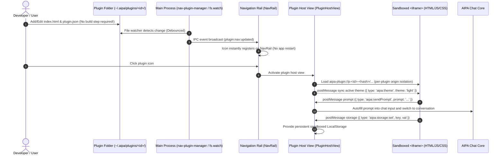
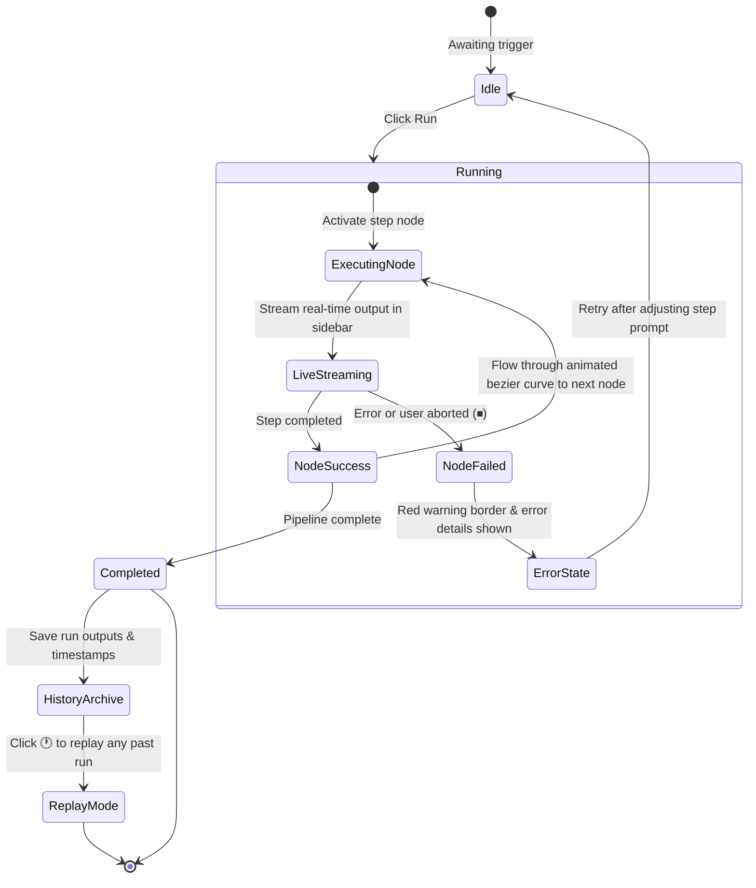
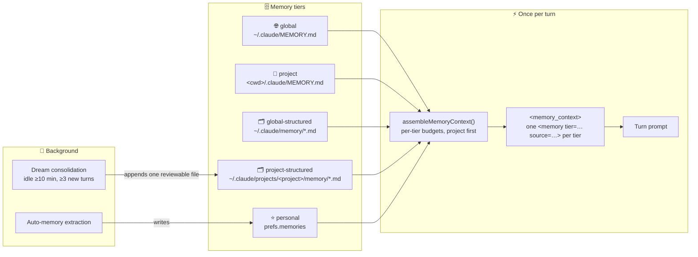

<p align="center">
  <h1 align="center">AIPA</h1>
  <p align="center">
    <strong>AI Personal Assistant — Your Always-On Desktop Agent Cockpit</strong><br/>
    Ask anything. Automate anything. Drive terminal and code, get things done.
  </p>
  <p align="center">
    
    
    
    
    
  </p>
</p>

---

AIPA is not a simple web-wrapper chat window. It is an **action-oriented desktop agent** that lives alongside you — reading and writing local files, executing shell commands, chaining tasks into automated workflows, and maintaining memory and preferences across sessions.

Under the hood, it drives **OpenAI Codex CLI** and **Claude Code CLI** as dual-core execution engines, packaged inside a finely tuned Electron + React cockpit with native multi-model support for OpenAI, Claude, DeepSeek, Ollama, and any OpenAI-compatible provider.

> 💡 **The CLI is the high-performance engine; AIPA is your intuitive cockpit.**

---

## 🏛️ System Architecture

```mermaid
graph TB
    subgraph Desktop["🖥️ User Desktop Environment (Windows 10/11)"]
        subgraph ElectronCockpit["🚀 AIPA Desktop Cockpit (Electron + React)"]
            subgraph Renderer["Renderer Layer (React 18 + Vite + Zustand)"]
                NavRail["Navigation Rail (NavRail)"]
                MainView["Main Content View (MainView)"]
                ChatPanel["Structured Chat / Tool Cards / LCS Diff"]
                OrgChart["Organization Chart"]
                EmpGallery["HR (People Ops)"]
                CanvasWorkflow["Canvas Workflow Editor"]
                PluginHost["Sandboxed Plugin Host"]
            end
            
            subgraph Preload["Isolation Layer (Preload / contextBridge)"]
                API["window.electronAPI (Type-safe IPC Bridge)"]
            end
            
            subgraph MainProcess["Main Process (Node.js CJS)"]
                PtyMgr["PTY Manager (node-pty ConPTY)"]
                CodexBridge["Codex Bridge (JSON-RPC 2.0 stdio)"]
                StreamBridge["Claude Bridge (NDJSON Stream)"]
                NavPluginMgr["Hot-Pluggable Plugin Watcher (fs.watch)"]
                ConfigMgr["Secure Config (DPAPI safeStorage)"]
                ClawdPet["Clawd Desktop Pet Integration"]
            end
        end

        subgraph Engines["⚡ Execution Engines & Providers"]
            CodexCLI["OpenAI Codex CLI (Rust Native Core · Primary Engine)"]
            ClaudeCLI["Claude Code CLI (Fallback Engine)"]
            LLMProviders["Multi-LLM Providers (OpenAI / Claude / DeepSeek / Ollama / Qwen)"]
        end

        subgraph LocalEnv["💻 Local Operating System"]
            Shell["Terminal Execution (PowerShell / Git Bash / CMD)"]
            FS["Workspace File System (Atomic Read/Write / Diffs)"]
            Git["Git Version Control / Worktree Isolation"]
            MemoryStore["Persistent Memory (~/.claude/projects / memdir)"]
        end
    end

    Renderer -->|postMessage / IPC| Preload
    Preload -->|IPC Channel| MainProcess
    MainProcess -->|JSON-RPC 2.0 stdio| CodexCLI
    MainProcess -->|NDJSON stdio| ClaudeCLI
    MainProcess -->|HTTP / SSE| LLMProviders
    CodexCLI --> Shell & FS & Git
    ClaudeCLI --> Shell & FS & Git & MemoryStore
```



---

## 🖥️ Desktop Cockpit Layout

AIPA adopts a modern **two-column layout** eliminating redundant intermediate lists. All core features open directly in the full-screen primary workspace:

```text
┌────────────────────────────────────────────────────────────────────────────────────────┐
│  AIPA — Desktop Agent Cockpit                                                    ─  □  ✕  │
├──────┬─────────────────────────────────────────────────────────────────────────────────┤
│ [🏢] │ Org Chart / Company Map → Department Roster                                     │
│ Dept │ ┌─────────────────────────────────────────────────────────────────────────────┐ │
│      │ │ 🤖 Assistant                                                                │ │
│ [👥] │ │ Refactoring module architecture...                                          │ │
│ HR   │ │ ┌─ 🛠️ Tool: Write (src/main/plugins/nav-plugin-manager.ts) ───────────────┐ │ │
│ [📁] │ │ │ + export interface NavPluginManifest { ... }                           │ │  │
│ Arch │ │ └────────────────────────────────────────────────────────────────────────┘ │  │
│      │ └─────────────────────────────────────────────────────────────────────────────┘ │
│      │                                                                                 │
│      │ ┌─ Employee Roster (HR)   ─────────────────────────────────────────────┐ │
│      │ │  ┌─────────┐   ┌─────────┐   ┌─────────┐   ┌─────────┐   ┌─────────┐        │ │
│      │ │  │ 👨‍💻 Coach  │   │ 👩‍🔬 Analyst│   │ 🎨 Creative│   │ 📚 Tutor │   │ ⚡ Productiv│   │ │
│ [📅] │ │  │ Writing │   │ Research│   │ Partner │   │ Academic│   │  Coach  │        │ │
│ Cal. │ │  └─────────┘   └─────────┘   └─────────┘   └─────────┘   └─────────┘        │ │
│      │ └─────────────────────────────────────────────────────────────────────────────┘ │
│ ───  │                                                                                 │
│ [📝] │ ┌─ Canvas Workflow Editor ────────────────────────────────────────────────────┐ │
│Notes │ │  [Node: Read Spec] ──(flowing line)──> [Node: Code Review] ──(done)──> [Done] │ │
│ [🔌] │ └─────────────────────────────────────────────────────────────────────────────┘ │
│Plugin│ ┌─ Interaction Input Area ────────────────────────────────────────────────────┐ │
│ [⚙️]  │ Status: ● Ready | Thinking: Medium | Perm: Accept Edits | Cost: $0.04    [🐱 Clawd]│
└──────┴─────────────────────────────────────────────────────────────────────────────────┘
```

- **Two themes, one readable system**: every colour that carries text is a semantic token — `--accent-text`, `--accent-text-strong`, `--text-subtle`, `--success-text`, the `--code-*` family and `--dialog-shadow` — with its own light value. A screenshot harness reads the rendered foreground/background pairs and checks them against WCAG AA (4.5:1 body, 3:1 large) in both themes, which is how the light theme's selected search/palette rows went from **1.55:1 to 5.20:1** and the citation chips from **1.47:1 to 4.94:1**. Code blocks stay deliberately dark in both themes, rather than a light frame wrapped around a `github-dark` body

- **The sidebar and archive read as one surface**: row hover and selection use the same token mechanism in every list, count chips sit below the row title in weight, the sidebar and archive scrollbars share a 6 px width, archive filter chips and fields share one 24 px height, and keyboard focus rings follow each control's own radius instead of forcing 4 px — with inset rings for rows inside `overflow:hidden` cards and hover-only row actions also revealed on focus. All of it is expressed in the existing light/dark tokens
- **Dialogs behave like dialogs**: the run-confirm, tool-approval and export dialogs are portalled above the app shell, carry `role="dialog"` / `aria-modal`, trap Tab inside the card and restore focus on close, and cap their height at `calc(100vh - 48px)` with an internal scroll area so a long command preview never pushes the Allow / Deny row off-screen. The faint-text tokens were raised (light `#5c5c63`, dark 53 % white) and the remaining hardcoded copy in settings, permissions and export was moved into the locale files — **3,353 keys with zero parity difference** between `en` and `zh-CN`. Toasts can carry an action button (the fourth argument of `addToast`), which is how a finished export offers **Show in folder** after its dialog has closed, and how the notice about a plugin-started conversation offers **Open**

- **Motion respects the OS preference**: one global `prefers-reduced-motion` block collapses every transition and entrance animation to a single frame while leaving scroll position and final visual state intact, with progress spinners the only exception — a frozen spinner is indistinguishable from a hung operation

- **One column, one vocabulary**: the transcript and the composer share a single centred `800px` reading column, with avatars living in the gutter rather than narrowing the text; the department header grows to fit its three rows and collapses Select / Export / Files / Handbook to labelled icons below 1100px, and the roster lays employees out on a `minmax(150px, 1fr)` grid instead of a fixed 108px tile. The palette ranks a name prefix above a word match and a description substring, so typing `ask` reaches **Ask AIPA about your history** rather than `Open Archive` via "t**ask**". Counts pluralize at the call site ("1 org", not "1 orgs"), every session date goes through one locale formatter, and no input suppresses its focus ring any more

---

## 🌟 Core Capabilities

| Module | Core Features | Visual Presentation |
|---|---|---|
| **💬 Chat & Execution** | Stream-JSON real-time stream, dual-model switching, collapsible thinking chain, auto-compaction; streamed deltas are appended per animation frame instead of rebuilding the message array, and list indexes, word counts and change parsing are cached per message — long conversations stay smooth | Structured tool cards, LCS color-coded diff view, task checklist, interactive permission dialog |
| **👥 HR (People Ops)** | Character persona illustrations, role-tailored attire/hairstyles, glowing status aura | The HR page shows Experts, Skills and Workflows as matching card grids (the standalone Skills panel was merged in): a skill card feeds its slash command into chat or opens the full SKILL.md, expert cards can be edited or recruited, workflow cards show step and run counts with hover edit/duplicate/delete and one-click run; a dashed card at the end creates a new item, with suggested presets below |
| **🏢 Org Chart** | Company-style department map, trunk→bus→drop connector lines, layout adapts to both container width and department count (centred single row / left-rail multi-row), per-department color and stable emoji; **company → department → team** across three levels, one section per applied template, a team strip always drawn under each card (a real sub-tree with its own bus and drops) and “open position” badges | Shows departments only (employees stay collapsed); clicking a card drills into that department's employee roster, and hovering offers direct recruit, a stats popover, employee export, or **deleting the department** (a confirm box outside the card giving the team count that will cascade with it); the HQ card likewise **deletes a whole company** — company, all its departments, and the teams beneath them, keeping the folders and sessions on disk). The roster itself renders each employee as a **little yellow helper** (one eye or two, height, hair and mouth hashed from the session id, always-on breathing, and a spinning halo plus typing arm while replying), with dimmed “open positions” standing in their own group until hired |
| **📁 Archive** | Company-wide task ledger: every session is filed under its **company / department / team**, derived live with no extra storage layer, filterable by organisation / time / archive state / origin / free text, grouped by company with an explicit unassigned bucket | Reach it from the left nav’s “Archive” entry or `Ctrl+8`; each row shows the task title, its department · team, an employee short-hash, time and turn count, and opens that session on click; rows can be archived inline and exported as `aipa_archive_<date>.json`. Conversations that were not typed by the user carry an **origin badge** — a clock naming the scheduled job that ran them, or a plug naming the plugin whose `chat.ask` opened them — and the filter row can show only one origin — or, once two jobs appear in the archive, one **job**, with a count per job and a selection that clears itself when that job no longer has rows instead of leaving an invisible filter behind; while a job is selected, a two-line strip above the ledger answers “how is it doing” — enabled or paused, next run, last outcome with its error code, failure streak, reported spend, and succeeded / failed / skipped counts over the runs the job still remembers (the strip never implies that window is the whole history) Automation origins are derived from every run each job still remembers, while plugin origins are recorded once at creation in `session-origins.json` |
| **🎨 Canvas Workflows** | Multi-step prompt pipeline orchestration, topology graph, live output streaming, execution replay | Infinite zoom dot-grid canvas, animated bezier edge flow, inline step title rename |
| **🔌 Zero-Compile Plugins** | Vanilla HTML5+CSS+JS, sandboxed isolation, postMessage bridge SDK, dynamic directory watching, AI edit drawer | Real-time sidebar icon registration, zero-build instant reload, host developer toolbar (reload + built-in source preview: file tree with line numbers, one-click copy or reveal folder + **Edit**: chat with the AI in a right-hand drawer to change the plugin, reloaded automatically when a turn lands) |
| **🧩 Plugin Hub** | Unified plugin dashboard, 1-click launch, source inspection, and developer starter guide | Pre-installed at the bottom of NavRail, enables cross-plugin navigation; UI and plugin names follow the app language (EN/ZH) |
| **📅 Work Calendar Plugin** | Month view with cross-day task bars, drag-to-create tasks, AI-streamed weekly/monthly reports, GitHub & local-folder work sources, person-day tracking | One-click report generation from week badges, preview / regenerate / pull sources, file-backed storage with JSON import/export |
| **📝 Quick Notes Plugin** | Decoupled hot-pluggable plugin, live Markdown preview, category filters, pinning, AI prompt dispatch | Independent HTML micro-app, upper NavRail placement, Ctrl+3 / Ctrl+Shift+N shortcut bindings, bilingual |
| **🧠 Memory Hierarchy** | Five prompt tiers — global and project `MEMORY.md`, global and project structured memdir, and the personal store | 4-tab memory console (under Settings → Memory, `Ctrl+5`) plus a Dream tab; background consolidation turns idle conversations into appended, reviewable memory files; all five tiers are assembled once per turn into one labelled `<memory_context>` block under per-tier and total character budgets |
| **🐱 Clawd Pet** | Win32 desktop pet synced with AI thinking, execution, and idle moods; background attention bubbles for approvals, questions, failures and finished plugin jobs, with a native OS notification when the pet cannot speak | Consolidated taskbar icons, smooth sprite animations, click-to-open bubbles while the window is unfocused, silent while it is focused; one delivery decision covers all five attention kinds — pet bubble, OS notification, or nothing — and DND / “Call Me Through the Pet” are honoured by both surfaces; Settings → General → “Call Me Through the Pet” |
| **⚙️ Settings & Channels** | MCP tool servers, OpenClaw external channels, model keys, permissions consolidated | Streamlined into Settings (Settings → Plugins & MCP / Channels) — plugins and MCP servers share one page, and the AI Engine page moves provider config **above Model** (right under the API key pool and its “Add Key”), so keys are added and listed in the same block before you pick a model, keeping navigation clean; providers are now a **compact list** rather than cards — each row keeps only a health dot, name, model-count badge, a test-connection button and an enable toggle, and clicking a row slides a **config drawer** in from the right holding every field (connection mode / API key / auth token / base URL / fetch models / status), so the list always keeps the "what providers exist and how are they doing" overview; MCP configuration is engine-routed — the Codex engine writes `[mcp_servers.*]` tables to `~/.codex/config.toml` and feeds them back into `systemInit`, while Claude still uses `~/.claude/settings.json`; the Hooks page was removed (hooks are only read by the Claude CLI from `~/.claude/settings.json` and have no effect under the Codex engine); the Sandbox page and a batch of inputs whose writes were silently dropped by the settings whitelist (API Key Helper, output style, available models, file suggestions, status line, default shell, respect `.gitignore`, commit attribution, worktree, …) were removed too, leaving only settings that actually persist; on wide windows the General page flows its section cards into **two measured columns** (each 511–592 px, so inputs stay at a readable 478–559 px) inside a centred 1,200 px page column, falling back to one column below 1,180 px — which fills the width that used to sit empty to the right of a 660 px form |

Session handoffs land where they point: auto-resume, the welcome screen's continue button, the quick switcher, the command palette, and the tray / app menu now actually open the session instead of dispatching an “open this session” event into the void, and a lookup that fails raises a visible error rather than doing nothing.

**A conversation remembers who started it.** The archive badges runs that were not typed by the user, but the badge used to end at the click that opened them. The transcript now carries one muted line above it — a clock and the job’s name, or a plug and the plugin’s label — with when it began, in the same relative-time words the rest of the app uses. The job name is a control that goes to Settings → Automations; the plugin’s label is text. The line is derived from the session list that already exists (keyed on the *viewed* session, not the live bridge id a streaming turn overwrites), so nothing is stored twice and nothing is guessed: a session with no origin, or one no longer in the list, shows no line at all.

---

## 🤖 One Cockpit, Two Engines

AIPA runs Codex as its primary engine and Claude Code as the fallback. The cockpit is deliberately engine-agnostic: the same tool cards, the same context meter and the same history should work whichever engine produced the turn. Codex had drifted into being a second-class citizen — the UI was there, but almost nothing populated it. This round closed that gap.

- **Telemetry comes from the protocol, not from guesses**: `thread/tokenUsage/updated` is normalized into the shape the renderer already reads (last-turn tokens plus `modelContextWindow`), so the context meter, the 85 % warning, the compact turn and the token badge finally populate under Codex. The app-server protocol exposes **no cost field**, so the cost badge stays empty there rather than showing an invented number
- **History actually opens**: Codex writes rollouts into date-sharded folders (`sessions/YYYY/MM/DD/rollout-*.jsonl`), not the flat directory the reader was looking in, and its entries (`userMessage` / `agentMessage` / `toolCall` / `reasoning`) are not the Claude shapes the renderer parses. Discovery now walks the tree, and a normalizer folds both the message and the event form into the renderer's existing schema — an old Codex conversation reopens with its prose, its thinking and its tool calls intact
- **Tool calls become cards**: the bridge used to pass the item *type* through as the tool name, which no card recognised, so Codex turns produced no tool cards at all. `commandExecution` becomes the Bash card (command, cwd, aggregated output, exit code), `fileChange` one diff card per file, `mcpToolCall` / `webSearch` / `imageView` their own cards, `plan` the checklist, `reasoning` the thinking block
- **Images reach the model**: attachments are sent as real `image` input parts. The protocol has no document variant, so a non-image attachment is announced in-band — "the engine cannot accept document attachments" — instead of silently shipping base64 into the prompt
- **Stop stops, then kills**: `turn/interrupt` first, with a 1.5 s grace before the process is force-killed, so an interrupted turn keeps its thread instead of taking the bridge down with it
- **You can talk to a turn that is still running**: `turn/steer` was implemented in the bridge and exposed over IPC, but nothing in the renderer ever called it — the composer hard-blocked every send while a turn streamed. Pressing send during a live Codex turn now steers that turn instead of starting another: the text appears immediately as a guidance row (*Sending guidance…* → *Sent to the running turn*), the red Stop button stays exactly where it was, and nothing re-runs the turn-boundary work (memory assembly, title generation, streaming state) that a normal send performs. The request names `expectedTurnId` — the 0.145 field, not the older `turnId` spelling — so the engine itself refuses guidance aimed at a turn that already ended, and that refusal is shown on the row with the engine's own words instead of being swallowed by the IPC handler. If the turn ends between the decision and the reply the row says it was not confirmed rather than claiming delivery; images are refused with a toast, because a steer carries text only; and the legacy Claude bridge, which has no steering channel, keeps the draft in the box instead of dropping it
- **Approvals use the protocol's real shapes**: the old code answered `{ decision: 'denied' }` to requests that no longer accept it and used the wrong shape for command / file-change / permission approvals — under the default on-request policy that would have blocked tool execution
- **Questions reach the user; unknown requests no longer approve themselves**: the dispatcher used to answer *any* unrecognised server request with success "to avoid deadlock", so `item/tool/requestUserInput` and `mcpServer/elicitation/request` — Codex asking a human a question — were silently granted instead of shown. Both now surface through the existing elicitation card (the pet raises a **clarification** attention when the window is hidden), wait for the real answer, and are rejected on timeout or interrupt rather than left hanging; a background turn with no listener declines immediately. Anything genuinely unknown — including `item/tool/call`, token refresh and attestation — now gets JSON-RPC `-32601`, logged once, so the turn fails visibly instead of handing out a permission nobody granted. Stale answers for already-resolved requests are dropped, and the wire `RequestId` keeps its original type instead of being coerced with `parseInt`
- **Protocol telemetry the app can now read**: `model/list` (paginated, cached, exposed as `codexModelList`), `account/usage/read` and `account/rateLimits/read` (brief cache, never blocking a turn), and `skills/list` — the bridge no longer synthesises `skills: []`, so a skill converted from a conversation is visible to Codex too. Probes prefer a live bridge and otherwise spawn a short-lived app-server with the Settings key, so they fail with a real error instead of "authentication required"
- **Notification deltas are bounded, not forwarded raw**: `item/plan/delta` becomes the checklist update (16 KiB rolling buffer, 150 ms throttle), command/file-change output deltas become tool progress (100 ms per item, 4 KiB tail), `turn/diff/updated` keeps a 32 KiB tail with a truncation flag, and `serverRequest/resolved` clears its timer and retracts the attention bubble. A chatty turn cannot grow IPC without bound, and an unknown notification is logged rather than vanishing
- **A question is a choice, not a text box**: `requestUserInput` already carries each question's offered options as `{ label, description }`, but the renderer flattened them into the description text, so the user had to retype an option the model had just proposed. The payload now crosses IPC as a bounded structured list (10 questions, 20 options, clipped strings), and the card renders real single-select rows with their descriptions, an *Other* free-text choice when the protocol sets `isOther`, password inputs for `isSecret`, and a Submit that stays disabled until every required question is answered. The answer map is keyed by question id, which is the shape the bridge maps back onto `ToolRequestUserInputResponse.answers` — no multi-select, because the protocol has none
- **A request the server already settled cannot be answered**: `serverRequest/resolved` and the bridge's own timeout used to leave a live Allow / Deny or Submit card pointing at a request nobody could answer, and clicking it wrote a response for an id the server had closed. Those events now move the matching card to a neutral *resolved* / *timed out* state with no buttons, and — importantly — they never overwrite a decision the user actually made: only `pending` cards settle, so a late event cannot turn a real "deny" into "nobody answered"
- **The turn's real patch is on screen**: per-tool cards only show edits that went through a file tool, and miss everything a shell command wrote. `turn/diff/updated` — the aggregate patch, tail-limited to 32 KiB with a truncation flag — now renders as a collapsed *Changes in this turn* row with the file count and `+`/`−` totals, expanding into a unified diff capped at 400 rendered lines with a *show all* affordance. It is mounted outside the message list (so scroll anchoring and virtualization stay untouched) and cleared on `turn/started`, so one turn's patch can never sit under the next turn's answer
- **The thread's real settings are visible**: `thread/settings/updated` reports the model, approval policy and reasoning effort a Codex thread actually runs with. A small, non-interactive strip above the composer shows them, names the wire values honestly (`never` is "never asks", not "auto-approve — safe"), and raises a warning dot when the thread is running on a different model than the picker currently shows. Nothing in that strip writes `prefs` or changes what the next turn sends
- **It says when Codex is waiting on you**: `thread/status/changed` used to cross IPC and then die in the renderer. When the thread reports `active` with `waitingOnApproval` or `waitingOnUserInput`, the compose-status line under the composer now carries a small chip — *Waiting on your approval* or *Waiting on your answer* — with a tooltip naming what is expected, so someone who came back to the window knows the agent is blocked on them rather than still thinking. Both flags show the approval chip: approving is the gate the turn cannot pass without, and one blocked turn must not raise two competing claims. `idle`, `notLoaded`, a plain `active` with no flag, and any malformed or unknown payload all hide the chip — “still working” is never dressed up as “waiting”. `systemError` becomes *Engine error* and nothing more: the status carries no detail, so no cause is invented. Switching sessions or tabs, a new thread, the end of the turn and a process exit all clear it, so one turn's “waiting” never survives into the next.
- **A stopped or failed turn says what the protocol said**: `turn/completed` carries `completed | interrupted | failed | inProgress`, and the bridge used to report every status except `failed` as a successful result — a user who pressed Stop got a transcript that looked like a normal finish. The raw status and a normalized `outcome` now cross IPC, and only `completed` triggers success side effects (completion chime, notification, title generation, memory extraction, task-queue advance). An interrupted turn gets a quiet inline *Turn stopped before completion* line — neither an error nor a success — while a failed turn keeps its error treatment; a missing or unrecognised status reads as unknown, never as success. `TurnError.codexErrorInfo`, the protocol's typed enum (`contextWindowExceeded`, `sessionBudgetExceeded`, `usageLimitExceeded`, `unauthorized`, `sandboxError`, the connection/stream variants, …), is forwarded verbatim and mapped by a small pure module to an explanation plus the app's existing action — compact for a full window, account settings for usage/auth/service limits, permission settings for a sandbox failure — with the raw engine message still shown as detail. Only when no code was sent does the old text heuristic remain, and then solely to choose an action, never to claim a cause.
- **The account's limits are visible before they bite**: Codex reports `account/rateLimits/updated`, and the cockpit used to drop it, so the first sign of a spent window was a turn failing. A quiet chip above the composer now appears once a window reaches 80 % (amber) or Codex names a reached limit (red), showing each window's length, the percentage used and when it resets; ordinary usage stays out of the composer, because this is an alert, not a dashboard. The numbers are the wire's own: the protocol's *sparse* rolling update is merged into the last `account/rateLimits/read` (a null means *unavailable*, not *cleared*), one read is issued when a thread starts so the chip has a baseline, and nothing renders when the payload is missing or unreadable. A reached reason remembered from an earlier update cannot keep the chip red once the windows show headroom — the percentages are the fresher statement
- **A step the cards cannot show is still a step**: item kinds with no rich card — sub-agent activity, sleeps, hooks, review mode, context compaction, image generation, and any kind a future engine adds — were forwarded over IPC and then dropped by the renderer, so a long turn could look like it did nothing. They now render as quiet muted lines: one line for a lone step, a collapsible *N engine steps* row for a run of them, split at turn boundaries and placed between the messages they happened between. An unrecognised kind falls back to *Engine step — `<kind>`*, a step that starts and never completes leaves no spinner behind, and a kind that already has a tool card with the same item id is never shown twice
- **The sidebar follows Codex's own session list**: `thread/name/updated`, `thread/archived` and `thread/deleted` were emitted by the bridge and dropped by the cockpit, so a thread renamed in the Codex CLI kept its old title and an archived conversation stayed forever. A rename now retitles its row and the open header in place, and an archive or delete removes the row at once — no list reload. A Codex thread id *is* the row's session id, the exact equality `session:rename` already relies on, so no fuzzy matching is attempted; a blank or null name is malformed and ignored rather than read as "clear the title", a background bridge never touches the user's list, and a transcript on screen is never wiped because its thread was archived somewhere else — continuing it later fails through the normal error path
- **An edit grows while it is written**: `item/fileChange/patchUpdated` streams the patch Codex is still parsing, and the cockpit ignored it, so a slow edit looked frozen until the item completed. The Edit card now shows a *Live diff* while the turn is running and switches to the authoritative Before/After the moment the item completes. Each snapshot is the file's whole diff so far, not a delta, so snapshots replace rather than append; updates coalesce to about ten per second, stop at 50 rendered lines with a *more lines* note, and never claim success or failure from a partial patch. A late snapshot cannot overwrite the finished diff — completion bumps a generation, clears queued trailing updates, and the final tool input replaces the card in place instead of appending a second one
- **The engine's own words reach the user**: `warning`, `deprecationNotice` and `configWarning` fell into the bridge's default branch and died in main. They now appear as quiet, dismissible lines above the composer, rendered verbatim — no severity label and no invented cause — deduped within a turn, capped at three with the rest counted (`+N more`), gone when the turn ends, and never written into the transcript. `model/rerouted` is the other half of the same honesty: when the engine runs a turn on a different model than the request named, the thread strip says the turn was moved and names both ids, with the engine's raw `reason` enum (`highRiskCyberActivity`) in the tooltip rather than a translated guess. `account/updated` drops the cached usage snapshot and re-reads the limits once — fire-and-forget with a forced read, so a slow account never holds a turn — and `skills/changed` invalidates the skills catalogue and asks Codex for exactly one `forceReload`, clearing that flag only after a successful read so a failed refresh retries instead of going quietly stale
- **Windows sandbox trouble is reported, not swallowed**: `windows/worldWritableWarning` and `windowsSandbox/setupCompleted` never reached the cockpit. The world-writable warning now rides the same quiet composer notice as the other engine warnings — the sentences are Codex's own, pinned from the binary because the payload carries only `extraCount`, `failedScan` and `samplePaths`, so nothing is paraphrased. A sandbox setup *failure* (`success: false`, naming `elevated` or `unelevated`) shows a short localized line with the engine's raw error kept as detail; a success is not announced at all, and a setup failure is never dressed up as a claim about what is safe
- **A reviewed approval says what the reviewer decided**: `item/autoApprovalReview/started` / `completed` carry `status` (`inProgress | approved | denied | timedOut | aborted`), `rationale`, `riskLevel` and `targetItemId`, and were dropped. The verdict now appears as one line on the very card it is about — *Automatic review: approved / denied / timed out / aborted* — followed by the engine's `rationale` verbatim when one was sent. It is shown only on that card: a review naming no `targetItemId`, or one about an item with no card on screen, is rendered nowhere, because a floating verdict beside the wrong command would be worse than silence. An in-progress line is cleared when its review completes, when the item completes and at the turn boundary, and a completion arriving while the line still says in-progress is ignored rather than retrofitted. The line never adds "safe": a review is a second opinion, and the wording reports a decision, not a guarantee
- **One card family, and focus you can see**: twenty-two tool cards had four different header treatments, three radii and a dark-only shadow. They now share one radius/border/padding/elevation recipe, pastel text that measured 1.7–2.2:1 on the light theme maps to theme-aware tokens (each tool keeps its hue — Read stays indigo, Write green, Cron violet), and the per-message action toolbar appears on keyboard focus as well as pointer hover. Focus rings inside cards are inset, because the global ring was being clipped by `overflow: hidden`; the always-dark code chrome keeps a theme-invariant ring instead of the light theme's blue. Empty states use the sidebar's small-icon-plus-muted-sentence pattern, and the scroll-to-bottom button now shares the composer's elevation and sits clear of it
- **A thread's standing goal is on screen**: `thread/goal/updated` carries a `ThreadGoal` — an objective the thread works toward, with a status enum (`active | paused | blocked | usageLimited | budgetLimited | complete`) and token/time counters. It now renders as a quiet line at the start of the same strip that names the thread's model and approval policy: the engine's objective verbatim, its status, and — only when the payload carries a positive `tokenBudget` — the raw used/budget counts. No percentage, progress bar or estimated time is derived from them, `createdAt`/`updatedAt` are dropped because the schema states no unit, and an unrecognised status omits the label rather than borrowing a nearby one. `thread/goal/cleared` retires the line only when it names the goal on screen, and switching conversations drops it
- **Unarchiving brings the row back**: `thread/unarchived` names only a thread id, so the sidebar cannot rebuild a row from the event. It re-reads the session index once and restores just that row in timestamp order — never a full list reload. The restore is idempotent (an id already listed is left alone) and refuses any id the window saw deleted, tombstones included, so a late unarchive cannot undo a delete the user made
- **A dozen automations are still findable**: Settings → Automations gained a quiet search row — text over the job name, its workflow, its localized schedule sentence and its expert, folded case- and whitespace-insensitively — plus status chips for *Running*, *Failing*, *Turned off* and *Waiting on a path*. Text and chips combine with AND, the chips with OR, because requiring a job to be running *and* failing would be a guaranteed dead end. All four chips stay on screen with counts (counts follow the text query but not the chip selection, so a chip advertises what toggling it reveals), zero-count chips are disabled, `Escape` clears the field, and a filter that matches nothing says so and offers one reset — it never looks like an empty account. The same row orders what it finds by *Next run* (the default: soonest first, watch jobs and jobs with no occurrence after, switched-off jobs last), *Last run*, *Name* (locale-aware, so Han names collate by pinyin in Chinese) or *Status* (running, then failing, then off) — each mode is one rule that can be checked by eye, with ties keeping the scheduler's order
- **Images reach the model on Codex**: attach up to four PNG, JPEG, WebP or GIF files by picker, clipboard paste, drop or screenshot (10 MB each). The bytes are written once into an app-owned `attachments` directory under `userData`, content-addressed by SHA-256 and never overwritten, then sent as `{ "type": "localImage", "path": … }` input parts — the shape the 0.145 schema defines and a live app-server accepted. The transcript keeps the path, name, size and type, never base64; reopening a saved Codex session recovers the same references from the rollout file. Validation is repeated on the main side by magic bytes, size, filename and directory containment, so a renderer cannot point Codex at an arbitrary file
- **An image that was not sent says so**: the composer offers images only when the engine probe reports Codex, and the decision is repeated at send time — a credentials or route change between attaching and pressing Send produces a *Not sent* reason on the user's row instead of a quiet omission. If `turn/start` rejects the input shape, the turn is retried once as text with the reason appended in-band, so the model never answers as though it had seen the image; a failed send leaves the thumbnails marked with the engine's own error
- **Model and reasoning effort actually reach the wire**: switching the model mid-conversation used to be a silent no-op on Codex — only `thread/start` carried it, and every follow-up ran the thread's original model. `turn/start` now carries `model`, which the protocol defines as the override for this and subsequent turns, on the first turn and every follow-up alike. `prefs.effortLevel` had never left the renderer at all; it is now sent as `effort`, but only when the model's own `supportedReasoningEfforts` advertises that value — there is no global effort enum, and an unadvertised value fails the whole turn, so anything unverifiable is dropped with a single log line and the turn runs at the engine default. The catalogue lookup is capped at **1.5 s**: a user's message never queues behind `model/list`, and the picker greys out levels the current model does not offer instead of letting the click be discarded silently
- **Renaming is protocol-native**: the sidebar and header rename a Codex session through `thread/name/set`, so the name lands in Codex's own session index (`session_index.jsonl` and its state DB) instead of a local override, and it survives a restart. When no app-server owns the thread, a throwaway one is spawned just for the handshake — the index is writable only through the protocol
- **`developerInstructions` are sent on both paths**: `thread/start` and `thread/resume` carry them, so a resumed thread keeps the same standing instructions (persona, department handbook, plugin brief) instead of silently losing them
- **What is deliberately not supported**: under Codex, rewinding or editing an earlier message is not offered — `thread/rollback` exists in the binary but is marked deprecated and scheduled for removal, so the UI does not build on it. Images are the one attachment kind the engine accepts as a file, and they are sent as `localImage` paths; document attachments are still not supported, because the protocol's remaining variants are `text`, `image`, `localImage`, `audio`, `localAudio`, `skill` and `mention`, and `mention` does not carry the file or its path to the model. A non-image attachment is therefore announced as text rather than pretended into the prompt
- **The picker offers the catalogue the engine will actually run**: the model menu used to show a static Claude list even on a Codex profile. A read-only `engine:getActive` now answers which engine the next turn lands on (derived from credentials and the installed binary, no spawn, provider key stripped before it crosses the context bridge), and on Codex the menu lists `model/list` — display name, description, a default badge and the supported reasoning efforts — while any probe failure falls back silently to the provider groups and then to the static list. Selecting a model still goes through the same persona / per-session override / prefs path, so nothing about conversation routing changed
- **Account limits are visible, not guessed**: Settings › Stats gains a Codex account card — plan, primary and secondary quota bars with reset countdowns (a local 30-second tick, no refetch), credits, lifetime and peak tokens, streaks, and a 14-day token sparkline drawn with inline SVG. It renders nothing at all when both probes fail, so a Claude-only machine does not grow a permanent error box; a failed refresh keeps the last known numbers and says so; and a window at 100 % (or a reported `rateLimitReachedType`) is shown in red rather than as healthy headroom
- **The account card refreshes itself**: plan limits, credits and usage describe the account, not a thread, and the Settings card used to read them only when it opened — a plan switch or a spent window showed up whenever the user next visited the page. `account/updated` and main's own `cli:rateLimitsUpdated` now start one probe round (limits + usage) through a single-flight hook: a burst of events coalesces inside two seconds, a background `internal-*` bridge is ignored, and a quiet account produces no probes at all. A failed half keeps its last known numbers instead of blanking data that is still the best information available, and the header says *checked 2m ago* only after a probe actually succeeded — before that it reads *not checked yet*, never "checked" without a time. The wording reuses the app's existing *just now / N minutes ago* keys, and the local tick only ages the label; it never causes a fetch
- **Codex's own skills are visible, read-only**: the Skills page lists `skills/list` sorted by scope — repo, user, admin, system — with disabled entries marked rather than hidden. Those directories belong to Codex, so the only actions are *show in folder* and *copy path*; the section renders nothing when the probe fails or finds no skills
- **MCP servers report whether they actually started**: Settings → MCP could edit `config.toml` but never said whether a configured server came up — the startup notification was explicitly "not mirrored yet". `mcpServer/startupStatus/updated` now gives each configured row the engine's own state (`starting | ready | failed | cancelled`), its `error` verbatim, and its typed `failureReason` as a raw token (`reauthenticationRequired` reads as *Needs sign-in*). A server the engine has not reported shows no pill at all — silence is not "connected" — a disabled server hides its old report, and reports are retired when the app-server process that sent them exits. `mcpServer/oauthLogin/completed` is a separate line, because a finished sign-in is not a started server. `guardianWarning` joined the composer's engine-notice stack as its own kind, with the reviewer's sentence left untouched
- **Hidden helpers follow the active engine**: the prompt-suggestion chip and the "welcome back" summary no longer spawn the legacy Claude binary on every turn. One resolver picks Codex when the profile has Codex credentials, then an explicitly selected third-party provider, then the legacy CLI — and when none of them exists the feature turns itself off with a single startup log line instead of failing per keystroke. Session titles are derived locally now: the old code spawned the CLI for a `generate-session-title` subcommand that does not exist in the binary
- **The file tree stops being a snapshot**: Files showed whatever the folder looked like when it was opened — a build that wrote `dist/` or a log that kept growing stayed invisible until the user collapsed and reopened the folder. Main now watches the directories actually on screen and pushes only the paths that changed, so a burst of writes costs one refetch of the affected node rather than a tree reload. Watching is scoped to what is displayed (a collapsed folder is not watched), the directory list is checked against the same allowed roots as `fs:list`, more than 256 directories is refused rather than silently trimmed, and the watcher is refcounted per directory, so two panels on the same folder share one handle and the last one to leave closes it. A directory the OS refuses to watch shows an explicit *not watching* badge instead of looking live: the badge reads live, off, or failed, and there is no fourth state where the tree looks fresh but is not
- **MCP tools are listed, and the config reloads for real**: Settings → MCP had two dead ends. The engine reports each server's tools during the handshake, but the page never showed them, so a configured server was a black box until the model happened to call something. Each row now has a disclosure with the engine's own tool names exactly as it sent them — copyable, never renamed — refetched when the card expands, when the server first reaches *ready*, and when the app-server handshake lands, never on a timer; a server that has not reported a list says *No tools reported yet*, because Codex omits an empty `tools` array and "0 tools" would be a claim the engine never made. The per-server **Reconnect** button pointed at a handler that returned a hardcoded *Reconnect not supported in this version* — a control that could not work even once. It is now one page-level **Reload MCP config** that sends `config/mcpServer/reload` — the protocol's only reload, global by design with null params — to the running user bridge, drops the tool lists and startup reports cached from the previous configuration, and reports *no engine running* as its own refusal rather than quoting an English sentence at a Chinese UI. Each server then reports its own state again
- **A conversation can be branched from any message**: the composer already let you steer a running turn; now a user message offers **Branch from here**, which forks the Codex thread and opens the branch — so an alternative line of thought no longer means losing the transcript you had. The branch point is `beforeTurnId`, and it is *exclusive*: the new thread keeps every turn before that message, and the message itself is not copied (the toast says *Branched from “…”* rather than implying it was). The ids come from the engine, not from guesswork: each user row learns its turn from the `userMessage` item echo, whose `turnId` is now mirrored — a row loaded from disk has no turn id and therefore shows no action at all, because there is nothing to name on the wire. Steering guidance is not a branch point either (it entered a turn that was already running), and while a turn streams the action stays visible but disabled with the reason in its title. Forking runs on a throwaway app-server, deliberately: `thread/fork` makes the server emit `thread/started` for the new branch, which would retarget a live bridge at the new thread and send your next message into the fork. Branching before the *first* message yields a thread with zero turns: Codex writes its rollout immediately, but that file holds only metadata, so `session:load` parses no messages and `thread/list` omits the thread until its first turn. The id is nonetheless real and resumable, so instead of sending it through the ordinary open path (which would report it missing) the window adopts it — the next message resumes it and starts turn one
- **Hooks report what they will do — and what they did**: the old Hooks settings page was removed because Claude hook files have no effect under Codex; Codex has its own hooks, and AIPA showed them in neither direction. A read-only **Settings → Hooks** now lists what the engine will actually consider: event, matcher, command, source file, enabled state and the engine's own `trustStatus`, grouped in lifecycle order, with `warnings` and parse `errors` shown verbatim. The honest part is trust — an `untrusted` or `modified` hook is listed by the engine and then never runs, silently, and there is no trust request on the wire, so the page prints the exact `key` and `currentHash` to write into `[hooks.state.'<key>']` and says a Codex restart is required; nothing on the page pretends to enable a hook, and the `managed` status — never observed running — is shown as unknown rather than claimed. `hooks/list` needs no thread, so the page answers before the first message
- **A turn diff admits when the disk has moved on**: the aggregate diff (`turn/diff/updated`) is a snapshot, and once the turn ends the files it names can be edited, replaced or deleted — a card that keeps rendering the old patch cannot show that. Each file in the diff is now checked with `fs.stat` (size and mtime only, contents never read) and reads *changed on disk*, *no longer on disk* or unchanged, with a warning line that stays visible while the card is collapsed. Three rules keep the claim honest. The capture time is stamped when the **turn ends**, not when a mid-turn diff arrived, so a file the agent itself wrote a moment later is never drift. A folder the watcher is not watching leaves its files **unchecked**, and says so, instead of implying freshness. And a stat error, a rejected path or an unknown turn cwd is unchecked too — never "unchanged". Paths come from `diff --git` pairs and `---`/`+++` headers alike (quoted paths, `a/`/`b/` prefixes, renames, copies, deletions), a deletion or rename source is expected to be gone so its absence is not reported as drift, and a path that now names a directory counts as missing. Re-checks are event-driven: the card watches exactly the folders its diff names, re-stats on `fs:changed`, and offers a manual refresh; nothing is watched, stat'ed or claimed while the turn is still streaming
- **A blocked turn now says who blocked it**: a `userPromptSubmit` hook can refuse a prompt, and when it does the engine sends **no model request at all** and ends the turn with zero items — the chat used to show an unanswered prompt with no explanation. `hook/started` and `hook/completed` (verified shape `{ threadId, turnId, run: HookRunSummary }`) now reach the transcript as a distinct row carrying the hook's own feedback text, its event name and source file, visibly a hook rather than an answer. Failures are fail-open on the wire — the turn proceeds and the model never learns — so only the two events whose output the model would have depended on, `userPromptSubmit` and `sessionStart`, produce a quiet row; a failed tool hook stays silent instead of writing a line for every tool call. Hook output is capped at 20 entries of 2,000 characters and marked truncated, and a notice appears only in the conversation that owns the stream, never from a background or other-tab bridge

---

## 🔌 Zero-Compilation Hot-Pluggable Plugins

AIPA introduces an accessible, zero-compilation plugin ecosystem. Authors write native HTML, CSS, and modern JavaScript without Node.js, Vite, or Webpack toolchains:



### Plugin Folder Layout
Place your tool inside `~/.aipa/plugins/<plugin-id>/`:
```text
~/.aipa/plugins/
├── welcome/               # 🧩 Plugin Hub (Pre-installed dashboard & developer starter)
│   ├── plugin.json
│   └── index.html
├── notes/                 # 📝 Quick Notes (Official hot-pluggable plugin, Markdown + AI dispatch)
│   ├── plugin.json
│   └── index.html
└── <custom-plugin>/       # 🛠️ Your Custom Micro-Tool (Zero-compilation)
    ├── plugin.json        # Manifest (ID, name, icon, location)
    ├── index.html         # Entry point (Pure HTML5)
    ├── style.css          # Styling (inherits host CSS variables)
    └── app.js             # Logic (communicates via window.postMessage)
```

### 🧩 Built-in Plugin Showcase
All three built-in plugins live in `src/main/plugins/builtin/` and are upgraded into `~/.aipa/plugins` whenever their version is bumped. The host passes the current UI language as `?lang=en|zh-CN`, and each plugin renders in English or Chinese accordingly; the left rail and plugin title bar use `nameEn` in English.

1. **Plugin Hub**: Provides an overview dashboard of installed plugins, one-click launching, source folder navigation in explorer or an in-app source preview with a file tree and line numbers, and a 3-step developer starter guide.
2. **Quick Notes**: Decoupled from hardcoded components into a hot-pluggable plugin featuring live Markdown editing/preview, category filtering (Work/Ideas/Study/Prompts/Todo), note pinning, and direct prompt dispatching to AI. Text now sits in a **760 px measure** (≈74 characters) centred in the pane — widening the window adds margin, not line length, and below 600 px a container query lets the title and toolbar wrap instead of squeezing — with a real type scale for headings, 13 px / 1.72 body text and spacing that collapses at the block edges. The preview path was rewritten from scratch after the old one was found to escape before parsing: blockquotes never rendered at all (`>` had already become `&gt;`), ordered lists, paragraph spacing, task checkboxes and code blocks were missing or wrong, and `**` inside a fenced block was eaten. It now handles headings, emphasis, inline code, quotes, ordered and unordered lists (with quotes nested inside items), checkboxes, rules and fenced code, with the code block's contents left literal.
3. **Work Calendar**: Migrated from a Feishu aPaaS full-stack app (NestJS + PostgreSQL + React) into a zero-compile plugin backed by host capabilities:
   - **Calendar**: Monday-first month view with lane-packed cross-day task bars; click or drag across days to create tasks, click a bar to edit/delete; a day panel lists the selected date's tasks.
   - **AI weekly/monthly reports**: The clock icon in each week column generates that week's report (material = tasks in the period + commits/file changes from bound work sources); the corner icon merges the month's weekly reports into a monthly report. Output streams and is saved automatically; the preview dialog offers *Pull sources*, *Regenerate* (overwrites in place), copy, and send-to-chat.
   - **Work sources**: GitHub repos (owner/repo or URL, branch, author filter, token) and local folders (native folder picker, file filter); pull the current week and inspect results. Deleting a source unbinds its tasks.
   - **Reminders**: The reminders from the former left-rail *Tasks* panel now live here — in N minutes, at a specific time, or recurring via cron. They are scheduled in the main process, so system notifications fire even when the plugin is closed; clicking one opens the Work Calendar. The old *Tasks* panel is removed; existing to-dos and reminders are imported into the Work Calendar on first launch, and `Ctrl+7` now opens the Work Calendar.
   - **Tasks / Reports / Person-days**: stat cards, filters and inline status changes; report history with edit and `.md` export; weekly person-day entries with "auto-generate from tasks" (5 workdays split in 0.5 steps) and a monthly per-week rollup.
   - **One palette, one screen**: the plugin ships its own stylesheet, which is how it drifted from the rest of the product — a lime-green selected tab, a saturated sky-blue task bar and a green "today" outline existed nowhere else in AIPA. Every colour now derives from a small set of custom properties matched to the app's indigo system, with a real dark palette rather than an invented one; task bars are tinted at 14 %, carry a 3 px inset edge, and are keyed by work source so one work stream reads as one colour across weeks. Row height dropped from 104 px to 88 px, which removes the nested scrollbar the calendar used to draw beside the window's own: at 1440×900 the entire month **and** the day panel are on screen, and at 1280×800 only the day panel falls below the fold. The week gutter reads `W40…W45` instead of a bare `09.28`
   - **Settings**: model and prompt templates (`{{period}}` / `{{material}}`), JSON import/export (tokens excluded). Generation follows the same routing as chat — a model owned by an enabled gateway / compatible provider uses that provider's credentials, otherwise Codex — and fails immediately with a clear message when neither is available.

### Host capabilities (`aipa:invoke`)
Plugins declare `permissions` in `plugin.json`, then call `postMessage({ type: 'aipa:invoke', requestId, method, payload })` and receive `{ type: 'aipa:response', requestId, ok, result | error }`. Permissions are checked in both PluginHostView and the main process.

| method | permission | Description |
|---|---|---|
| `data.get` / `data.set` | `storage` | File-backed storage at `~/.aipa/plugin-data/<pluginId>/<key>.json` (atomic writes) |
| `github.commits` | `network` | GitHub commits API from the main process (branch/author filter, token, 20s timeout) |
| `fs.pickFolder` / `fs.scanFolder` | `fs` | Native folder picker; scan files modified in a date range with `*.ext` filters (skips node_modules/.git etc.) |
| `ai.generate` / `ai.abort` | `ai` | One ephemeral generation streamed back via `aipa:ai:event` (delta/status/done/error). Routing matches chat: a model owned by an enabled gateway / compatible provider runs on that provider (Claude CLI with its base URL and token); otherwise a read-only Codex turn |
| `chat.ask` | `chat` | Ask the assistant a question and get the answer back as the invoke result — no UI. Either shape runs on the hidden `internal-` machinery: a read-only permission mode, a private sink, no `cli:*` events; routing matches chat / `ai.generate`. Default 60 s timeout (clamped to 5 s … 10 min), at most 2 turns in flight and 10 per minute per plugin. A private turn (default) persists nothing and returns `sessionId: null`. `visible: true` instead persists the conversation and returns the id the Archive itself opens — the Codex thread id or the Claude JSONL id, never the bridge id — and the app refreshes the sidebar and names the plugin in a toast whose **Open** action goes through the same `aipa:openSession` path the archive uses; a visible turn that yields no openable id fails with `failed` rather than promising a conversation that is not there. Passing that id back as `sessionId` **continues the same conversation** through the engine's own resume path (Codex `thread/resume`, Claude `--resume`) and returns the id unchanged, without a second “conversation created” announcement; a plugin may only continue a conversation the origin ledger attributes to *it*, checked before anything spawns — `session_not_found`, `session_not_plugin`, `session_owned_by_other_plugin`, `session_engine_unsupported`, and `session_requires_visible` for a private ask carrying an id all refuse without creating a session or spending a model call |

A refusal carries a stable `code` alongside the message (`permission_denied`, `busy`, `rate_limited`, `timeout`, `failed`, …), so a plugin can branch instead of parsing prose. Worked example (manifest `"permissions": ["chat"]`):

```html
<script>
  let seq = 0
  function ask(prompt) {
    return new Promise((resolve, reject) => {
      const requestId = `ask-${++seq}`
      const onMessage = (e) => {
        const d = e.data
        if (!d || d.type !== 'aipa:response' || d.requestId !== requestId) return
        window.removeEventListener('message', onMessage)
        d.ok ? resolve(d.result.text) : reject(Object.assign(new Error(d.error), { code: d.code }))
      }
      window.addEventListener('message', onMessage)
      window.parent.postMessage({
        type: 'aipa:invoke',
        requestId,
        method: 'chat.ask',
        payload: { prompt, timeoutMs: 60000 },
      }, '*')
    })
  }

  // The answer belongs to the plugin; render it here, or hand it to the main
  // chat with aipa:sendPrompt if the user should keep reading it there.
  // Add `visible: true` to the payload and the turn also persists a
  // conversation the Archive can open; resolve with the whole result,
  // `{ text, sessionId }`, when the plugin needs that id.
  ask('Summarise these release notes in one sentence:\n…').then(console.log)
</script>
```

> Plugin pages are served from `aipa-plugin://p-<id>-<hash>/<absolute path>`, so relative asset paths (`./js/app.js`, `style.css`) keep working. Each plugin id maps to a fixed host, so its `localStorage` survives edits and folder moves; a plugin that needs to migrate older data can call `aipa:storage:get` on startup (the built-in Quick Notes plugin ships this one-time migration).

Multi-file plugins shipped with the app live in `electron-ui/src/main/plugins/builtin/<dir>/`, are copied to `dist` by `npm run build:plugins`, and installed into `~/.aipa/plugins/` on startup — only overwritten when the bundled version is newer. Plugin data in `plugin-data` survives upgrades.

### 🤖 AI edit drawer (`plugin:edit:*`)

To the right of **Source** in the plugin toolbar sits **Edit**: it slides an AI chat drawer in from the right, where you describe the change you want in plain language and the AI rewrites the plugin's files in place.

No new editing machinery is involved — a plugin is just HTML/CSS/JS on disk, so "chat your way to a plugin change" *is* an ordinary multi-turn conversation whose working directory is the plugin folder:

```text
┌─ Plugin host (PluginHostView) ──────────────────────────┬─ AI edit drawer ───────┐
│  [⟳ Reload] [</> Source] [✨ Edit] [✕]                   │  ✨ Edit with AI [📂][✕]│
│                                                          │  ┌──────────────────┐  │
│   (the plugin iframe keeps running; it reloads          │  │ make the header  │  │
│    automatically once an edit lands)                     │  │ dark             │  │
│                                                          │  └──────────────────┘  │
│                                                          │  🔧 read  index.html   │
│                                                          │  🔧 apply_patch …      │
│                                                          │  Header colours are    │
│                                                          │  now dark.             │
│                                                          │  ┌──────────────────┐  │
│                                                          │  │ Enter to send …  │  │
│                                                          └───────────────────────┘
```

- **Working directory = the plugin folder**: the main process starts one Codex session per plugin with `cwd` = `plugin.dirPath` (resolved from its own plugin scan, never from a renderer-supplied path), so the agent can read and rewrite that plugin's files. A standing brief constrains it to that folder, forbids changing the manifest `id`, and asks it to summarise each turn in a sentence or two.
- **Live**: every tool call in a turn (file reads, file edits) streams to the drawer over `plugin:edit:event` as a `🔧 tool + filename` line, and the prose answer streams the same way.
- **Applied immediately**: when a turn finishes the drawer asks the host to reload the iframe, so the plugin comes back running the new code — no manual reload.
- **Never covers the plugin**: the drawer is a **flex sibling** of the plugin frame, not an overlay — opening it squeezes the iframe into the remaining width, so the plugin stays fully visible and you can watch it while you describe the change.
- **Multi-turn and interruptible**: keep asking follow-ups in the same drawer (one session keeps the context); *Stop* calls `plugin:edit:abort`, closing the drawer ends the session. The session is ephemeral and **never** appears in chat history.
- **Channels**: `plugin:edit:start` (first message, opens the session) / `plugin:edit:send` (follow-up) / `plugin:edit:abort` / `plugin:edit:close`, with all events on `plugin:edit:event` (`delta` / `tool` / `status` / `done` / `error`). Unlike `ai.generate`, this is the *host* editing a plugin at the user's request, so the plugin does not need to declare the `ai` permission — the same trust level as the source preview.

---

## 🏢 Organization Chart

The Departments view is a **company map**: a company HQ node sits on top, a trunk drops from it into a horizontal bus, and a drop line connects each bus end to a department card; each department card in turn grows its own **team strip** beneath it. This level keeps the employees (sessions) collapsed, so "which departments exist, and which teams each of them carries" is readable at a glance.

With few departments (a single centred row, trunk dropping from the middle):

```text
                        ┌──────────────────────────┐
                        │      🏢  AIPA Company     │
                        │ 3 departments · 14 staff  │
                        └────────────┬─────────────┘
                                     │  trunk
              ┌──────────────────────┴──────────────────────┐  ← bus
              │                                             │
        ┌─────┴─────┐                                 ┌─────┴─────┐
        │🧪 R&D Center│                                │🎨 Design Lab│
        │  D:/projects│                                │  D:/design  │
        │👥 11  💬 3122│                               │ 👥 3  💬 2017│
        └───────────┘                                 └───────────┘
```

With more departments it switches to a **rail layout** (the trunk runs down the left through every row, one bus per row, and a drop line carries each bus into its card):

```text
  ┌─────────────┐
  │   AIPA HQ   │
  └──────┬──────┘
         │
         ├──────────┬───────────────┬───────────────┬
                    │               │               │
              ┌───────────┐  ┌─────────────┐  ┌───────────┐
              │R&D Center │  │ Design Lab  │  │ Marketing │
              └───────────┘  └─────────────┘  └───────────┘
         │
         ├──────────┬───────────────┬
                    │               │
              ┌───────────┐  ┌─────────────┐
              │  Finance  │  │    Legal    │
              └───────────┘  └─────────────┘
```

One level further down sit the department's own teams:

```text
                        ┌───────────────────┐
                        │   🚀 Engineering  │
                        │ 👥 5  💬 100  🎯 2 │  ← 🎯 = open positions
                        └─────────┬─────────┘
                                  │  trunk
                        ┌─────────┴─────────┐  ← bus
                        │                   │
                   ┌────┴────┐         ┌────┴────┐
                   │🔗Frontend│         │🔗Backend │
                   │ 3 · 1 open│        │ 2 · 1 open│
                   └─────────┘         └─────────┘
```

- **Adaptive layout**: the column count follows both the container width and the department count — up to 4 per row, switching into a dense mode at 9+ departments (up to 5 per row with tighter cards); a light set of departments sits centred under a mid-pane trunk, while a larger set switches to a left rail with one bus per row
- **One section per company**: apply several company templates and each gets its own section with its own HQ card. The HQ shows the **real company name** (Software Company, Content Studio, …) and the section totals cover that company alone — departments, staff (teams included) and messages. A legacy user's flat top-level departments land in the last section and look exactly as they did before
- **The team strip is always drawn**: every department card grows one beneath it (a department with no teams grows none) — a trunk out of the card's bottom centre, a horizontal bus, and a drop into the centre of every team chip. The chips are equal width (`(cardWidth - gaps) / n`, capped at 150px), so the bus can be placed without measuring the DOM; past three teams the rest collapse into a `+N` chip that opens that department's full roster. That count is not fixed: when a chip would fall under ~66px and start cutting names down the middle ("Personn / el"), the strip shows one team fewer and lets `+N` carry the rest — three chips nobody can read are worth less than two that can be The strip shares the cards' grid row (`rowGap: 0`), so cards in a row are always the same height and the trunk never starts in mid-air
- **A chip is an entry point**: it shows the team name and its employee count (plus “N open” when it has positions), and clicking it opens **that team's own roster**
- **Honest counting**: a card's stats cover only the sessions in that node's own directory (each team has its own), and open positions are shown as a separate faint badge — **never folded into the headcount**
- **Balanced rows**: departments are spread evenly across rows so the last row never ends up with a single stray card (5 departments become 3 + 2, not 4 + 1)
- **Auto-sizing cards**: 216–400px normally, 180–300px in dense mode; the chart reflows live as the window resizes, with no overflow and no dead space
- **Card contents**: an illustrated portrait, the department name, working directory, employee and message counts, last-active time, plus a pulsing dot when the department is active
- **The name gets two lines, never a "…"**: a department card *is* its name, so the name clamps to two lines instead of one (`Department of State Affairs` used to read `Department of State Af…`), every card reserves both lines whether or not it needs them — rows are equal height, and the folder line then sits at the same y across a row — and the full name is always in the tooltip. In the compact layout the name also keeps clear of the floating stats/delete buttons, which it previously ran under
- **Every node is a person**: departments, teams and the company HQ are drawn as portraits rather than icon squares — the HQ portrait wears a crown, and each built-in company template maps every one of its departments to a distinct face (hair silhouette, glasses and skin tone), so Product, Engineering and QA never look alike. A department you create by hand gets a face derived from its ID, which stays the same across reloads
- **Hover actions**: hovering a card reveals “+ Recruit” (start a new employee/session in that department) and “Enter ›”, plus a **delete** trash icon in the top-right corner
- **Deleting a department**: the trash opens a confirm box **outside** the card (the card clips its own overflow and cannot hold one). The box leads with the scale of what is about to go — “this department still has N teams; their records are removed as well” — and states that the **folder and the sessions in it stay on disk**: deleting drops the record only, descendant teams cascade with their parent, and the step stays recoverable
- **Deleting a whole company**: the HQ card carries a trash of its own in its hover actions, and one click takes the **entire section** — the company, every department under it, and every team under those. The confirm box counts them separately (“this company still has N departments and M teams; their records are removed as well”) so how far the cascade reaches is legible before the click. The legacy section holding an old install's flat top-level departments is a **grouping, not a node**, so it has no such button — there is no company there to delete
- **Click to drill in**: opens that department's employee roster, grouped by TODAY / YESTERDAY / THIS WEEK, listing **every employee (session)** in the department with search, export and recruit
- **An “Open positions” group**: while the node still carries positions, this section lists first, **above** the time groups — a dimmed, faceless figure with the job title and “Open”, sized exactly like a real employee so that hiring reads as one person walking into a seat rather than the whole row shifting. A single click hires it: that job description goes out as the first message, the real session appears and the ghost is gone. A position can also be removed outright, behind a two-step confirm
- **A seat is a role, not a placeholder**: positions can be added, edited and removed from the roster (`+ Add position`), and each one can name the **persona** it will be hired as — an emoji, a name, a model and a system prompt that already live in the persona store, referenced by id rather than copied, so editing a persona updates every seat that uses it. A seat that names no persona inherits the department's default one
- **A department has a handbook**: a short standing brief (conventions, hand-off expectations, where things live) prepended to the first message of every employee started there, inside a `<department_handbook>` block; the header's "Handbook" button carries a filled dot once one is set. It applies to new sessions only — an existing transcript is never rewritten behind the user's back
- **Who is on duty is visible**: hiring a seat applies that persona (model, system prompt, output style) before the first turn, records the session→persona mapping once the engine assigns a session id, and restores it when the conversation is reopened. Employee tiles and ghost seats both carry the persona chip; when the tile is too narrow the name keeps its width and the model gives up its own first
- **A department page is a team page**: teams have their own directory, so arriving from a team chip shows that team's own roster — the header carries a “Engineering › Team” breadcrumb with a back link, and a team bar in the page switches between teams without returning to the chart
- **Recruiting starts with a job description**: “+ Recruit” (or `N`) opens a dialog asking what this employee is responsible for and which skills it should bring. Its “✨ AI polish” button rewrites the draft into a clearer job description — streamed live into the field and stoppable at any point — and on confirm that text is sent as the employee's **first message**, so the employee starts working immediately. Left blank, it just creates an employee waiting for its first task
- **Stats popover**: the chart button on each card shows staff count, today's active, total messages, last active and the directory, and exports `<department>_employees.json`
- **Add department**: the toolbar’s “+ New Department” (or the `N` key) opens a panel whose “From template” entry applies a built-in **company template** in one step; you can also type a name and directory by hand and drill straight in

The roster you land on shows little yellow helpers, not cards — each employee stands on a shared floor line:

```text
   ◯      ◯      ◯          ◯      ◯
  /|\    /|\    /|\        /|\    /|\
  / \    / \    / \        / \    / \
 ──●──────●●─────○──────────●──────●─────   floor / colour-label glow
 one-eye  two-eye  tall    three hairs  short
 bald     tuft
                       ↑ replying: halo spinning, right arm typing
```

#### 🧩 Code layout

`components/departments/` is split by responsibility instead of by size: `DepartmentDashboard.tsx` only composes the chart — `header`, `deptView`, `roster`, `teams`, `stats` and `controls` are separate components, with the pure sorting / searching / pinning helpers in `data.ts`. `DepartmentPanel.tsx` likewise composes the sidebar out of `DeptPanelHeader`, `DeptRow`, `DeptRowMenu`, `DeptAddForm` and `DeptDeleteConfirm`. Company templates are **data** in `deptTemplates.data.ts`; the logic that previews and applies them (idempotent, depth-first) stays in `deptPresets.ts`.

### 🏗️ Company Templates

A fresh AIPA opens on an empty org chart, and building a company from nothing means inventing a dozen names, a dozen folders and an entire hierarchy. The templates turn that into one click: **pick a company type → pick a root folder → done**.

```text
┌─ 🏗️ Start from a company ────────────────────────────────────────────┐
│  ┌──────────────┐ ┌──────────────┐                                   │
│  │ </> Software │ │ ✍️ Content   │  ← five company types, each       │
│  │     Company  │ │    Studio    │    covering every function        │
│  └──────────────┘ └──────────────┘                                   │
│  ┌──────────────┐ ┌──────────────┐                                   │
│  │ 🛒 E-commerce│ │ ⚗️ Research  │                                   │
│  │     Company  │ │    Team      │                                   │
│  └──────────────┘ └──────────────┘                                   │
│  ┌───────────────────────────────┐                                   │
│  │ 🏛️ Imperial Court             │                                   │
│  └───────────────────────────────┘                                   │
│  ┌──────────────────────┐ ┌──────────────────────┐                   │
│  │📂 Use my existing    │ │⬚ Start blank         │                   │
│  │   folders            │ │                      │                   │
│  └──────────────────────┘ └──────────────────────┘                   │
│                                                                      │
│ About to create                                                      │
│  ● Software Company                                                  │
│    ● Product 2 open                                                  │
│    ● Design 1 open                                                   │
│      └ Design System 1 open                                          │
│    ● Engineering 1 open                                              │
│    …                                                                 │
│ Will create 9 departments · 3 teams · 13 open positions              │
│                                                                      │
│ Root folder  [ C:/Users/me/AIPA          ] [ Choose folder ]         │
│           Company folders are created inside this root, e.g.         │
│           “AIPA/Software Company/Engineering/Backend”                │
│                                                                      │
│                     [ Cancel ]  [ Create 12 nodes ]                  │
└───────────────────────────────────────────────────────────────────────┘
```

- **Five company types**: Software Company, Content Studio, E-commerce Company, Research Team and Imperial Court — each covering **every function a company actually needs**. The software one alone creates Product, Design, Engineering, QA, DevOps, Data, Security, Customer Success and Marketing, rather than a handful of departments in one field
- **The fifth is a working separation of powers**: the Imperial Court template is the classical 三省六部制 — the Secretariat (中书省) drafts the edict, the Chancellery (门下省) reviews it and may send it back, and the Department of State Affairs (尚书省) executes through its six ministries (Personnel, Revenue, Rites, War, Justice, Works). Nine departments, six teams and seventeen open positions in all, with the Censorate (御史台) standing outside that chain to report on the whole of it, the Court of Judicial Review and the Imperial Academy holding their own authority, and the remaining courts handling rites, receptions and the treasury. The separation is *working*, not decorative: the Chancellery can reject what the Secretariat wrote, and the Censorate reports on both
- **Company → department → team, all three levels at once**: a team is a subfolder (`~/AIPA/Software Company/Engineering/Backend/`) that owns employees and sessions just like a department
- **Positions hang first, work later**: the template also writes a job title and a job description onto every node, shown in the roster as a dimmed “open position”. **Applying a template makes zero model calls** — the session is only created when you click “Hire”, and that description becomes the employee's first message
- **Real folders on disk**: confirming creates the directories parent-first (defaulting to `~/AIPA`), so the nodes are immediately recruitable
- **Applying twice is idempotent**: a node whose folder already exists is skipped and honestly subtracted from the preview (greyed out); with nothing left to do the primary button greys out as “All already exist”
- **A second template is welcome**: the next company lands in a sibling folder under the same root and renders as a second section of the chart — the first company is untouched
- **Use my existing folders**: turns the directories your past sessions ran in into departments in one go — this used to happen silently in the background and is now an explicit choice
- **Start blank**: for building your own structure; the dialog will not come back
- **One dialog, three entry points**: the empty org chart, the org chart’s “New Department” panel and the sidebar’s add-department form all open it
- **Names follow the interface language, until you rename them**: a node created from a template keeps the template's bilingual original (`presetName`, `presetTitle`, `presetBrief`) alongside the resolved copy, so switching the UI language re-renders it. Renaming a node, or editing a single field of a position, detaches only that field — the user's wording is never overwritten by a later language switch. Directory paths and avatars deliberately keep their creation-time values, because the path is a real folder on disk. Records created before this change need no migration


- **Figurines instead of cards**: every employee is a little yellow helper — one pill-shaped body carrying both head and torso, goggles, denim overalls with a bib, black gloves and boots. The look is hashed from the session id: one eye or two, height, hair (three strands / one tuft / side part / bald), denim shade and mouth all vary, so the same employee always comes back as the same character and a department reads as a crowd of distinct helpers
- **Always-on breathing**: each figure breathes gently (a slight rise plus an occasional blink), phase-offset by its hash so a row never pulses in unison. While an employee is replying its breathing speeds up, its right arm starts typing and its halo spins — who is working is visible at a glance
- **Actions on the figure**: hover reveals a pin (local, same as the old cards) and a dismiss button behind a two-step confirm (Dismiss / Cancel); `Shift+click` cycles the session colour label, which also renders as the glow under the figure's feet

---

## 👥 HR (People Operations)

HR hangs under no department — it looks sideways at **everyone in the company**: three card grids side by side for Experts, Skills and Workflows. The roster of one particular department is reached by drilling into it from the org chart.

```text
┌──────────────────────────────────────────────────────────────────────┐
│ 👥 HR                                                                │
│ Manage the company's staff: experts are specialists you can switch   │
│ to in chat, skills are the prompt packages they carry, and workflows │
│ chain multi-step tasks into reusable pipelines.                      │
├──────────────────────────────────────────────────────────────────────┤
│ 🧑💼 Experts                                         [ + Recruit ]   │
│  Each expert owns a domain, with its own expertise, prompt, model.   │
│  ┌────────┐ ┌────────┐ ┌────────┐ ┌────────┐                         │
│  │  Coder │ │ Writer │ │Analyst │ │Product │ ← click to switch role  │
│  └────────┘ └────────┘ └────────┘ └────────┘                         │
│                                                                      │
│ 🧰 Skills                                           [ + New skill ]  │
│  Reusable prompt packages (SKILL.md), invoked by slash command.      │
│  ┌────────┐ ┌────────┐ ┌────────┐                                    │
│  │  Code  │ │ Weekly │ │  Doc   │                                    │
│  │ Review │ │ Report │ │Translat│                                    │
│  └────────┘ └────────┘ └────────┘                                    │
│                                                                      │
│ 🔀 Workflows                                       [ + New workflow ]│
│  Chains prompts into a pipeline that runs as a task queue.           │
│  ┌────────────────┐ ┌────────────────┐                               │
│  │ Weekly Report  │ │  Code Review   │ ← singleAgent / teamwork      │
│  └────────────────┘ └────────────────┘                               │
└──────────────────────────────────────────────────────────────────────┘
```

- **Experts are employees you can switch roles with**: each carries its own expertise, prompt and model, and clicking one moves the current chat into that role; the cards wear a theme-tinted backdrop and a role badge so the job is readable at a glance
- **A persona belongs to the conversation, not to the app**: switching persona in the chat header only changes the conversation it was switched in — prompt, model and output style are resolved at send time from that session's `sessionPersonaId`, so another open conversation keeps sending as its own persona. A new conversation inherits the persona currently selected in `prefs.activePersonaId`; reopening a session restores its recorded `aipa:session-persona:<id>` mapping. `prefs.personas` remains the global catalogue, referenced by id rather than copied. If the persona was deleted, the header shows an amber “missing” badge and the turn runs on the default settings instead of silently impersonating a surviving persona. Picking a different model in a persona conversation records a per-session override (`aipa:session-model:<id>`) that outranks the persona's model; the picker marks the override and offers a one-click return to the persona's own model, so the header never claims a model the turn will not use
- **Skills are the prompt packages an employee carries**: stored as `SKILL.md` and invoked from chat with a slash command; opening a card shows the full text, and a two-step confirm deletes it; the list is scanned once per root — the persisted working directory and the tab's cwd are normally the same folder, which used to count every project skill twice
- **Workflows chain multi-step tasks into reusable pipelines**: single-agent (`singleAgent`) and multi-agent (`teamwork`) flavours, sortable by recently updated / name / runs, and importable by pasting JSON from the clipboard
- **An empty section has no card**: when there are no skills (or experts, or workflows), the section drops its dashed placeholder entirely — the header keeps the single primary create action, and the suggested presets become the section body under a state-aware label (“Start from the marketplace · click to install”). A dashed card repeating a button that sits 12 px above it read as a broken card, and for a new user the honest next step is a ready-made skill rather than authoring a `SKILL.md`. The add card survives only inside a grid that already has content, where it is an affordance rather than an empty state — which keeps all three sections in one grammar
- **Getting there**: the “HR” entry in the left nav, or search “HR” in the command palette

## 📁 Archive (Task Ledger)

The Archive is the **company-wide ledger of work**: an employee is a session, so every row is a session, and its attribution is derived live from “the session's directory → the org node that owns it” rather than stored a second time — preferring the engine's real working directory (Codex) and falling back to `dirToSlug(node directory) === session projectSlug` (a Claude project folder is already named after that slug). Renaming a department directory cannot leave stale ownership behind. Which project, which department it was assigned to, which employee ran it, when, and over how many turns, all read in one place.

```text
┌──────────────────────────────────────────────────────────────────────┐
│ 📁 Archive        47 tasks · 2 companies · 12 this week      [Export]│
├──────────────────────────────────────────────────────────────────────┤
│ [ All orgs ▾ ] [All] [Today] [Week] [Month] [Show archived]          │
│                                                    🔍 Search…        │
├──────────────────────────────────────────────────────────────────────┤
│ 🏢 Software Company                                       14 tasks    │
│   Reconnect logic in pty-manager  R&D · Backend #a3f21c Today  18 turn│
│   Document the app-server protocol  R&D        #7d0e55 Yest.    6 turn│
│   Redo the palette and glass        Design · System #c91b02 Tue  24 tu│
│ 🏢 Content Studio                                          3 tasks    │
│   Ten candidate angles for the meeting  Editorial #9911ab Mon   9 turn│
│ 📁 Unassigned                                              2 tasks    │
│   A few one-off questions          D:/scratch  #4188aa Today    2 turn│
└──────────────────────────────────────────────────────────────────────┘
```

- **Derived live, no new storage**: departments and sessions are joined by `sessionMatchesDir(session, node directory, homeDir)` (real `cwd` first, slug comparison as the fallback); the department table still lives only in local storage, so the archive never becomes a second source of truth
- **Grouped by company (root node)**: a row shows the task, the employee and the time, with the owning “R&D · Backend” written as a small label after the title; every department and team of one company sits under one heading rather than fragmenting into three groups that cannot see each other. An “Unassigned” group always sits last, collecting sessions that ran outside every node directory instead of dropping them
- **Four filters**: organisation (all / each company / unassigned), time (all / today / this week / this month), whether archived rows show, and a search over titles and first prompts
- **Click a row to reopen that session**: it loads the conversation history and switches to the chat panel; opening from the Archive does not show the “back to department” button, since that button's destination is the department view — somewhere you never came from
- **Archive and export**: any row can be flagged archived from the row itself (hidden by default, filterable at any time); export writes `aipa_archive_<date>.json`, grouped by company with each task's department/team, carrying title, employee, session id, directory, turn count and timestamp
- **Opens instantly, however big the ledger gets**: the rows are windowed — a group still renders its real header and full-height card, but only the rows intersecting the viewport (plus an eight-row overscan) are mounted, with spacer blocks summing to the rest. On a 4,080-session ledger that took first paint from **1,845 ms to 76 ms** and the DOM from **81,641 nodes to 602**, with identical scroll height, identical last row, and 16.5 ms average frames while scrolling. Windowing the rows rather than the groups keeps the rounded card, the collapse and the inter-group spacing exactly as they were
- **A row is named after what you asked, not after what the CLI printed**: a transcript's `user` entries are not all things a human typed — the harness records slash commands, shell round-trips, hook output, image placeholders and background-task notices as user messages. The old reader took the *last* of those verbatim, so a session whose final entry was `/clear` was literally titled `/clear`, and a pasted screenshot was titled `[Image: original 2160x1350…]`. The reader now strips those wrappers, keeps the last real message as the search preview, and derives the title from the **first** message a human actually wrote, so a `/clear` halfway through a conversation can no longer rename the whole session. An explicit title still wins. On a 4,080-session corpus 19 of the 20 most recent rows were showing noise and now show real requests
- **Runs that were never a conversation stay out of the ledger, but not silently**: once titles became honest, five of the top rows read `Untitled Session` — transcripts containing nothing but `/clear`, `/exit` and harness wrappers, with no human sentence at all. Those rows are now hidden by default, judged by an unresolved title *and* a message count of four or fewer, so a long session whose title merely failed to resolve is never mistaken for one. The header, the group badges and the footer all count what is actually on screen, and one line above the footer says `16 command-only sessions hidden · Show` — revealing them in place, dimmed and tagged, persisting the choice. A search always looks through them, because a search that hides a match reads as “nothing here”
- **Global full-text search (`Ctrl+Shift+F`)**: from any view this opens an overlay that searches transcript **bodies**, not just titles, across both engines. An incremental index under `~/.aipa/cache` keeps the searchable prose (≈0.4 % of the corpus — tool output was never searchable) and refreshes by `(mtime, size)` on every query, so a settled query takes tens of milliseconds instead of seconds; files added, edited or deleted outside the app are seen on the next search. The index is bounded (32 M characters, oldest evicted first) and any file not in it is still searched by streaming it from disk, up to 64 per query, so eviction can never hide a hit. The first query after the cache is lost answers immediately from what is indexed so far and completes the build in the background. Results are grouped by project and tagged with the engine, each shows the matched line with the query emphasised, and Enter opens the session, scrolls to the matched message and flashes it. Inside a conversation `/` is unchanged — it searches that conversation — and the global overlay opens only when no session is loaded
- **Search knows who wrote what**: result rows carry the same origin badge as the archive — a clock and the scheduled job’s name, or a plug and the plugin’s label — and an *All / Mine / Scheduled / Plugins* filter narrows the results already returned, with a count of what the filter hides and an empty state that blames the filter rather than the search. Origin is resolved by matching each hit to the session list, so a result whose session is not there shows no badge and is counted as **unknown**, never as *mine*; filtering is client-side, so it never triggers another search, and the filter resets with the query rather than outliving it
- **Ask AIPA about your history (`Ctrl+Enter` in the search overlay, or “Ask AIPA about your history” in the command palette)**: a question typed into the same overlay (“what did we decide about the search index?”) is answered from the user's own past sessions. The main process extracts up to four search terms, probes both transcript indexes (Claude and Codex), and opens only the top eight matching sessions, keeping just the user/assistant prose lines that mention a term — capped at 1,400 characters per session and 8,000 for the whole digest. That digest, and nothing else, goes into one private turn on whichever engine the profile can authenticate with: it is ephemeral, read-only, refuses permission prompts, and leaves no session behind. The “answer-only” promise is real on both engines — the legacy bridge runs with an empty tool list, and a Codex turn runs under the `untrusted` approval policy, so even a read-only shell command waits for an approval this turn will never give. The answer streams into the card as the model writes it (a 120 ms, 12,000-character-capped progress push, keyed by a per-question id so a superseded turn can never paint the overlay), can be stopped mid-sentence without closing the window, and copies verbatim with its citations intact. Follow-ups stay in the same overlay: the next question carries the previous exchange as continuity context — enough to resolve “that” or “上一句”, never counted as a source, with every claim still required to come from the numbered excerpts — and a small “Following up on …” chip shows exactly what is being carried, dismissible in one click. It cites its evidence as `[1]`-style chips that reopen the cited session at the exact message; a short “Sources” list names the sessions below. Retrieval is entirely local; only one ask runs at a time, and closing the overlay or editing the question aborts it so the next question is accepted immediately rather than waiting out the turn. Both entry points — the overlay's ask row and the palette command — are hidden when no authenticated engine exists, and the row additionally requires four characters. If nothing matches, AIPA says so without spending a model call — except on a cold start, where it waits up to two seconds for the index build, retries once, and then says it is still indexing instead of claiming that nothing exists
- **The same history answer can be asked from inside the conversation**: the retrieval above lived only in the search overlay, so the question it answered was detached from the chat that provoked it and the citations vanished when the overlay closed. The composer now carries a **History** button that opens a small question box and runs the very same `session:askHistory` path — the question never enters this conversation's engine thread. The answer arrives as its own transcript card, not a model bubble: a *Past conversations* badge, the question that was asked, the streamed answer with `[1]`-style citation chips, a status line that separates *refused* (busy, no authenticated engine) from *ran and found nothing* from *timed out* from *stopped*, and a numbered sources strip whose rows reopen the cited session at the cited message. One pure parser now drives the chips in both places, and only numbers that map to a source actually returned become clickable — a hallucinated `[7]` beside four sources stays literal text. The card states its limits rather than implying them: only user/assistant prose was searched (never tool output, diffs or file contents), a still-building index means the answer may be missing material, an aborted ask is marked stopped and never completes itself, a timeout clears the partial draft instead of letting it pass as an answer, and the row is not saved with the conversation, because it never entered it. One ask runs app-wide: while one is in flight — from this button or from the overlay — the button is disabled and says which. The row owns no subscription, so a virtualised unmount cannot leak a progress listener, and a row whose transcript or tab is gone cancels its ask instead of holding the slot behind a screen nobody can see
- **Getting there**: the “Archive” entry in the left nav, the command palette, or `Ctrl+8`

---

## 🎨 Canvas Workflow Engine



**A step is not just a prompt.** A `WorkflowStep` can keep its text in three different places — `prompt`, `parallelPrompts` (a parallel node queues several at once) or `condition` plus `branches` — and carries its canvas geometry and colour alongside. Both editors decided whether a step was worth keeping by asking `step.prompt.trim()`, which is empty for exactly those two node types: the settings editor rebuilt every step as `{id, title, prompt}` on save, so **every extra field on every node** was dropped the first time a workflow was opened there, and the list editor deleted parallel and condition nodes outright — editing a workflow's name could delete its steps. One `stepHasContent` predicate now answers that question everywhere, and saves spread the original step instead of rebuilding it. The four run paths had the mirror-image bug — they read `step.prompt` alone, so a parallel node was never queued and gave no sign it had been skipped; they now share one function that says what a step contributes.

**Scheduling lives where the workflow does.** A workflow page carries a **Schedule** button that opens the automation dialog already bound to that workflow, so turning something you just built into a recurring run no longer means leaving for Settings and rebuilding the binding by hand — and the page carries its schedules next to the bound expert rather than folding them into one sentence: one quiet row per job with its trigger, *Paused* chip or next run, last outcome (*Succeeded · 2h ago*, *Failed: hourly limit*, *Running*), what that run spent, and **Open / Run now / Pause** in place — so a workflow you have just built is also where you watch it run. A workflow with no schedules adds no rows at all, and delete stays in Settings, which remains the management surface. The dialog itself was extracted out of the Settings page unchanged and is now mounted from both places; both read the same trigger vocabulary, so a cron expression is described identically wherever it appears. The button is view-mode only: scheduling while editing would bind the saved workflow rather than the draft on screen.

### ⏰ Automations (调度器)

A workflow you have to remember to run is one you will not run. **Settings → Automations / 自动化** is a scheduler owned by the main process over `userData/automations.json`: a job is a **trigger** plus an **action**. The same jobs are reachable from the **Automations submenu** in the File menu and the tray menu — each row says its next run, runs the job on click, states why it cannot run (*paused*, *running now*, *workflow deleted*, *no upcoming run*), stops at twelve rows with a pointer to Settings, and is rebuilt from the existing `automation:changed` broadcast rather than a timer. The trigger is either a `cron` expression, reusing the existing `parseCron` / `nextFireTime` with a five-minute floor, or an `interval` in minutes; the action is an existing workflow, or a plain prompt with an optional working directory.

- **Every run is its own conversation**: it opens a fresh thread on whichever engine the profile can actually use — Codex when Codex credentials exist, otherwise the legacy Claude bridge in session mode — so the result lands in the Archive as a named session and never streams into the conversation you have open. A Claude run records the real JSONL session id, not the internal bridge id, so the run is openable; if the engine reports no id, the job status says the run produced no session instead of pretending
- **A workflow keeps its expert**: a workflow can bind a persona (the editor's *Expert for scheduled runs* picker), and a scheduled run adopts that persona's prompt, output style and preferred model — so a job that fires at 3 a.m. runs as the expert the user chose when they built the workflow, instead of as whichever expert (and model) the chat picker happened to be on. The binding lives on the workflow rather than on the job, so every automation that runs it agrees; a plain-prompt job has nothing to bind. A persona the user later deletes degrades that run to the plain assistant with a warning on the row, never a failed or disabled job — and since preset personas ship Claude model ids, a Codex run drops such an id rather than failing `thread/start` over it. The workflow page's own Run button is deliberately untouched: it still uses the open conversation's expert, and the picker's one-line hint says so
- **A job remembers more than its last run**: every finished run is recorded on the job — start time, outcome, wall-clock duration, what it spent and the openable session it produced — capped at the most recent twenty so `automations.json` stays bounded. The row says *3 failures in a row* once an unattended job keeps failing (a skip is not an attempt, so it neither adds to nor clears the streak), and a disclosure lists the recent runs with time, status, duration, tokens, cost and an **Open** link each, newest first. A run that was cut off by a crash is recovered on the next launch from its recorded start and filed as *interrupted*, instead of disappearing. That disclosure can now reveal every remembered run (**Show all N runs**, with **Show fewer** to collapse it again), and a **Failures N** chip narrows it to failed runs only — every failure rather than just the newest five, with an explicit line when nothing failed
- **Every job says when it runs next**: the Settings row and the archive's job summary now carry the next occurrence — an absolute time, plus *in 12 min* or *tomorrow at 09:00* when it is close — and keep four cases apart instead of printing all of them as "Next run": a switched-off job says it is off rather than showing a timestamp it will not keep, a watch job says it waits for its path to change, a schedule with no occurrence says so, and an occurrence already in the past reads *Due now* or *Overdue — was due 2h ago*. Both surfaces call the same helper, so they cannot disagree, and a running job keeps its following occurrence rather than repeating its status
- **The palette and the workflow page speak the same schedule language**: both now call the shared next-run helper, so a job that is turned off, waiting on a watched path, due now or overdue reads that way in the command palette and on a workflow's schedules strip — the strip no longer silently drops the timing clause for event-driven jobs, and a missing watched path keeps its warning instead of gaining a contradictory countdown. The palette also adds a *Failing — 2 failures in a row* segment from the second consecutive failure, so searching "failing" finds a job whose last run alone would not say so
- **Older scheduled conversations stay attributable**: the archive's origin resolver now reads every remembered run, not just `lastSessionId`, so a conversation produced three nights ago is still badged with the job that ran it. The honest limit is the cap — a run older than a job's history, or one whose job was deleted, still reads as user-started rather than guessed
- **A job can name its own expert**: the workflow binding is only the default. Each job's dialog carries an *Expert* field with three meanings — *Workflow default (Analyst)*, *Default assistant*, and any persona — so a plain-prompt job ("summarise my inbox at 07:00"), which has no workflow and therefore no expert at all, can finally choose who does the work. A job override outranks the workflow even after the workflow is re-bound elsewhere; the Settings chip says *· this job* so the two are never confused, and a deleted override runs as the plain assistant with a warning rather than quietly substituting the workflow's expert, which would answer a question the user did not ask
- **A job can be told not to spend**: an optional daily limit rides the same 24-hour window the cost line already reports on — a rolling one, so a job that runs at 23:00 does not get a fresh allowance at midnight. At or above the limit the occurrence does not start: it is recorded as a `skipped` run naming `budget_exceeded`, the next run is scheduled, and the failure streak is untouched because nothing was attempted. The blind spot is said out loud rather than papered over: only *reported* money counts, so a window where every run came from an engine that reports tokens but no dollars is not treated as `$0 spent` — the run is allowed and the row warns that the limit could not be checked. **Run now** is the user spending on purpose and always passes; the dialog's hint says so
- **The memory console answers questions**: one search field covers all five tiers — personal facts, project `MEMORY.md`, the structured memdir, the dream log and the instruction files — grouping hits by tier with a count each, highlighting whole-word matches, and opening the hit in its own tab with the matching card scrolled into view. The four tiers the console did not have loaded are fetched once when the first query appears, never per keystroke; a tier whose file cannot be read renders “could not be searched” rather than joining the no-match state, and a missing file is “no file yet”, not an error. Escape clears the query before it closes the console
- **A run remembers what it remembered**: a scheduled run takes exactly one memory snapshot and prefixes every step with it, and each run record now keeps that snapshot’s *shape* — which tiers contributed, the block’s character count, whether a budget truncated it, and a distinct state for “memory read failed” versus “no memory at all”. Content is never stored, only names and counts; a failed read is finally distinguishable from a user with no memory, and skipped runs (which never fetched one) claim nothing. The digest sits beside the other per-run facts inside the history disclosure
- **One switch pauses every schedule**: travelling, metered hotspot, or a broken provider is not a reason to turn jobs off one by one and remember which were on. A global **Pause all** sits at the top of Settings → Automations and stores a sibling `pausedAll` key beside the jobs, so every job keeps its own switch exactly as it was and resuming restores precisely that. While paused the scheduler does not tick, `nextRunAt` is frozen rather than rewritten, and pending retries are dropped (a resumed job must not replay an old failure); **manual runs still work** and an in-flight run finishes. On resume only overdue schedules are recomputed from now, so a long pause neither fires swallowed occurrences nor marks them late — the pause is a gap, not a backlog. A malformed flag reads as unpaused, because a bad byte must never silently freeze every job
- **One budget covers all of them**: three jobs with a $5 limit each can still spend $15 a day, so a daily budget now sits beside Pause all and covers every automation together. It sums the same rolling 24 hours each job’s own limit uses across all jobs still in the store, and both a scheduled occurrence and a scheduled retry are refused once the reported total reaches it — the refusal is recorded as a `global_budget_exceeded` skip rather than a failure, and the job’s own limit still wins when both would refuse. **Run now is never capped by either.** Only reported money counts: if a run in the window never reported a cost the total reads as a lower bound (with `≥` and a note beside it), and a window where nothing reported at all lets the run through while saying the cap could not be checked. A malformed stored value reads as no cap, never as zero.
- **An automation can wait for a file instead of a clock**: a third trigger kind watches a file or folder and starts the job when it changes. A file is watched through its parent directory — an editor’s usual save is write-temp-then-rename, which a watcher on the file handle misses — and only that basename counts. Events coalesce instead of queueing: at most one run per quiet window (five minutes by default, 1–1440 configurable), so fifty files landing while the assistant is busy start one run, not fifty afterwards. A watch job has no next run by design, so nothing invents a countdown for it: the menu reads `watching <name>`, and if the path disappears the row turns warning-toned and the menu says the path is missing, because no listener is attached. A watch run is unattended spend, so the hourly cap, the job’s own limit and the shared daily budget all apply, while Run now stays manual; a watch job never retries, since the next file change is its retry. Watchers exist only while AIPA is running, and the global pause suppresses their fires without releasing them.
- **Plugins can schedule work too**: a plugin whose manifest declares the `schedule` permission can create, list and delete its own automations — never the user’s. Ownership is recorded as `originPluginId`, which only the main process can stamp; the renderer’s own create path cannot set it, so a compromised plugin view cannot make a job look plugin-made or the reverse. What a plugin may schedule is deliberately narrow: a prompt it supplies (never a workflow, never a working directory, never a file watcher, since watching the file system is the user’s own capability), at most five live jobs, and the hourly cap and the shared daily budget apply to every run afterwards. A plugin-made job appears in Settings with a “From <plugin>” chip, stays fully editable and deletable, survives a user edit with its origin intact, answers `not_found` once the user deletes it, and keeps its row working with the raw id if the plugin has since been uninstalled.
- **The status bar says what is running**: a compact segment appears only while a scheduled run is in flight or a retry is waiting — a pulse and a count — and a failed read hides it rather than leaving a stale number on screen. A run that failed while the window was closed used to leave nothing behind once its toast expired, so the segment now also keeps a **warning-toned count of failed runs you have not looked at yet**. A watermark in `localStorage` records how far you have been shown, is seeded on first run to the newest failure already in history (an upgrade must not ambush anyone with months of it), and is compared against a record's *completion* rather than its start, so a run that was already in flight when you last looked still counts when it fails afterwards. The popover leads with those failures — job, relative time, error code, and “3 in a row” on that job's newest row — each opening its transcript when the run left one and Settings → Automations otherwise, with a **Run again** action on the same row (the two are siblings inside a group, never nested buttons) that starts the job without a trip through Settings — manual runs bypass the global pause, which the button's tooltip states rather than leaves to surprise; the row stays after the start, since the failure still happened and only the watermark retires it. Skips are never failures, and a failed read still hides the segment. Opening it lists the runs in flight with how long they have been going, the retries with when they are due, and the next three enabled jobs; while the global pause is on that last group is empty, because those times are frozen and printing them would promise runs that cannot start. Every row leads back to Settings → Automations, which owns Run now and the switches; the segment itself never starts or stops anything.
- **The menu knows when the schedule is paused**: the File and tray Automations submenu leads with **Pause all automations** / **Resume all automations**, and while the switch is on every enabled row reads “held by global pause” instead of a countdown it cannot keep — a job you turned off yourself still reads “paused”, because that is the setting you chose. Rows stay clickable, since a manual run bypasses the pause, and a disabled note above the list says so. The tray tooltip adds `— Automations paused`, so hovering the icon answers “why did nothing run overnight?” even with the window closed.
- **A second schedule is one click away**: every job row offers **Duplicate**, which copies the trigger (including a watched path, its recursion and its quiet window), the action (prompt or workflow, plus any working directory or persona), quiet-on-success, the retry choice and the job's own spend limit — and nothing that happened: no history, no last-run state, no pending retry, no failure streak, and no plugin origin, because a job the user creates is the user's even when the original came from a plugin. The copy is created **switched off**, since duplicating a 03:00 job must not silently give the user two of them, and the toast says so. Generated names never stack — a copy of a copy becomes `x (copy 2)`, then `x (copy 3)` — and the suffix is never clipped: the original name loses characters instead. A job whose workflow or watched folder is gone can still be duplicated; the copy carries the same flag.
- **The dialog shows what the schedule will actually do**: under the trigger fields, a **Next runs** line lists the next three occurrences, computed read-only in the main process with the same evaluator a save uses, so the preview and the saved job cannot disagree. An impossible cron (`0 0 31 2 *`) is refused in place with the same stable code a save would return, and Save is disabled; a valid but rare schedule shows the one or two runs it has rather than inventing a third, and a schedule with none left says so. A 250 ms debounce plus a request sequence means a slow reply for an older trigger never lands under a newer one — the line clears the moment a field changes. A watch trigger has no calendar, so it shows no preview at all; an IPC outage shows no time and does not block Save, because main validates again when the job is saved.
- **Coming back, the chat says what happened while you were away**: a launch stamp in `localStorage` records when the app was last open, and on start the runs that *completed* since then are summarised above the transcript — succeeded / failed / skipped counted apart, the newest three listed with job, age and reason, `and N more`, each row opening its transcript (or Settings) like every other entry point. Completion is what the gap is measured on, so a run that began before the window closed and finished after it is included; a run still in flight is not, and a skip is never counted as a failure. The card is computed once per launch: it cannot reappear after a trip to Settings, cannot surface over a conversation started mid-session, and stays away on the first launch ever or when the stamp is corrupt or in the future.
- **A schedule can be “the 21st of every month” instead of a cron expression**: the trigger picker gains **Monthly**, which asks for one day-of-month and a time and writes the same five-field cron (`m h d * *`) the Custom field already accepts, so nothing new reaches the scheduler and a monthly job saved before today reopens here rather than as raw cron. The day is validated as typed: an empty or non-numeric field blocks Save with a reason, digits outside 1–31 are clamped for the trigger while the line beneath says which day is actually carried (“this schedule will use the 31st”) instead of silently becoming the 1st, and a day of 29–31 adds the honest caveat that months without it are skipped entirely — the job does not run there and does not slide to the nearest day. A list (`1,15`), a range, a step or a day paired with a weekday uses POSIX OR semantics the single field cannot represent, so those stay **Custom cron** rather than being rewritten.
- **A failure becomes a question instead of a dead end**: a run that failed is followed by the same manual chore every time — copy the job name, the error and the time, start a chat, paste it all. **Ask AIPA** now does that homework once, from three places: the failed job's row in Settings, a failed row in the status bar's background-work popover, and a failed row on the “while you were away” card. It opens a new conversation and parks a drafted post-mortem in the composer — nothing is sent until Enter, and the toast says exactly that. The question carries only what the job knows: the trigger in words, the failing run's start and duration, its error code with the app's own wording when the code has one and the raw code when it does not, the failure streak, the transcript id when the run left one, the spend limit with reported spend stated as a *lower bound* whenever any run in the window reported no cost (no limit or no reported cost prints no dollars rather than `$0`), and the last five runs oldest-first with their outcomes. Over the 4,000-character cap it drops the oldest runs first and rewrites the heading to say so, because the facts and the ask are the part that can still be answered; the tail always tells the model to diagnose, name what to check, propose the smallest change — and to ask before changing anything. A job list that cannot be read says so instead of opening an empty conversation.
- **A conversation can become a schedule**: the chat header offers **Schedule this conversation**, which opens the automation dialog prefilled with the session’s name and the first message you actually typed — harness echoes, slash commands and hook output are skipped when the transcript also holds a human turn. The action is a prompt, never a workflow invented on your behalf, and text over the editor’s 4,000-character limit is cut with a note saying so, never with an ellipsis inside the instruction. The dialog states plainly that each run starts fresh and does not carry this conversation’s context, and saving names the new schedule in the toast.
- **A failure gets two more chances — if you ask for them**: an opt-in per-job retry (off by default, because every attempt runs the whole job again and spends again) gives a failed unattended run two more tries, 10 and 30 minutes after it failed. The pending retry is persisted, so a restart does not lose it, and it expires at the next regular occurrence rather than firing days late after a long shutdown; a success, a manual Run now, a schedule change or disabling the job cancels it. A retry is still subject to the hourly cap and the spend limit — a rail that refuses it resolves the pending attempt instead of looping — and a job whose own schedule repeats faster than ten minutes gets no retry at all, since its schedule already is one. Each attempt is its own history record, marked as a retry, and a failed retry is another failure in the streak
- **A working job can stop calling you**: a job that runs at 03:00 and succeeds raises an announcement like any other, which for a healthy nightly job is a notification saying “all as planned”. A per-job **Quiet on success** switch suppresses that raise entirely — no pet bubble, no OS notification, no dedupe entry — while failures stay loud by construction: the flag is only consulted for a successful run, so no setting can silence a broken one. The run still records its history, spend and session; only the announcement is absent
- **Every job is a `Ctrl+K` trip away**: the command palette lists each scheduled job as a row carrying its trigger, next run (or *Paused*), and last outcome — so name, schedule and state are all searchable — with **Run now** and **Manage** rows beside it. Open, Run now and Manage are separate rows rather than buttons because the palette only navigates rows with the arrow keys; a running job, or one whose workflow was deleted, is not offered a second start. The group appears only when there is a job to show, follows `automation:changed` while the palette is open, and a failed probe shows nothing rather than an empty heading
- **Late runs fire once, not N times**: a job that came due while AIPA was closed runs on the first tick after launch and is marked “ran late” rather than replaying the gap
- **You can see what an unattended run costs**: every run records the token usage its engine reported and, when the engine reports money, the cost — the job row appends `· 12.4k tok · $0.03`, and once more than one paid run exists it also carries the lifetime total in the tooltip. Codex reports tokens but no money, so a Codex job has no cost segment at all instead of `$0`; a failed run keeps what its completed turns spent, a skipped one shows nothing rather than the previous run's figure, and cache reads are listed in the tooltip rather than inflating the headline count
- **Rails**: one in-flight run per job, 2 concurrent globally, 12 runs/hour, 50 jobs; a working directory must sit under an allowed root, and a job whose workflow was deleted is disabled and flagged instead of firing into nothing
- **Failures call you — and still do when the pet is not around**: a finished run raises the same attention record as a failed chat turn, and that record owns the one delivery decision: the pet bubble when it is running, a native OS notification when the window is unfocused and the pet cannot speak, nothing while the window is focused. The scheduler no longer has a fallback of its own, so one run can never be announced twice; clicking either surface opens the session the run produced (or brings the app forward when it produced none)
- **AIPA has to be running**: there is no OS-level scheduling — close the app and nothing fires, which is exactly why the late-run rule exists
- **A missed time can wait for the next one instead of ambushing you**: each job now chooses what happens to an occurrence that came due while AIPA was closed — run it once on return and mark it late (the default, and what every existing job keeps doing), or skip it and wait for the next regular occurrence. The choice sits in the dialog under the trigger and is copied by Duplicate. Only a genuinely closed-app miss is skipped: an occurrence that came due while AIPA was open but could not start because the run slots were busy still runs late, exactly as before, and the skip requires a gap of more than a minute so the ticker's normal delay after launch is not mistaken for a missed schedule. A skipped occurrence is written to the run history as `missed_while_closed`, is never counted as a failure, and does not move a watch job — which has no calendar to miss in the first place.

### 🧠 Conversation → workflow / skill

The chat header's ⋯ menu can turn the conversation you just had into a reusable asset — **save as workflow** (one step per human request) or **save as `SKILL.md`**.

- **Deterministic, no model call**: the derivation is a pure transform over the transcript, and the result is always previewed and editable before it is saved
- **Harness noise is dropped**: slash commands such as `/clear`, command echoes and image markers never become steps
- **Caps are stated, not silent**: 20 steps / 12 instructions, with a banner that names how many requests were omitted; a prompt longer than 2 000 characters is trimmed and says so
- **The user's wording survives**: each step prompt keeps the original text verbatim, and the files and commands touched during that turn are appended as labelled context only while they fit the budget
- **The install folder always has a usable name**: a title written entirely in a non-Latin script sanitizes to nothing usable (“技能” becomes `-`), which used to create a directory of hyphens. `sanitizeSkillDirName` now falls back to a deterministic FNV-1a hash of the original title, producing `session-1a2b3c4d`, and the renderer mirrors it character for character in `skillInstallSlug` — the path previewed in the dialog and the directory created on install share one normalizer, so they always agree

---

## 🐱 Desktop Pet Attention Alerts

The pet is also AIPA's background notification surface. When the window is hidden, minimised or unfocused, it raises one bubble for four things: an **approval** is waiting, a **question** is waiting for an answer, a **task failed**, or a **plugin job finished**.

- **The bubble opens what needs you**: clicking an approval, question or failure bubble reopens that exact session; a plugin bubble opens that plugin
- **Quiet while you are looking**: while the window is visible and focused nothing is shown. Approvals and questions raised then stay queued and appear when you leave; failures and plugin completions are transient and expire instead of nagging later
- **Repeats coalesce**: the queue is keyed by session plus kind, so a second failure in the same conversation refreshes one bubble instead of stacking. Approvals and questions collapse into a count that is decremented one answered request at a time, and a batch of plugin completions becomes one “3 plugin jobs finished” bubble
- **One notification, not two**: for a failed task the pet is the notification — the renderer's generic native completion notice is suppressed while the bubble is showing, and if the pet cannot show, that native notice remains the fallback. Approvals, questions and plugin completions never had a native notice to duplicate
- **Internal turns never call**: memory extraction, away summaries and a plugin's `chat.ask` run on an `internal-` bridge with no session to attribute, so they raise no alert
- **Off switch**: Settings → General → “Call Me Through the Pet” (`petAttentionAlerts`, default on). Turning it off retracts any bubble already on screen

---

## 🧠 Memory Hierarchy & DreamTask



**Five tiers reach the prompt, in one bounded block.** On every `sendMessage` — once per turn, never per keystroke — `assembleMemoryContext` reads the tiers that exist and emits them in this order: global doc, project doc, global structured, project structured, personal. Each sits in its own `<memory tier="…" source="…">` block inside one `<memory_context>`; a missing file simply drops its tier.

**Memory reaches the turns nobody is watching.** The canonical assembler now lives in the main process (`src/main/sessions/memory-context.ts`); the renderer asks for the block over `memory:buildContext` and keeps its local implementation only as a fallback for a bare harness, with a byte-identical parity contract checked by a harness. A scheduled automation takes one memory snapshot per run and prefixes every step with it — one snapshot, not one per step, so the same job cannot hand two steps different views of the user — and a plugin's `chat.ask` turn gets the same block from the plugin workspace. A failed read sends the prompt byte-for-byte as written; a user with no memory sees no header and no stray blank line. A scheduled run deliberately gets **no persona**: jobs store a workflow or a raw prompt, neither carries a persona binding, and inventing a global default would silently put the wrong expert (and model, and cost) behind a 3 a.m. run.

**A memory file AIPA cannot read is visible, not silently blank.** A failed stat, read, parse or directory scan is collected per path instead of collapsing into "nothing there", so a broken file no longer looks like an empty memory. A missing file is still just missing and is never reported as unreadable. These diagnostics never enter `<memory_context>` — the model never sees them — and reach only the two surfaces that already talk about memory: a scheduled run's record carries the count (never paths or contents, so `automations.json` stays bounded, and records written before the field existed still load as zero), and Settings → Memory lists each skipped path with its scope and reason under a collapsed warning while the run or prompt continues with the rest. The list is capped at 50 entries so a corrupted directory cannot bloat a prompt or a record.

**A passage can be remembered without leaving the conversation.** Selecting text in the transcript and choosing **Remember** stores it in the personal tier: normalised, clipped to the 500-character cap with a note saying so, deduplicated case-insensitively against what is already there, and refused honestly at the 200-item cap. The item is shaped exactly like one typed in the memory panel (`source: 'chat'`), and the toast names the category it was filed under and offers **Undo**, which re-reads the store first and removes that exact id — a memory added in the meantime is never the one that disappears. The message-level **Remember this** takes the same path, so the two entry points store, deduplicate and undo identically.

**Budgets are characters, so what fits is deterministic.** The per-tier caps are 3 000 (global doc), 4 000 (project doc), 2 000 (global structured), 3 000 (project structured) and 2 000 (personal), with any single structured file capped at 600 characters. The whole block, framing included, may not exceed 12 000 characters. When the total is tight, allocation runs in priority order — project doc, project structured, personal, global doc, global structured — so the repository's own conventions outrank a large cross-project file; the surviving blocks are still emitted in the order above.

**Dream consolidation writes memory, and can be undone one pass at a time.** When a real conversation has been idle for ten minutes with at least three turns since the last pass, the main process runs one private ephemeral turn that reads a bounded digest (the last eight turns at 500 characters each, tail-first, plus 1 600 characters of existing memory — 7 600 in total) and returns zero to five candidate statements as JSON lines. Candidates pass a dedupe check (NFKC-normalised, exact and ≥24-character containment, against every project memdir, both `MEMORY.md` docs, the personal store, and the statements of passes you deleted) and a secret scan (`sk-`, `ghp_`, `xox-`, `AKIA`, bearer tokens, JWTs, `api_key=` assignments); rejected counts are recorded, never written. What survives becomes one new file `projects/<slug>/memory/dream-<timestamp>-<session>.md`, created with `wx` so an existing file is never overwritten, carrying a `<!-- dream:pass ... -->` marker, one `- [kind] statement` per line and a provenance line pointing at the session. Nothing else is ever edited. The Dream tab lists every pass — status, date, session, entries, expandable statements — and deleting one removes exactly that file; its statements go on a suppression list so a later pass cannot resurrect them. A pass that could not run (no engine, junk output, explicit empty) writes nothing, logs one row, and is throttled for six hours; a manual "Consolidate now" reports the same truth without creating a second row. Automation runs and internal turns never count as activity: the hooks are only wired into real user bridges, so there is no exclusion list to drift.

**The Memory console's age dots** are a reading aid over structured memdir files — they prune nothing.

**Who writes what.** Auto-memory extraction writes `prefs.memories`, which is the prompt's `personal` tier; it does not write the memdir. Dream consolidation is the only automatic writer of the project memdir, and it only ever creates new `dream-*.md` files. In the Memory panel, the Project tab edits the project's `.claude/MEMORY.md`, and the Structured Memory tab reads the memdir files the CLI produces. `~/.claude/MEMORY.md` has no writer inside AIPA — it is read into the `global` tier, but only an external tool or a hand edit changes it.

**Background work is invisible to the open chat.** Auto-memory extraction, the away summary and similar internal turns now run on a private bridge (`cli:runInternal`) with a read-only sandbox and an `internal-` id. Their events never reach the renderer, so their output can no longer be appended to the conversation on screen or reassign the active session.

---

## ⌨️ Essential Keyboard Shortcuts

| Shortcut | Description | Shortcut | Description |
|---|---|---|---|
| `Ctrl+N` | New conversation | `Ctrl+Shift+P` | Open command palette |
| `Ctrl+K` | Session quick switcher (fuzzy search) | `Ctrl+F` | Search current chat |
| `Ctrl+Shift+F` | Global full-text search (all sessions) | `Ctrl+Shift+R` | Regenerate response |
| `Ctrl+Shift+K` | Compact context immediately | `Ctrl+Shift+O` | Focus mode (zen chat) |
| `Ctrl+Shift+D` | Toggle theme (Dark / Light / System) | `Ctrl+Shift+L` | Toggle language (EN / ZH) |
| `Ctrl+Shift+T` | Pin window (Always on top) | `Ctrl+,` | Open settings panel |
| `Ctrl+1 ~ 8` | Switch primary cockpit view (`Ctrl+8` = Archive) | `Ctrl+/` | View keyboard shortcuts help |
| `Ctrl+Shift+Space` | **Global toggle AIPA window** | `Ctrl+Shift+G` | **Global clipboard query to AIPA** |

---

## 🚀 Getting Started

### 1. Clone and Install
```bash
# `codex/` is a submodule pointing at openai/codex (protocol reference only — not needed at runtime)
git clone --recurse-submodules https://github.com/CipherSlinger/AIPA.git
cd AIPA/electron-ui
npm install
```

### 2. Build and Launch
```bash
# Build all targets (Main, Preload, Renderer)
npm run build

# Start the desktop application
node_modules/.bin/electron dist/main/index.js
```

### 3. Development Mode (HMR)
```bash
# Terminal 1: Start Vite renderer dev server
npm run build:main && npm run build:preload && npm run dev:renderer

# Terminal 2: Run Electron pointing to Vite
NODE_ENV=development node_modules/.bin/electron dist/main/index.js
```

Rebuilding `dist/renderer` while a non-dev instance is running replaces every lazy chunk with a new content hash, so panels opened afterwards ask for files that no longer exist. The app now heals itself: a failed lazy import triggers **one** window reload (with a 15s cooldown so a genuinely broken build cannot reload-loop), which re-reads `index.html` and picks up the new asset map. Until that lands, the failure is at least contained — every tab owns its own error boundary, so one broken panel no longer takes the others down with it.

---

## 🛡️ Security

- **Encrypted Secrets**: API keys stored with OS-level encryption (`electron.safeStorage` / Windows DPAPI) and never sent to the renderer — provider configs arrive with credentials blanked, carrying only a "configured" marker.
- **Process Sandbox**: Plugins execute in sandboxed `<iframe>`s with zero access to Node.js APIs. They are served over the app's own `aipa-plugin:` scheme, and each plugin gets a distinct origin derived from its id — web storage still works, but plugins cannot read each other's DOM or storage, nor the app's.
- **Path Containment**: Session ids, memory files, skill folders, worktrees and plugin folders all pass a separator-aware containment check (`isPathInside`) in the main process, closing `../` escapes for both reads and recursive deletes.
- **Granular Permissions**: 5-level tool permission control (Default / Accept Edits / Don't Ask / Plan Only / Bypass).
- **Environment Sanitization**: Clean environment variable whitelists passed to child processes. Every Codex turn now sets `sandbox` explicitly (workspace-write, or read-only in Plan mode) instead of silently inheriting a possibly full-access `~/.codex/config.toml`.
- **External Links & Window**: `window.open` and page navigations are limited to `http/https/mailto`; every other protocol is refused. All renderer permission requests (camera, microphone, geolocation, notifications…) are denied by default.
- **Local bridge authentication**: the Clawd state server (`127.0.0.1:23333+`) accepts loopback peers only, validates the `Host` header (blocking DNS rebinding), rejects browser `Origin`s, and requires the bearer token from `~/.clawd/auth-token` (mode 0600) on every mutating request, with a body-size cap. It writes `~/.claude/settings.json` only after the user explicitly turns on "manage Claude hooks"; an upgrading user's existing opt-in is preserved rather than silently switched off.
- **Screenshot consent**: the first `window:captureScreen` call in a session shows a native dialog (in the UI language). Approving covers the rest of that run; denying returns nothing. The approval is never stored as a preference, so the renderer cannot grant itself permission.

---

## 📄 License

Distributed under the [MIT License](LICENSE).
