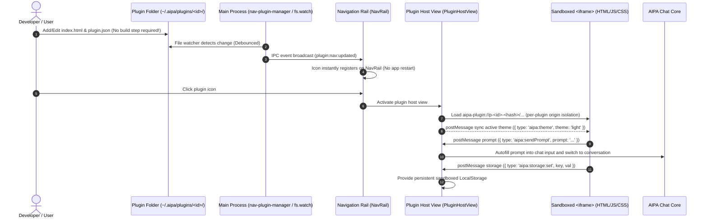
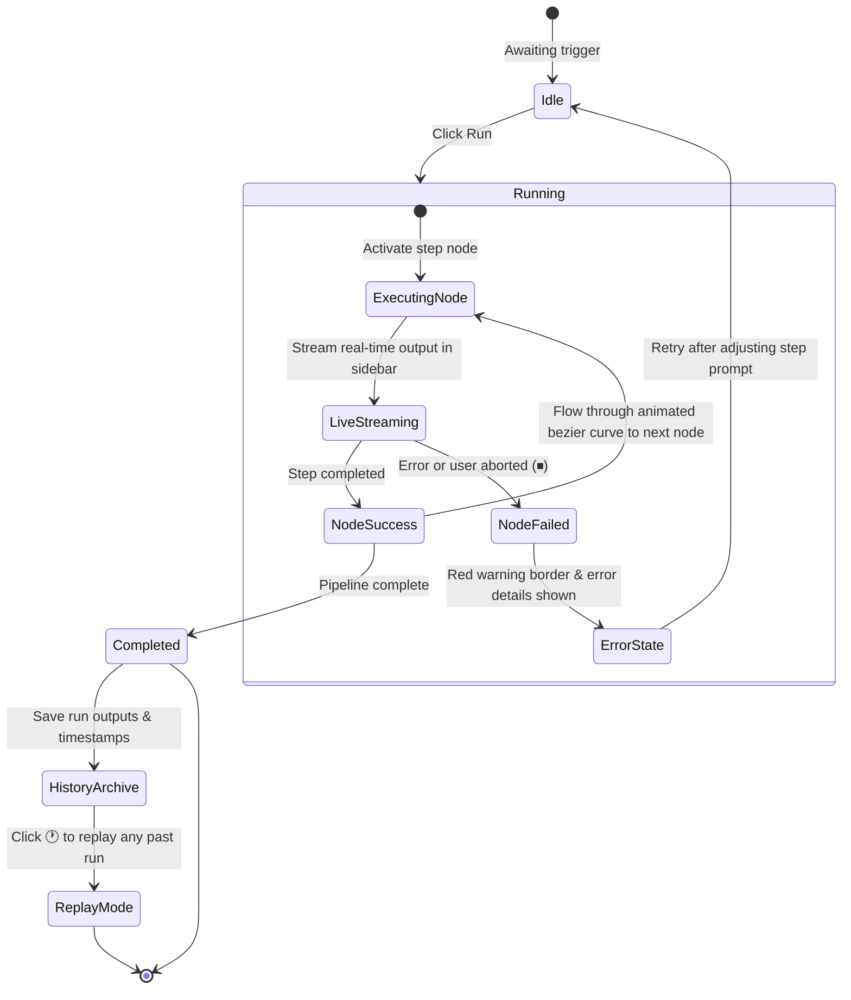
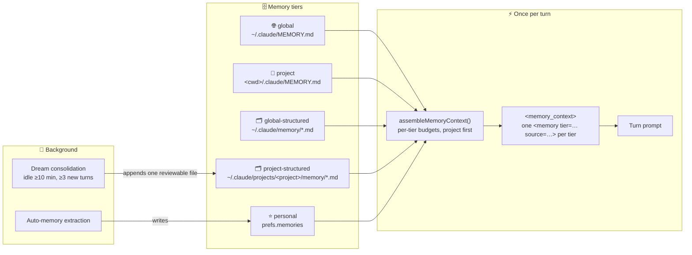

<p align="center">
  <h1 align="center">AIPA</h1>
  <p align="center">
    <strong>AI Personal Assistant — Your Always-On Desktop Agent Cockpit</strong><br/>
    Ask anything. Automate anything. Drive terminal and code, get things done.
  </p>
  <p align="center">
    
    
    
    
    
  </p>
</p>

---

AIPA is not a simple web-wrapper chat window. It is an **action-oriented desktop agent** that lives alongside you — reading and writing local files, executing shell commands, chaining tasks into automated workflows, and maintaining memory and preferences across sessions.

Under the hood, it drives **OpenAI Codex CLI** and **Claude Code CLI** as dual-core execution engines, packaged inside a finely tuned Electron + React cockpit. The model menu offers the catalogue the active engine will actually run — Codex's own list on a Codex profile, the built-in Claude list otherwise — and there is no provider registry in between.

> 💡 **The CLI is the high-performance engine; AIPA is your intuitive cockpit.**

---

## 🏛️ System Architecture

```mermaid
graph TB
    subgraph Desktop["🖥️ User Desktop Environment (Windows 10/11)"]
        subgraph ElectronCockpit["🚀 AIPA Desktop Cockpit (Electron + React)"]
            subgraph Renderer["Renderer Layer (React 18 + Vite + Zustand)"]
                NavRail["Navigation Rail (NavRail)"]
                MainView["Main Content View (MainView)"]
                ChatPanel["Structured Chat / Tool Cards / LCS Diff"]
                OrgChart["Organization Chart"]
                EmpGallery["HR (People Ops)"]
                CanvasWorkflow["Canvas Workflow Editor"]
                PluginHost["Sandboxed Plugin Host"]
            end
            
            subgraph Preload["Isolation Layer (Preload / contextBridge)"]
                API["window.electronAPI (Type-safe IPC Bridge)"]
            end
            
            subgraph MainProcess["Main Process (Node.js CJS)"]
                PtyMgr["PTY Manager (node-pty ConPTY)"]
                CodexBridge["Codex Bridge (JSON-RPC 2.0 stdio)"]
                StreamBridge["Claude Bridge (NDJSON Stream)"]
                NavPluginMgr["Hot-Pluggable Plugin Watcher (fs.watch)"]
                ConfigMgr["Secure Config (DPAPI safeStorage)"]
                ClawdPet["Clawd Desktop Pet Integration"]
            end
        end

        subgraph Engines["⚡ Execution Engines"]
            CodexCLI["OpenAI Codex CLI (Rust Native Core · Primary Engine)"]
            ClaudeCLI["Claude Code CLI (Fallback Engine)"]
        end

        subgraph LocalEnv["💻 Local Operating System"]
            Shell["Terminal Execution (PowerShell / Git Bash / CMD)"]
            FS["Workspace File System (Atomic Read/Write / Diffs)"]
            Git["Git Version Control / Worktree Isolation"]
            MemoryStore["Persistent Memory (~/.claude/projects / memdir)"]
        end
    end

    Renderer -->|postMessage / IPC| Preload
    Preload -->|IPC Channel| MainProcess
    MainProcess -->|JSON-RPC 2.0 stdio| CodexCLI
    MainProcess -->|NDJSON stdio| ClaudeCLI
    CodexCLI --> Shell & FS & Git
    ClaudeCLI --> Shell & FS & Git & MemoryStore
```



**The IPC surface is one table, not one file.** The main process registers 193 channels across 21 modules under `src/main/ipc/register/` — sessions, config, files, shell, PTY, the Codex bridge and its turns, plugins, automations, memory — and `src/main/ipc/index.ts` is now a 172-line coordinator that mounts them in order. Every handler goes through one `safeHandle`, which owns the logger, the error envelope and the registration guard that a split into twenty files would otherwise copy twenty times with small differences. A harness diffs the sorted channel set and its per-channel counts against a snapshot taken before the split, checks that preload still exposes exactly those 193 APIs, and fails if two modules register the same channel or if any module grows past 500 lines — so the next split cannot silently drop, rename or double-register a channel

---

## 🖥️ Desktop Cockpit Layout

AIPA adopts a modern **two-column layout** eliminating redundant intermediate lists. All core features open directly in the full-screen primary workspace:

```text
┌────────────────────────────────────────────────────────────────────────────────────────┐
│  AIPA — Desktop Agent Cockpit                                                    ─  □  ✕  │
├──────┬─────────────────────────────────────────────────────────────────────────────────┤
│ [🏢] │ Org Chart / Company Map → Department Roster                                     │
│ Dept │ ┌─────────────────────────────────────────────────────────────────────────────┐ │
│      │ │ 🤖 Assistant                                                                │ │
│ [👥] │ │ Refactoring module architecture...                                          │ │
│ HR   │ │ ┌─ 🛠️ Tool: Write (src/main/plugins/nav-plugin-manager.ts) ───────────────┐ │ │
│ [📁] │ │ │ + export interface NavPluginManifest { ... }                           │ │  │
│ Arch │ │ └────────────────────────────────────────────────────────────────────────┘ │  │
│      │ └─────────────────────────────────────────────────────────────────────────────┘ │
│      │                                                                                 │
│      │ ┌─ Employee Roster (HR)   ─────────────────────────────────────────────┐ │
│      │ │  ┌─────────┐   ┌─────────┐   ┌─────────┐   ┌─────────┐   ┌─────────┐        │ │
│      │ │  │ 👨‍💻 Coach  │   │ 👩‍🔬 Analyst│   │ 🎨 Creative│   │ 📚 Tutor │   │ ⚡ Productiv│   │ │
│ [📅] │ │  │ Writing │   │ Research│   │ Partner │   │ Academic│   │  Coach  │        │ │
│ Cal. │ │  └─────────┘   └─────────┘   └─────────┘   └─────────┘   └─────────┘        │ │
│      │ └─────────────────────────────────────────────────────────────────────────────┘ │
│ ───  │                                                                                 │
│ [📝] │ ┌─ Canvas Workflow Editor ────────────────────────────────────────────────────┐ │
│Notes │ │  [Node: Read Spec] ──(flowing line)──> [Node: Code Review] ──(done)──> [Done] │ │
│ [🔌] │ └─────────────────────────────────────────────────────────────────────────────┘ │
│Plugin│ ┌─ Interaction Input Area ────────────────────────────────────────────────────┐ │
│ [⚙️]  │ Status: ● Ready | Thinking: Medium | Perm: Accept Edits | Cost: $0.04    [🐱 Clawd]│
└──────┴─────────────────────────────────────────────────────────────────────────────────┘
```

- **Two themes, one readable system**: every colour that carries text is a semantic token — `--accent-text`, `--accent-text-strong`, `--text-subtle`, `--success-text`, the `--code-*` family and `--dialog-shadow` — with its own light value. A screenshot harness reads the rendered foreground/background pairs and checks them against WCAG AA (4.5:1 body, 3:1 large) in both themes, which is how the light theme's selected search/palette rows went from **1.55:1 to 5.20:1** and the citation chips from **1.47:1 to 4.94:1**. Code blocks stay deliberately dark in both themes, rather than a light frame wrapped around a `github-dark` body

- **The sidebar and archive read as one surface**: row hover and selection use the same token mechanism in every list, count chips sit below the row title in weight, the sidebar and archive scrollbars share a 6 px width, archive filter chips and fields share one 24 px height, and keyboard focus rings follow each control's own radius instead of forcing 4 px — with inset rings for rows inside `overflow:hidden` cards and hover-only row actions also revealed on focus. All of it is expressed in the existing light/dark tokens
- **Dialogs behave like dialogs**: the run-confirm, tool-approval and export dialogs are portalled above the app shell, carry `role="dialog"` / `aria-modal`, trap Tab inside the card and restore focus on close, and cap their height at `calc(100vh - 48px)` with an internal scroll area so a long command preview never pushes the Allow / Deny row off-screen. The faint-text tokens were raised (light `#5c5c63`, dark 53 % white) and the remaining hardcoded copy in settings, permissions and export was moved into the locale files — **3,636 keys with zero parity difference** between `en` and `zh-CN`. Toasts can carry an action button (the fourth argument of `addToast`), which is how a finished export offers **Show in folder** after its dialog has closed, and how the notice about a plugin-started conversation offers **Open**

- **Motion respects the OS preference**: one global `prefers-reduced-motion` block collapses every transition and entrance animation to a single frame while leaving scroll position and final visual state intact, with progress spinners the only exception — a frozen spinner is indistinguishable from a hung operation

- **One column, one vocabulary**: the transcript and the composer share a single centred `800px` reading column, with avatars living in the gutter rather than narrowing the text; the department header grows to fit its three rows and collapses Select / Export / Files / Handbook to labelled icons below 1100px, and the roster lays employees out on a `minmax(150px, 1fr)` grid instead of a fixed 108px tile. The palette ranks a name prefix above a word match and a description substring, so typing `ask` reaches **Ask AIPA about your history** rather than `Open Archive` via "t**ask**". Counts pluralize at the call site ("1 org", not "1 orgs"), every session date goes through one locale formatter, and no input suppresses its focus ring any more

---

## 🌟 Core Capabilities

| Module | Core Features | Visual Presentation |
|---|---|---|
| **💬 Chat & Execution** | Stream-JSON real-time stream, dual-model switching, collapsible thinking chain, auto-compaction; streamed deltas are appended per animation frame instead of rebuilding the message array, and list indexes, word counts and change parsing are cached per message — long conversations stay smooth | Structured tool cards, LCS color-coded diff view, task checklist, interactive permission dialog |
| **📋 Tasks** | A task is the unit of work that owns a folder: creating one makes `~/AIPA/Tasks/<slug>-<idtail>/` with `materials/`, `output/`, `notes/` and a per-task `task.json` mirror, backed by a main-owned `tasks.json` written atomically; files enter `materials/` by copy — picker, drag-and-drop or a pasted path — and every source passes the app's allowed-roots gate first | Task list grouped by status, or by due day on one switch — overdue, today, the next seven days, later and undated, with done and archived kept in their own sections — with an archived drawer, and a detail view whose header carries the title, status, folder reveal and archive/delete, beside a materials rail with import and per-file removal; renaming never renames the folder, archiving hides the task but keeps its files, deleting archives by default and only moves the folder to the app trash when asked, and a task whose folder disappeared opens with an explicit missing banner instead of vanishing; **Dispatch** opens a chat tab rooted in the task folder and fills the composer with a brief built from the task's actual materials, leaving the send to you — the first completed turn is recorded as the task's dispatch conversation and listed in the detail view, later dispatches start follow-up conversations in the same folder, and choosing a department records attribution only, never the working folder |
| **👥 HR (People Ops)** | Character persona illustrations, role-tailored attire/hairstyles, glowing status aura | The HR page shows Experts, Skills and Workflows as matching card grids (the standalone Skills panel was merged in): a skill card feeds its slash command into chat or opens the full SKILL.md, expert cards can be edited or recruited, workflow cards show step and run counts with hover edit/duplicate/delete and one-click run; a dashed card at the end creates a new item, with suggested presets below |
| **🏢 Org Chart** | Company-style department map, trunk→bus→drop connector lines, layout adapts to both container width and department count (centred single row / left-rail multi-row), per-department color and stable emoji; **company → department → team** across three levels, one section per applied template, a team strip always drawn under each card (a real sub-tree with its own bus and drops) and “open position” badges | Shows departments only (employees stay collapsed); clicking a card drills into that department's employee roster, and hovering offers direct recruit, a stats popover, employee export, or **deleting the department** (a confirm box outside the card giving the team count that will cascade with it); the HQ card likewise **deletes a whole company** — company, all its departments, and the teams beneath them, keeping the folders and sessions on disk). The roster itself renders each employee as a **little yellow helper** (one eye or two, height, hair and mouth hashed from the session id, always-on breathing, and a spinning halo plus typing arm while replying), with dimmed “open positions” standing in their own group until hired |
| **📁 Archive** | Company-wide task ledger: every session is filed under its **company / department / team**, derived live with no extra storage layer — except a filing the user made by hand, which wins, is marked as a label, and is kept when its node is deleted rather than quietly re-derived from the folder — filterable by organisation / time / archive state / origin / free text, grouped by company with an explicit unassigned bucket | Reach it from the left nav’s “Archive” entry or `Ctrl+8`; each row shows the task title, its department · team, an employee short-hash, time and turn count, and opens that session on click; rows can be archived inline and exported as `aipa_archive_<date>.json`. Conversations that were not typed by the user carry an **origin badge** — a clock naming the scheduled job that ran them, or a plug naming the plugin whose `chat.ask` opened them — and the filter row can show only one origin — or, once two jobs appear in the archive, one **job**, with a count per job and a selection that clears itself when that job no longer has rows instead of leaving an invisible filter behind; while a job is selected, a two-line strip above the ledger answers “how is it doing” — enabled or paused, next run, last outcome with its error code, failure streak, reported spend, and succeeded / failed / skipped counts over the runs the job still remembers (the strip never implies that window is the whole history) Automation origins are derived from every run each job still remembers, while plugin origins are recorded once at creation in `session-origins.json` |
| **🎨 Canvas Workflows** | Multi-step prompt pipeline orchestration, topology graph, live output streaming, execution replay | Infinite zoom dot-grid canvas, animated bezier edge flow, inline step title rename |
| **🔌 Zero-Compile Plugins** | Vanilla HTML5+CSS+JS, sandboxed isolation, postMessage bridge SDK, dynamic directory watching, AI edit drawer | Real-time sidebar icon registration, zero-build instant reload, host developer toolbar (reload + a per-plugin AI **work-model** picker + built-in source preview: file tree with line numbers, one-click copy or reveal folder + **Edit**: chat with the AI in a right-hand drawer to change the plugin, reloaded automatically when a turn lands) |
| **🧩 Plugin Hub** | Unified plugin dashboard, 1-click launch, source inspection, and developer starter guide | Pre-installed at the bottom of NavRail, enables cross-plugin navigation; UI and plugin names follow the app language (EN/ZH) |
| **📅 Work Calendar Plugin** | Month view with cross-day task bars, drag-to-create tasks, AI-streamed weekly/monthly reports, GitHub & local-folder work sources, person-day tracking | One-click report generation from week badges, preview / regenerate / pull sources, file-backed storage with JSON import/export |
| **📝 Quick Notes Plugin** | Decoupled hot-pluggable plugin, live Markdown preview, category filters, pinning, AI prompt dispatch | Independent HTML micro-app, upper NavRail placement, Ctrl+3 / Ctrl+Shift+N shortcut bindings, bilingual |
| **🧠 Memory Hierarchy** | Five prompt tiers — global and project `MEMORY.md`, global and project structured memdir, and the personal store | 4-tab memory console (under Settings → Memory, `Ctrl+5`) plus a Dream tab; background consolidation turns idle conversations into appended, reviewable memory files; all five tiers are assembled once per turn into one labelled `<memory_context>` block under per-tier and total character budgets |
| **🐱 Clawd Pet** | Win32 desktop pet synced with AI thinking, execution, and idle moods; background attention bubbles for approvals, questions, failures, spending-limit holds, finished plugin jobs and finished automations, with a native OS notification when the pet cannot speak | Consolidated taskbar icons, smooth sprite animations, click-to-open bubbles while the window is unfocused, silent while it is focused; one delivery decision covers all six attention kinds — pet bubble, OS notification, or nothing — and DND / a timed “Silence for…” / “Call Me Through the Pet” are honoured by both surfaces. The bubble is a **SAO-style HUD card** by default — dark angled panel, accent and icon and eyebrow by kind, a `1/3` queue badge, session/count meta rows, a progress bar, a draining countdown and a typewriter reveal, with a synthesized cue that respects mute and DND — and Settings → General → Bubble Style switches it back to the classic card. Passive notices ride the same window without ever replacing an actionable card: a **Link Start greeting** a few seconds after launch, turns that finish while AIPA is in the background (replacing the native notification) — and when that turn belongs to a task, the card is titled with the task and clicking it reopens the task, not just the thread, and context-low warnings; every announcement lands in a 50-row **history** (tray → Recent Announcements, or Settings → General → Recent Announcements) whose rows reopen their session when clicked. A notice that was saved as a task now carries a small chip with that task's title on its collapsed row, so the log names the work it became before you open it. Pet preferences changed in AIPA Settings now reach the running pet immediately instead of after a restart. The **permission bubble** — the card you actually answer (Allow/Deny, clarification forms, plan review, Codex notices) — wears the same HUD skin under Bubble Style: angled panel, kind accent, uppercase eyebrow, custom-drawn radios and checkboxes, with the classic light card one pick away. While a turn runs, an **Activity strip** keeps one card updated in place (never a second window) with the current tool, the elapsed time and a tool count, refreshing on a heartbeat so a long silent build does not blank it, yielding to any approval card, staying out of the announcement history and turning itself off from Settings → General. The strip also carries one compact spend row once the engine reports usage — `TOKENS 12.4k → 3.1k`, with `· $0.012` appended when the turn is priced — which clears with the turn and never appears on an error card. A **Stop** button rides the strip whenever the turn can really be aborted — the same abort the radial menu's Stop petal performs, so a runaway command is one click away without opening a menu; the button sits inside the clickable card without also triggering the card's open-AIPA click. Right-clicking the pet opens a **radial quick menu** — SAO-style ring of five angled petals: New Chat, Open AIPA, Stop the running turn, Silence (flips to Resume while quiet) and More; keyboard `1`–`5`, `Escape` closes, click-away closes, the ring is centred on the sprite and clamped into the monitor's work area, and if the window cannot be created the native menu opens instead. Two HUD gauges ride the hint baseline — CPU load and used memory, sampled when the ring opens and every four seconds while it stays up, turning amber above 85% — and a pulsing RUNNING dot with the orb while a turn is in flight — when the turn belongs to a known conversation that line becomes a chip naming it, filled in from the same listing the Recent ring fetches on demand so the menu never waits on the session store, and clicking it closes the ring and opens that thread. **More opens a second ring** — Notices, Settings, Hide Pet, All Commands (the old native menu), Recent and Ask — drawn as the same instrument at a smaller radius: the outer ring fades out, the nested one fades in with a slight overshoot, every nested chip keeps its inner edge on the same circle so a wide label never tucks under the centre orb, the orb becomes a violet `←` back arrow, `Escape`/`0` steps back a level, and `Esc` again closes. Both rings carry an unread-count pill fed by the announcement history. **Recent opens a third ring** of the five most recently active conversations — each chip shows the thread name or its first prompt and a compact age, clicking one brings AIPA forward and opens that thread, and the list is cached for 15 seconds so a right-click never waits on the session files. **Ask opens the quick command bar** — a one-line HUD field beside the pet, also summoned from anywhere with `Ctrl+Shift+Alt+Q` (falling back to `Ctrl+Alt+Q`, then `Ctrl+Shift+Q` when another app owns the chord): `Enter` sends, `Esc` cancels, an Enter that only commits an IME composition never sends, and a start that fails — no key, not signed in — says so inside the bar and keeps the typed text instead of losing it. By default it continues the conversation already open in AIPA — the chip names it (`CONTINUE · <thread>`), and one click switches that ask to a new conversation; a remembered thread the engine can no longer resume is reported in the bar with the prompt intact instead of quietly starting a new one. The prompt runs as a real persisted Codex turn without AIPA ever opening or stealing focus, is refused outright while another turn is running rather than queueing a second one, and its answer arrives as a clickable pet notice that opens the conversation it came into; the bar takes the keyboard, hands it back to the window it interrupted when dismissed, and follows the bubble theme and reduced motion. **The bar remembers**: the last 40 accepted asks persist across restarts, ↑/↓ walk them with the draft preserved at the bottom of the walk, and an empty field shows a staggered list of the five most recent asks (click or ↓ then Enter inserts it into the field, never sends); a grown list re-anchors the bar and still clamps inside the work area, while refusals — no key, another turn running, a dead thread — are never recorded. **Notices opens the notice log** — a HUD panel that appears beside the pet and lists the last 50 announcements with kind icon, accent rail, message, relative time and unread dot; filter chips for All / Unread / each kind present that scroll sideways on one line — the review and the evening wrap share a warm `REVIEW` chip with a look-back clock glyph of their own, and `DUE` sorts ahead of it — before any kind a newer build introduces, a search over titles and messages (`/` or Ctrl+F, Escape clears before it closes), keyboard up-down-Enter-Delete, a per-row dismiss and Clear All, an empty state, and clicking a row marks it read, focuses AIPA and reopens the session the notice came from — or the task itself when that conversation is registered on one. The same log opens from the first row of tray → Recent Announcements and from a button beside the announcements list in Settings → General; its filter strip scrolls sideways instead of wrapping, so the list never jumps down when a new kind appears. The panel grows with its content up to 420 px, never covers the pet, and closes on `Escape`, its own close button or a click outside — leaving by either of the first two marks the whole log read and clears the badge, while a click outside leaves it unread. **Brief opens the task briefing** — a HUD card beside the pet, also summoned anywhere with `Ctrl+Shift+Alt+B` (`Ctrl+Alt+B` when the chord is taken), that answers “what is on my desk?” without opening AIPA: the local date and a task count, then every active row ordered needs-you → in progress → ready → inbox — the card grows to fit them up to its 420 px cap and then scrolls the rest inside itself, and a quiet `1–4 of 9` line states how many tasks are on the desk and that the number chords keep naming the first four — each with its status dot and label, title, routed department (or *unassigned*), material count and relative age, plus an empty state when there is nothing. Clicking a row opens that task's latest conversation, or — when it has none — that task's own record in the Tasks view rather than the list's default selection; `1`–`4` open the rows, and a row's **Start** button — or `Shift`+`1`–`4` — dispatches the task, opening a chat tab in its folder with the brief in the composer and sending nothing; a row can also be finished from the brief — its **Done** check button or `Alt`+`1`–`4` — which moves the task to done and lets it leave the card, and finishing offers an **Undo** for a few seconds, which puts the task back in the status it had before; a needs-you row also carries the reason it is waiting, when the engine reported one; rows with a due day now sort ahead of undated rows within each section, soonest first, and carry a compact due marker — `TODAY`, `TOMORROW`, a short date or `2D LATE` — with today and overdue in the warning tone and later days muted; pressing that marker pushes the task's due day to tomorrow in place, and the same quiet line a finish uses offers the old day back — including a task that had no day at all — though the marker is a button only on a row due today or already late, since a future deadline must never be pulled earlier, and a row already due tomorrow shows its day as plain text; `Escape`, the close button or a click outside dismisses, and the card clamps into the work area on every edge and follows both bubble skins, the language and reduced motion. It is a seventh petal on the nested ring and never opens by itself — a request, not a notification. Every notice row expands in place on `Space` (or the chevron) to show the whole message, its kind and meta rows, and an action strip: **Open** when it names a conversation, **Copy** (`c`), **Save as task** (`s`, which writes the notice into a task's materials and shows the Tasks view without stealing focus from the log), and **Dismiss**. A saved notice keeps an **Open task** action that reopens the task it became — its latest conversation, or the Tasks entry when it still has none — instead of only landing on the task list; the link is read back from the task itself, so it is still there after a restart or a reopened log, and saving the same notice again reuses that task rather than writing a second one. Expanding marks nothing read, saving dismisses nothing, the single-letter shortcuts are ignored while the search field has focus, and `Escape` collapses an open row before it closes the panel. A **needs-you badge** rides the sprite's top-right corner whenever tasks are waiting on you — a count, or a dot once it reaches double digits, scaled with the pet, with the count still in its accessible label; clicking it opens the task brief and dragging from it still moves the pet, while DND, "silence for…" and the hidden pet make it disappear rather than queue. And an opt-in **Morning brief** (off by default) shows the task brief once per local day, a few seconds after launch, only when something is not yet done — never in DND, silence or quiet hours, never twice in a day, and a skipped morning stays skipped. An opt-in **Evening wrap-up** (off by default; Settings → General or the tray's *Evening Wrap-up* checkbox) closes the day instead: at 18:30 local the pet raises one card that says what was checked off today, how much is still on the desk and how much of that is late, and — only when there is any — what is due tomorrow, naming up to three finished titles with `×N` when one was checked off more than once and a `+N more` row for the rest, and names the first two of tomorrow's tasks so the evening ends with something to start on in the morning, while the sentence above still counts all of them. A day with nothing finished and nothing open says nothing, and that verdict is not remembered, so a task captured later the same evening is still counted; DND or a timed silence postpones the wrap without spending the day; a machine that slept through 18:30 still gets it when it wakes the same evening; and the next morning never speaks yesterday's — `day-wrap.json` records a day only once a surface actually took the card. The tray's *Today's Wrap…* row raises the same card on demand — a manual command that works whether or not the wrap is switched on, useful at 16:00 or after a day away from the desk — and it is only a preview: it never marks the day as spoken, so the 18:30 card still comes. A due-day reminder is separate and always on: once a day at 08:00 local, the pet raises one aggregated card for every task due today or overdue — never one card per task — naming up to three of them — most overdue first, then today's — and summing the rest as `+2 more`, and remembers what it already said, so a restart the same day repeats nothing. Its card also offers *Later*: the same card comes back two hours on, rebuilt from the live task list, so a task finished in the meantime never returns. The wait is stored, so closing AIPA for an hour still brings the card back when the two hours are up; a deadline that passed while the app was closed is dropped rather than spoken late, and a clock that steps backwards re-arms the wait instead of shortening it. Once a week the pet also looks back: a **weekly review** card speaks for the week that just ended — Monday to Sunday — on the first launch after Monday 08:00, and stays available until Thursday 08:00 so a weekend away does not lose it. It counts what was actually checked off in those seven days (from the history's own completion times, not from a status a later edit could have changed), how many tasks are still open and how many of those are past due, and lists up to three finished titles with the weekday each was finished on plus a `+N more` row; it reuses the ordinary notice kind, so it lands in the announcement history and falls back to a native notification when the pet cannot speak. A small `weekly-review.json` in the user data records the week it covered, so it never speaks twice for one week; DND or a timed silence postpones it without spending the week, and a week with no finishes and nothing open says nothing at all — a clear desk is not a card full of zeroes. Clicking that card, or the tray's *Week in Review…* row, opens the **Week in Review** window beside the pet — the whole week rather than one line: its Monday–Sunday range, four counts (done, distinct tasks, still open, past due), the change from the week before, a seven-column strip for each day with the busiest day accented, every finished title with `×N` when it was checked off more than once and the weekday it was last finished on, and the desk as it stands now — past due first, then nearest — with every row opening the task it names. An empty week says so instead of showing zeroes; `Escape`, its Close button or a click outside dismisses it, the up and down keys walk the rows and `Enter` opens one, and the header's `‹` `›` arrows — or the left and right arrow keys — step back a week at a time (up to a year), each week rebuilt from the same completion history while the desk half stays at “now”, with no future week to show. A day column is a filter: clicking one — or `Enter` on the focused column — narrows the finished list to the tasks that last finished that day, and a `Fri · 2 ×` chip under the heading clears it; a day with nothing finished is not a button at all, the desk half is never filtered, the `+N more` line steps aside rather than guess how many of the week's uncapped names fell on that day, `Escape` clears the filter before it closes the window, and stepping to another week drops it, since a day belongs to exactly one week. It never writes anything, and it follows both bubble skins, the language and reduced motion. A Done that is really a double click now writes once, not twice: the brief ignores the trailing press while its answer is in flight, and main refuses the same task's second finish within a second — on a repeating task that second write would have skipped a whole occurrence. Three capture-bar readings were tightened too: Korean intervals need their own left bound, so `120일마다` is a number rather than every 20 days; a token carrying a backslash (`C:\reports\weekly`) is a path, not a cadence; and a line started while a stay-save is still in flight begins with no day or cadence chip carried over from the line just filed. A **quick capture** bar — `Ctrl+Shift+Alt+T`, or the tray's *Capture task…* row — turns a typed line into an Inbox task without opening AIPA: `Enter` saves, `Escape` cancels, an IME composition never submits, the title is trimmed, collapsed and capped, an empty submit or a store failure says why and keeps the bar and its text, and a save is confirmed by a short *Saved to Inbox* notice that opens the Tasks view — the one notice allowed to speak while the pet is quiet, because the user just asked for it. The bar remembers the last 20 titles you actually saved to Inbox: ↑ recalls the newest, further presses walk back, ↓ walks forward and finally restores whatever you had typed (the footer shows ↑↓ as a hint), the history survives restarts, and an empty, whitespace-only or failed save is never recorded. The bar also reads the day out of the line: a standalone *today / tomorrow / tonight*, a weekday name, `in N days`, `next week`, `M/D`, a bare `YYYY-MM-DD`, or 今天 / 明天 / 后天 / 大后天 / N天后 / 周X / 下周一 / M月D日 resolves to one local calendar day and appears as a small tag under the field — `Enter` files the task with that due day, the × dismisses the day for that line only, and the typed title is never rewritten. Clicking that day opens a three-day strip — Today, Tomorrow, Next week — so a guess can be corrected without retyping the line: the chosen day is what saves, the strip marks the day already in force, a later date typed into the line outranks the choice, and `Escape` closes the strip before it closes the bar. The same scan hears a cadence, too: daily and every day, weekly and every week, monthly and every month, and every `<weekday>` in English; 每天, 每周, 每月 and 每周五 in Chinese; 매일, 매주 and 매월 in Korean — and a cadence may carry an interval: `every other week`, `every 2 weeks`, `every 3 days`, `every 2 months` (digits or two..ten), 每两周 / 每隔一周 / 每三天 / 每2个月, 격주 / 2주마다 / 3일마다, while `bi-weekly` stays unread because English disagrees on what it means. A cadence with no day gives the task one it can actually be reminded about — today, or the weekday it named — a cadence and a day can arrive in the same line, and the phrase stays in the title exactly as a day phrase does, because the bar has never rewritten what you typed. The cadence appears as its own chip beside the day and opens a five-row strip — doesn't repeat / every day / every week / every other week / every month, which wraps onto a second line at the bar's narrowest width instead of shrinking any row; the line outranks a manual pick, clearing the cadence never touches the day, and the ordinary word `everyday` never matches. The reading is deliberately narrow: a hyphen pair reads as a range, a three-letter weekday counts only when capitalised, and a day that has already gone (`上周五`, `last friday`) resolves to no day at all rather than to next week. It also finds a leap day that is coming (`2月29日` scans forward to the next 29 February) and leaves a line alone when the number is part of something else (`5-10 min`, `2/3 of the budget`). A cadence word that is really part of a compound (`bi-weekly`, `每周末`, `每月底`, `每个月末`) likewise leaves the line alone rather than starting a series on the wrong day, `每周三次` and `每周三回` are counts rather than Wednesday, and a token that is really a URL or a path (`https://…`, `github.com/x`) never starts a series — the scanner only offers a cadence it would genuinely save. A weekly cadence that names its weekday starts on the first such weekday on or after the day the line also named, so `next week, every Friday` recurs on Fridays and not on whatever day next week happens to begin — and when that anchoring moves the day, the chip names the weekday it will actually use (`Fri · Nov 13`) instead of leaving the typed day phrase beside a date it contradicts (`next week · Nov 13`); the input text itself is never rewritten. `Shift+Enter` saves and leaves the bar open for the next line: once main accepts the write the field clears, the chips reset, a quiet *Saved · next one?* line sits underneath until you type again, and the recent-captures list stays out of the way while that confirmation is up — a brain dump is one chord and one key per line. The field is never cleared before that answer, so a line typed while the write is still in flight survives it, with the day and cadence chips that line itself earned; a Shift+Enter on a *different* line in that window is queued and filed right after the first write instead of being dropped, while a repeated Shift+Enter on the line already being written is the key repeating and never files it twice. A stay-save reaches the task list and the pet's brief as soon as it lands, like any Enter save, and an Enter on the empty field replaces the confirmation with *Enter a task first* rather than stacking two contradictory lines. The save confirmation's notice opens the task it just created rather than the task list, falling back to the list only when the hand-off is refused. Those titles are visible too: an empty field opens with the five newest saved captures listed beneath it, clicking one fills the field without sending, and the bar gives that extra room back the moment you type. A task can repeat, and finishing one does not close it. The task detail's due popover carries five cadences — doesn't repeat, every day, every week, every other week, every month — and a repeating row shows its cadence quietly beside its due day (`2w`, `3d` when it carries an interval no preset names), while the popover spells that cadence out under the options (`Currently: Every 3 days`) so a capture-bar interval is never invisible and a preset click simply replaces it. Marking such a task done advances its due day to the next occurrence — by its interval, so every other week moves 14 days — instead of finishing it: the status stays, the store records the occurrence in the history before the new day, and a monthly cadence clamps to the short month's last day rather than drifting (31 Jan → 28/29 Feb, then 28 Mar). On the brief that finish keeps the row on the card, says which day comes next in the same quiet line, and offers the old day back. Undo is strict about what it may overwrite: it restores a day only when the row still carries exactly the day that action wrote, so an edit made in AIPA while the offer is up is never clobbered, and a row already due tomorrow shows its marker as plain text rather than a button that could only do nothing. A repaint also keeps the list's scroll position, so pushing the due day on a row far down no longer throws the card back to the top. The capture strip gained the matching rule: recalling an earlier line, or picking one from the suggestion list, drops a day chosen for the previous draft, so an old line cannot be saved on a date it never named. Every pet surface is drawn as one instrument: the same inset padding and corner cut, a 160 ms fade with a 200 ms slide instead of a slow spring, tabular numerals on every count, date and age so digits stop shifting the layout, and focus rings that sit inside the cut corners the clip-path would otherwise crop — and the update card states its message in full the moment it appears, never typing it out. |
| **⚙️ Settings** | MCP tool servers, model keys, permissions consolidated | Streamlined into Settings (Settings → Plugins & MCP) — plugins and MCP servers share one page, and the AI Engine page leads with the API key and its pool, then the model picker — the provider list that used to sit between them is gone entirely, along with its health dots, its config drawer and its "fetch models" button, so the page is one credential and one catalogue, and adding a key fills that catalogue from the key itself; MCP configuration is engine-routed — the Codex engine writes `[mcp_servers.*]` tables to `~/.codex/config.toml` and feeds them back into `systemInit`, while Claude still uses `~/.claude/settings.json`; the Hooks page was removed (hooks are only read by the Claude CLI from `~/.claude/settings.json` and have no effect under the Codex engine); the Sandbox page and a batch of inputs whose writes were silently dropped by the settings whitelist (API Key Helper, output style, available models, file suggestions, status line, default shell, respect `.gitignore`, commit attribution, worktree, …) were removed too, leaving only settings that actually persist; on wide windows the General page flows its section cards into **two measured columns** (each 511–592 px, so inputs stay at a readable 478–559 px) inside a centred 1,200 px page column, falling back to one column below 1,180 px — which fills the width that used to sit empty to the right of a 660 px form |

**Ctrl+F finds text in the conversation you are already reading.** The command palette searches across sessions — and that search now reads tool output and thinking blocks as well as prose, because the command that failed is exactly the thing people go looking for: a result says *in tool output* or *in thinking* when the match came from there, a block the index had to trim is marked cut short, and a miss on a trimmed block falls back to re-reading the file from disk rather than answering from a copy that was known to be partial. The overlay also filters by where the match came from — all / prose / tool output / thinking — and orders newest or oldest first. A filter is a statement about coverage, so it says so: *only tool output: this query has N more matches not shown*, with one click to show everything, and an empty filtered result is written differently from a search that found nothing. Ordering and filtering are applied to the results the search already returned, and the search itself stops at the **40 most recent** matches — when that window is full and a filter or the oldest-first order is active, the overlay says plainly that the window is the limit, because a filtered view of a capped set is partial twice over. The find bar docks above the transcript and counts real matches — *3 of 12* — stepping with Enter / Shift+Enter and scrolling the active match to the middle. Highlights are drawn with Chromium's CSS Custom Highlight API over `Range`s built from the transcript's text nodes, so the rendered markdown is never rewritten to insert `<mark>`s and the React tree underneath is untouched. It searches the text the message blocks actually display: message bodies, an expanded thinking block, a raw-markdown view — not timestamps, not button labels, not the tool-card chrome, so searching “Copy” finds no phantom matches. The three empty states are deliberately different: an empty counter while nothing has been typed (never “0 of 0”), *No matches for “…”* with the query quoted, and “this conversation is empty” when there is nothing to search at all. Opening it mounts every row of the transcript for that moment — a virtualised list can only count what is rendered, and a count that only covers the visible window would be a lie; recomputing is limited to opening, a query change, a new message and the end of a turn, so a streaming answer does not make the counter flicker frame by frame. Searching only the visible text has one honest cost: a phrase that lives in a collapsed message body or inside a tool card would come back as *No matches* while sitting right there on disk. **Include tool output** closes that gap explicitly. Turned on, it unfolds the collapsed bodies and forces the tool cards open, so the same scan covers them, and the bar says which set it counted — *3 of 12 in messages and tool output* — instead of changing the number under the same sentence. Turning it off, or closing the bar, puts the transcript's fold state back exactly as it was: only the rows that were collapsed when the toggle went on are re-collapsed, so an answer that arrived mid-search keeps whatever state it has. The expansion has a budget and refuses rather than scanning a partial set: past 200 unfolded items or two million characters of text the toggle stays off and names the figure it would have had to render, because a find bar that counts half a conversation and calls it all of them is worse than one that admits it cannot.

Session handoffs land where they point: auto-resume, the welcome screen's continue button, the quick switcher, the command palette, and the tray / app menu now actually open the session instead of dispatching an “open this session” event into the void, and a lookup that fails raises a visible error rather than doing nothing.

**A conversation remembers who started it.** The archive badges runs that were not typed by the user, but the badge used to end at the click that opened them. The transcript now carries one muted line above it — a clock and the job’s name, or a plug and the plugin’s label — with when it began, in the same relative-time words the rest of the app uses. The job name is a control that goes to Settings → Automations; the plugin’s label is text. The line is derived from the session list that already exists (keyed on the *viewed* session, not the live bridge id a streaming turn overwrites), so nothing is stored twice and nothing is guessed: a session with no origin, or one no longer in the list, shows no line at all.

### 📋 Tasks that own their folders

- **Work that outlives one conversation gets a home of its own**: until now the app's closest thing to a task was a conversation that happened to run in a folder. A task is now a record with a directory — `~/AIPA/Tasks/<slug>-<idtail>/` holding `materials/`, `output/`, `notes/` and a `task.json` mirror — owned by the main process in `tasks.json` (atomic write, a corrupt file kept beside the original instead of being silently replaced) and merely cached by the renderer, the same discipline automation jobs already follow. A task whose folder has gone missing still opens: the record is kept, and the view says the folder could not be found and that nothing was deleted, rather than hiding work the user did.
- **Materials are copies, not links**: a file enters a task through the OS picker, a drag onto the task view, or a pasted path, and it is copied into `materials/` — never linked, never moved — after the source has passed the same allowed-roots gate every other file read in the app goes through. Two files with the same name get ` (1)` rather than overwriting each other, and removing a material deletes only the task's copy: the original the user picked is untouched. The record stops naming a file before the file is unlinked, so the worst failure leaves an orphan inside the task folder, not a row pointing at something that no longer exists.
- **The folder is stable, the title is not**: renaming a task changes the title and nothing on disk; archiving closes it out of the list while leaving its folder and materials exactly where they were; restoring puts it back in the status it left from. Deleting archives by default, and only a confirmed "move the folder to the trash" takes the files — into the app's own trash, never straight off the disk. Nothing destructive happens to a directory unless the folder's own `task.json` carries that task's id, so a hand-edited store cannot aim the app at somebody else's folder.
- **A task dispatches into a real conversation, and the folder is the invariant**: **Dispatch** does not send anything for you. It opens a chat tab whose working directory is the task folder and writes a visible brief into the composer — the task title, the materials that actually exist in `materials/`, and the instruction to work inside that folder — and the send stays yours. The first completed turn is recorded as the task's dispatch conversation, with a `session_started` history event and a row in the detail view; dispatching again starts a **follow-up conversation in the same folder** rather than resuming the earlier thread, and the card says so, because resuming would overwrite the earlier transcript and leave the task with one conversation where there were two. The board follows the work: a task still in *inbox*, *ready* or *assigned* moves to *in progress* the moment a turn in it really starts — never on a refused send, and never out of *needs you*, because a decision you owe is not erased by the engine starting to run. A turn that ends with an engine error moves the task to *needs you* instead — the board says a decision is owed, not that work is happening — while a stop the user asked for changes nothing. The engine's reason travels with the status: the task detail opens with a quiet waiting banner, its history shows the transition and a labelled reason line, the task list carries a one-line hint, and the pet's brief prints it under the row. A task can also carry a due day: the detail sets or clears it, the list marks today and overdue, and it survives restarts. Finished work keeps its day but loses the warning tone — nothing is late once it is done — and the detail header wraps onto a second line rather than letting a control run past a narrow pane Clicking the calendar glyph in that due chip offers Today, Tomorrow, Next week and Clear, so a deadline is one click instead of a date-picker detour. The deadline also rides along: global search marks every task row with Today / Tomorrow / a short date / Nd overdue, and the dispatch brief hands the engine a localized due line beside the folder rule..
- **A department is attribution, not a working directory**: the picker records `departmentId` and `routedBy: 'user'` plus a `routed` history event, and nothing else. The turn still runs in the task folder — the one place that decides this (`sessionOpenDir`) puts the task directory ahead of both the transcript's recorded folder and the department's, so a rollout that was written in a department folder cannot move the next task turn back there. The header's folder chip follows the same rule and becomes read-only for a task tab, because offering a folder picker there would let the UI contradict what the send path does. Nothing outside tasks changed: an ordinary conversation still runs in the folder it always did, and `prefs.workingDir` is never written by a task. **A department is a processor, not a folder**: creating one asks for a name and nothing else — no directory field, no `mkdir`, no template folder, and no write to `prefs.workingDir` — while a department saved before the task migration keeps its folder as a read-only *legacy* note that only the old session join reads. The department page is now processor configuration plus the work routed to it: its handbook, default persona and open seats, and a task list (status, material count, last activity) whose rows open the task's own conversation. Recruiting an employee or hiring a ghost position no longer switches the app's working folder; both create a task, route it to the node and open its draft with the job description already in the composer. Attribution follows the same rule everywhere — search, archive, brief and handbook resolve a conversation through its task's `departmentId` first, and reach for the folder only when no task owns it, so a folderless department is fully usable and two departments sharing one legacy folder can no longer both claim the same conversation. **A suggestion is a chip, never a decision**: every place a department can be chosen — the new-task sheet, a task's Change-department control and the hand-off dialog — also shows a *Suggested* chip when the task's own words overlap a department's identity. The scorer is a local heuristic over the department name, its seat titles and its handbook (weights 3 / 2 / 1, threshold 0.15 over the normalised total): a name hit is the strongest signal, a seat title next, and the handbook — unbounded prose — only counts after several distinct terms. Latin words match case-insensitively with a conservative plural key, Chinese matches by overlapping bigrams, so `采购供应商合同评审` finds `采购部` without a space in sight. Clicking the chip is the only way it routes; an explicit pick always wins, a score below the threshold or an empty title means no chip at all, and a suggestion whose department was deleted between render and click reports the failure and leaves the picker open instead of guessing. **A finished automation can become real work**: **Save output as a task** on a completed run creates a task titled from the job, writes the run's output into the task's `materials/` as a text file, routes it to the job's department when that department still exists, and records `from_automation` with the run id in the task's history, so the timeline shows where the work came from. Saving the same run again reopens the task it already created rather than duplicating it; a pruned transcript says there is no output instead of saving an empty task; and nothing is created until the user asks. **A legacy folder can become a task, and the folder is never touched**: where a department still owns a folder from before the migration, its legacy note offers **Import folder as a task** — and so does the Archive's legacy grouping. The import copies the tree into the new task's `materials/` (recursive, hidden entries and symlinks skipped, 500 files / 200 MiB caps, same-name copies stored as `stem (1).ext`), routes the task to that department, and records an `imported_folder` history row naming the source path and the copied / skipped / truncated counts. The source is read-only for the whole operation — nothing is moved, renamed or deleted, and the test compares the source tree byte for byte afterwards. A missing, unreadable or empty folder disables the button with the real reason; a live task that already recorded that source path is reopened instead of duplicated, while an archived one does not block a fresh import. **A task is findable where you already search**: `Ctrl+Shift+F` now returns tasks above conversations — matched on the task title, its material file names and its routed department's name (case/whitespace normalized, Chinese by substring), with the matched term highlighted, the status pill, the department chip and the material count on the row. One selection model walks tasks and conversations, Enter opens the task's latest conversation or its draft when it has none, the department filter narrows both groups, archived tasks never appear, and the group costs no IPC — it filters the already-loaded store, so typing stays instant. **What a task cost is visible, and unknown stays unknown**: a main-owned `userData/usage.json` ledger accumulates each conversation's completed turns — output tokens summed, the latest input/cache readings kept as the current context, priced turns summed into `costUsd` and unpriced ones leaving cost absent — atomically written, corrupt-file preserving, capped at 2,000 sessions by recency. The task detail gains a quiet **Spend** block totalling its conversations (cost, turns, compact output tokens) with one line per conversation, and a conversation the ledger never saw says *no usage recorded* rather than `$0.00`; when any conversation is unrecorded the total is prefixed `≥`, so the number never claims more certainty than the data. Task rows carry the figure only when it is known, and a failed ledger write never fails the turn.

### 💻 Terminal dock, runnable code, and snippets

- **The terminal is a real shell again, and it stays alive when you hide it**: the dock had been spawning Codex's interactive mode rather than a shell, so it is now `kind: 'shell'` — your own `$SHELL` / `cmd.exe`, started in the conversation's working folder, with the same path guard as every other surface (outside an allowed root the dock refuses by name instead of starting somewhere else). A tab that fails to spawn keeps its name and shows the translated reason rather than vanishing. Hiding the dock no longer kills anything: it is latched mounted after the first open and hides with `display: none`, so toggling it — a view action — cannot act as a kill switch for a build you started there. **Close all** is the explicit way to end shells, and it asks first whenever something is running. A hidden dock that still holds shells is announced in the status bar (*1 shell running*, or *terminals finished* when they all exited) and clicking the chip brings the dock back, because hidden work with nothing on screen saying so is the same as lying about it.
- **The chord belongs to one owner**: `Ctrl` + backtick was bound twice — once by the View menu accelerator and once in the renderer's shortcut hook — so a single press toggled the dock twice and it never moved. The menu now owns the chord, the renderer listens for `menu:toggleTerminal` only, and the palette gained **Toggle terminal** (which hides and restores, and says so in its description).
- **A code block can be run for real, and the card says what actually happened**: every block carries **Run**, behind a confirmation that shows the exact command and the folder it will run in. Execution happens in a dedicated `shell:exec` registry — a sanitized environment (no `NODE_OPTIONS`, `LD_PRELOAD`, `BASH_ENV` or API keys), a working directory confined to the allowed roots, a 120 s timeout, a 64 KiB tail, process-tree kill on stop, and a run id that can never collide. The block shows live output with ANSI escapes stripped and carriage-return overwrites collapsed, then an honest footer: the exit code, the elapsed time, `timed out` / `stopped` / `couldn't start` as distinct states, and a visible note when output was cut. Nothing says "executed" before the exit event arrives, and a block whose run never started never claims it did.
- **Snippets are theirs to write**: `::` had a popup, a store and a backup section but no way to author one — the only snippets that existed were the ones shipped in the repo. Settings gains a **Snippets** tab with add, edit, delete and a search box, enforcing the same limits the popup relies on (50 snippets, 32-character keyword, 4000-character body, keyword must be a single word) and naming which rule blocked a save — *that keyword is taken* names the existing one rather than dropping the edit. The popup's empty state now offers **Add a snippet**, and the palette lists every snippet as its own row: picking one inserts it into the composer when the chat is open, and otherwise copies it and says so.
- **A command in a code block can be handed to the terminal instead of run in the sandbox**: **Send to terminal** opens the dock, picks the live shell — creating one in the conversation's folder when there is none — and types the command in without pressing Enter; the toast says exactly that, and says "still starting" when the shell is not ready yet. Multi-line blocks are refused with the reason beside the button, because a shell runs each line the moment its newline arrives, so "typed in but not run" does not exist for them — **Run**, with its confirmation, is the honest action there. Text aimed at a tab whose PTY is still starting waits in a queue drained when the shell is ready, and is dropped when that tab closes or its shell exits: ids are reused, so a dead tab's text can never land in the next one.
- **The terminal is reachable from the palette too**: **New terminal tab**, **Clear active terminal** and **Close all terminals** sit beside **Toggle terminal**. Close all routes through the dock's own confirmation, so the palette cannot end a running shell without the same question the X asks, and each row says why it cannot act when there is no folder or no active tab.
- **A finished run is a starting point, not a dead end**: the block now offers **Run again** (through the same confirmation, with the command and folder shown again — a second run is still a run you are authorizing), **Copy output** (exactly the text on screen, and the toast says it when the copy is only the last N characters), and **Ask AIPA about this run**, which drafts a message — the command, the result in words (exit code / timed out / stopped by you / could not start), the elapsed time and a capped output tail with a visible note when the tail was cut — into the composer without sending it. A successful run with no output says *no output*, and a run that never started says so, rather than showing the same blank box for all three.

### 🧭 Working tree, and getting back to AIPA

- **The cockpit shows the working tree it is working in**: `fs:gitStatus` had been implemented in main and exposed in preload since the beginning, with no caller — so "what is uncommitted in this folder right now" was a question you had to leave AIPA to answer. The status bar now carries a chip for the conversation's folder: the branch when the tree is clean, `main · 3` when it is not, the short SHA when HEAD is detached, and ahead/behind arrows when the upstream is known. The popover groups files as **Staged / Unstaged / Untracked / Conflicted** with their porcelain letters, and a row opens its diff in the viewer the Changes panel already uses. Three states are refused rather than dressed up: a folder that is not a repository, a machine without `git`, and a folder with no session all hide the chip instead of claiming "clean"; more than 200 entries says *showing first 200 of N*; an untracked file says there is no diff until it is added, and when the diff cannot be taken in the conversation's folder the row reveals the file and says that is what it did. Refresh is on open, on window focus and on file-watcher events (throttled to one read per 2 s) — never a polling timer.
- **AIPA can be summoned from anywhere**: the View menu gains **Show AIPA**, and a global chord — `Ctrl+Alt+Space`, falling back to `Ctrl+Shift+Space` and then `Ctrl+Alt+A` when another application owns it — brings the window forward instead of toggling it, lands on the chat, and puts the caret at the end of whatever draft is already there. The fallback order is the feature: a chord someone else owns costs a different chord, not the whole hotkey. If all three are refused, the app says so once, names the menu item that still works, and never advertises a chord it did not actually get — the chord that is live is the one variable the rest of the app reads.
- **The app tells you which hotkey it actually got**: the summon chord is claimed at startup or not at all, and until now the only report was a log line. **Settings → Advanced → Global hotkeys** now lists each registration — summon, the clipboard quick action, and the menu's **Show AIPA** — as *Available* or *Not available in this session*, naming the chords that were tried when another application owns them. The status is recorded by the same values registration used, refreshable by hand and on window focus, never polled; when the status cannot be read it says so rather than defaulting to "available". The keyboard cheatsheet carries the same marker on its global rows, and only when the refusal is known.

### 📂 The folder belongs to the conversation

- **Reopening a conversation puts it back in the folder it ran in**: a Codex rollout records its `cwd`, and the app had the value all along (`SessionListItem.cwd`) but never used it — so an old conversation reopened ran its next turn wherever the window happened to be, while the one folder write that did exist moved the *global* default and silently re-pointed every other conversation. Opening now restores the recorded folder onto the conversation's tab, and when neither the transcript nor a department names one it clears the override rather than inheriting the previous conversation's folder. This is correctness, not decoration: a continued Codex turn runs in its rollout's cwd, so the folder the app spawns in and the folder the thread actually uses only agree when the recorded one is restored.
- **One answer to “which folder will this turn run in”**: the send path, the chat header, the status bar, the speculation sandbox, the terminal dock, the git-status chip, memory extraction, handoff and the model/effort pickers each carried their own fallback chain — three different ones. The status bar read a chat-store copy that ignored the tab, so it could name a folder the assistant was not using. They now share one resolver — this conversation's folder, then the default for new conversations, then home — and a folder nobody knows is left blank instead of being dressed up as `~`.
- **The header says it, and says what a click can mean**: a quiet line under the session title names the folder and where it came from, with the full path on hover. A draft really moves when you pick a folder. A recorded Codex conversation cannot — its thread resumes where it ran — so the same click explains that and offers **Start a new conversation in…**, which clears the view, moves the folder and starts fresh. The menu's **Open folder**, the palette's **Change Working Directory** and the worktree switch follow that one rule, and each says what it will do before it does it; the toast afterwards names both folders and points out that the previous conversation is still in history (it is — only the view was cleared).
- **A recorded folder that is gone is marked, not papered over**: opening stats the recorded folder exactly once. Only a definite “does not exist” becomes a warning — a refused or failed stat proves nothing and leaves the folder in use undisclosed — and a late answer is checked against the view before it speaks. The line turns amber, the popover says continuing will very likely fail because Codex still runs there, and the exit is a new conversation somewhere that exists.
- **Session lists say where each conversation ran**: the quick switcher and the archive print the recorded folder beside the title, the full path in the tooltip, and nothing at all when the engine did not record one — an unknown folder is never filled in with home, and a row that already names the project does not print the same folder twice.

### 🧭 The diff, and the folders you already used

- **A diff is read in the folder the conversation runs in**: `fs:gitDiff` never accepted a folder — it always ran `git diff HEAD` in the app-wide working folder. A conversation scoped to its own tab was therefore shown a diff from another checkout, or from somewhere that is not a repository at all, while the git-status chip beside it had already learned to read the conversation's folder and could only apologise for the mismatch. The handler now takes the folder with the request, through the same allowed-roots gate `fs:gitStatus` uses, and the Changes panel asks in the conversation's folder too, because those are the files the agent changed there.
- **A refused folder is a refusal, not another checkout's answer**: a folder outside the allowed roots, or one that no longer exists, comes back as `cwd_invalid` and never silently becomes the app-wide folder. A diff produced in the wrong repository looks exactly like a correct one — same colours, same hunks — so "I could not look there" has to arrive as itself. The popover opens the file's folder instead and says that is what it did, and only that specific refusal earns the fallback; a real git failure is reported as a git failure.
- **The folders your conversations actually ran in are a menu**: the header's folder line now opens a real popover, and its first rows are the folders previous conversations recorded — derived from the transcripts on every open, never stored, so the list cannot outlive the conversations it describes or drift from them. Choosing one in a draft moves the conversation; choosing one in a recorded conversation starts a new one there, because a resumed Codex thread runs where its rollout says. **Browse…** is still a row, just no longer the only door, and the rows carry no per-folder counts because the session list they come from has a cap.
- **You can search by folder**: the quick switcher's filter now matches the recorded folder as well as the title, case- and separator-insensitive, and marks a row when the folder is the reason it matched — otherwise a result with no visible hit looks like a glitch. The command palette gained "Start a new conversation in ⟨folder⟩" rows for the same history, and a hint on the switcher says folders are searchable only when the list actually contains one.
- **The sentence that had become false is gone**: the popover used to warn that the diff viewer ran in the app-wide working folder. Once the diff follows the conversation, that warning described a limitation that no longer existed; it was deleted rather than left to mislead, and the refusal that can still happen has its own wording.

### 🗂 Folders you can browse, schedule, and be refused by

- **A scheduled job remembers the folder it was made for**: the scheduler has carried a per-job folder since it was written — validated, persisted, used at run time — and the dialog never set it, so every job silently ran in whatever the app-wide folder happened to be when the timer fired. The dialog now has a "Runs in" field: the app-wide folder by default (shown as a promise that follows the preference, not as today's path), up to five folders conversations actually ran in, or a folder you pick. A job's own folder is shown on its row, with the full path on hover, and a folder AIPA is not allowed to read is named in the error box instead of being swallowed.
- **The archive can be browsed by folder**: the ledger already filtered by department, origin, scheduled job, time range, archived state and free text, but not by where the work happened — the one dimension every transcript records. The folder facet is derived from the same shared list as the palettes, offers an explicit "No folder recorded" option so absence stays reachable, re-inserts a chosen folder that the cap would otherwise hide, and shows no per-folder counts, because a number drawn from a capped list is a false total.
- **A refusal is not the same as a quiet tree**: the status-bar git chip stayed silent for every failure, which meant "AIPA may not read this folder" and "this folder is gone" looked exactly like "nothing to report". Main now says which refusal it is, and the chip answers with a small lock or warning — the repository is fine, AIPA simply cannot see it — plus a popover that never shows an empty changed-file list. Ordinary silence is untouched: a folder that is not a repository, or a machine without git, still gets no indicator at all.

### 🔐 A folder becomes readable because you picked it

- **Consent is recorded where the user gave it**: the file-system gate only knew home, `~/.claude` and the app-wide folder, so a project on another drive was refused everywhere — no diff, no git status, no shell, no job. A folder is now added to the gate's roots when it comes back from an OS folder dialog, which is the one place a human answered. The renderer cannot add a root by asking: `prefs:set` refuses the list outright, and there is no other channel shaped like a grant. Grants are read at call time, so one pick fixes every surface at once.
- **What was granted is visible and can be taken back**: Settings → Permissions opens with the list of granted folders — short label, full path, read live from main rather than cached — and removal is confirmed inline with what it actually means: diffs, git status, shells and jobs there will be refused, and nothing on disk is deleted. "Reset preferences" now clears the grants too, instead of leaving them in memory to be written back by the next pick.
- **A refusal now has an exit**: when the git chip or the job dialog refuses a folder, it offers to let AIPA read it. The offer opens the folder dialog seeded at the refused folder; confirming the same folder grants it and the chip re-reads git for real (invalidating the cached refusal first, once, with no timer), while picking a different folder goes through the ordinary "this conversation moves here" rule. Cancelling changes nothing and says nothing.
- **The gate is a guard, not a vault**: it stops mistakes and stale claims — a diff asked for in the wrong checkout, a conversation pointing at a folder the app never opened, a job saved against a path nobody picked. It is not a boundary against a compromised renderer, and the code says so rather than implying otherwise.

### 🔎 Search knows where the work happened

- **The history search can be narrowed to a folder**: the cross-session search filtered by where in the transcript a match was, who started the session and which department it belonged to — but not by the folder the conversation actually ran in, which every transcript records. A hit carries no path of its own, so the folder is looked up from the session listing by id, never guessed from the project label (a Claude project slug is not a cwd). The control offers the folders the loaded hits represent, plus an explicit "No folder recorded" choice so absence stays reachable instead of vanishing; choosing a folder never removes the option just chosen when a page pushes it past the list's cap. There are no per-folder counts, because the hit set is a page and a number beside a folder would read as a total.
- **The folder view explains its own emptiness**: when the choice hides everything the earlier chips left, the screen names the folder and offers one click back to everything — it does not say "no matches", which would be a claim about the whole history that this view did not earn. Typing a new query starts at All, because the new rows may all have run elsewhere. The filter runs after the transcript chips and before the department and archive views, so every later count still describes what survived.
- **The overlay stayed under its own ceiling while growing**: the folder facet added state, a memo, two empty-state branches and 20 labels to a 1 388-line coordinator that a previous wave had capped at 1 400. Rather than raise the cap, the two derivations that had become long enough to hide bugs moved out as pure, testable modules — the narrowing chain (chips → folder → department → snapshot → order, where the order *is* the contract) and the "which view may claim this empty screen" decision. The coordinator now calls them; the harness that guards the ceiling and the label inventory still passes.

### 🖥 A rejected terminal now has a way forward

- **A shell that was refused can be retried without retyping anything**: when a terminal tab fails because its folder is outside the gate, the failure area offers to let AIPA read that folder. Confirming the same folder retries the same command in the same tab; picking a different folder moves the tab if it never produced output, and opens a new tab (keeping the old transcript) if it did; cancelling changes nothing. Each retry is one PTY per epoch — the effect is keyed on the tab id and a retry counter, the input buffer is reset per attempt, and closing the tab cancels the retry, so a double click cannot spawn two shells and closed tabs cannot come back.
- **The rule is a pure module with a name**: `terminalGrant.ts` decides between none / retry / move / new-tab from the refusal code, the folder outcome and whether the tab has output. The component only renders the button and applies the decision, which is why the policy can be read without reading JSX.

### 🧹 The IPC surface no longer advertises what it cannot do

- **Six preload keys that nothing could call are gone**: `onHookEvent`, `onCustomTitle`, `windowIsAlwaysOnTop`, `providerSetActive`, `providerGetActive` and `providerAbort` were forwarded to the renderer and had no reader, along with four main-process handlers behind them and a complete `cli:customTitle` chain — a bridge sink, a stream-bridge emitter case and a renderer listener that no producer ever reached. The split audit now records additions *and* removals channel by channel, so an unexplained disappearance still fails the build check.
- **What looks dead but is not is written down**: a handful of channels are referenced only by their own harnesses; they are listed rather than deleted, so a later cleanup has the evidence it needs instead of a guess.

### 🗂 A folder can be searched, not just filtered

- **"Search only in this folder" is a real press, not a select**: the folder control on the search strip is a view over the page that was already loaded, so a folder whose older conversations sit past the scan ceiling looks empty even though they exist. The new action hands that folder's session ids to main *before* its ceiling — the same allowlist channel the department scan uses — so the rows on screen and the corpus that was scanned are the same conversations.
- **The list is frozen at the press, and the copy says what it will cost**: a rebuilt session listing must not retarget a scan that is already running, and a fresh array identity would look like a new narrowing and restart it, so the ids are copied once. The strip announces the size before the press, states the 500-conversation cap when it bites, and refuses a folder the listing resolves to no conversation at all — an empty folder is one press that would read nothing, not a reason to fall back to the whole history. A department and a folder both mean "search only these conversations", so at most one is pinned; widening back to everything clears both pins and the folder view together.
- **Every sentence reads the reply, not the request**: the active line, the truncation note and the scoped-empty copy all take their narrowing from the reply's `filteredBy` echo and the press-time pin. A scan that failed, was refused, or was answered before the pin changed can therefore never be described as narrowed, and "no matches" is only ever said about the corpus main says it kept.

### 🖥 A refused run can be allowed without leaving the conversation

- **The shell gate's refusal now has a next step**: when a code block's command is refused because its folder is outside what AIPA may read, the failure offers one button: allow AIPA to read this folder and run. The label is the consent for both halves of the action, so the folder dialog decides what happens — confirming the same folder grants it and re-runs that exact command in that folder once; confirming a different folder grants *that* folder and runs nothing, with a quiet line saying so; cancelling changes nothing. The command and folder come from the refusal, never from the composer, so the retry is exactly the run that was just refused.
- **One dialog, one retry, nothing after unmount**: a re-entry guard makes a double click one press, the button reports itself busy while the OS dialog is open, and a block unmounted while the dialog was up starts no process into nothing. The policy is a pure module (`blockRunGrant.ts`) that reads only the failure code and the folder it named, so a refusal of any other kind — bad command, missing folder, a registry refusal — keeps its own answer and never grows this button.

### 🧾 A receipt may not show a body it disclaims

- **A failed memory assembly no longer expands a stale block**: the receipt line prints "this turn ran without memory" and zeroes the block and its sources, but the expandable `<pre>` was reading the receipt's raw text, so an old block could be reopened under a sentence that said nothing was given. The body is now read through the same guard as the summary; only the department handbook may still expand in that case, because it is a separate and still-true record.

### 🧱 The coordinator split again, and nothing was relaxed

- **The search coordinator went back under its ceiling by splitting, not by raising it**: the folder facet pushed `GlobalSearchOverlay.tsx` to 1 469 lines against a 1 400-line ceiling. The three scan pins and the presses that own them moved into `useSearchScanNarrowing.ts` — which also derives the live folder scope and the pinned names — the next-page count and the "a page landed" announcement moved into `searchPagingNotices.ts`, and the "may this widening note claim the screen" question joined the existing empty-state chain. The coordinator is 1 397 lines.
- **The invariant harness now follows the code instead of the filename**: "only the deliberate actions write a pin" is still asserted exactly — three presses write `scanOrigins`, three write `scanDept`, and no rendered file writes either — and so are "the fourth scan argument is one corpus, not a union of two" and "the next-page count is the loaded set". The setter inventory, the dynamic translation templates and the literal key counts in those checks moved with the code they describe.

### 🧭 Two places without the mouse, and a run that goes where the command belongs

- **Alt+1…9 reaches a department; Ctrl+Enter reveals the folder a conversation actually ran in**: the org chart's cards are numbered in the order the chart draws them — each company's departments in list order, then the departments with no company above them — and a slot with nothing behind it (past the end, outside 1–9, or not a whole number) does nothing at all: no navigation, no toast, no swallowed keystroke. Teams, companies and nodes the chart draws no card for never take a number, so a chord can never open a card the user cannot see. In the session quick switcher, `Ctrl+Enter` on the highlighted row opens that conversation's own recorded folder in the file manager, and the hint appears on that row only — the resolver takes exactly one argument, so the app's global working folder cannot be handed to it by accident. A conversation with no recorded folder shows no hint and the key does nothing, because pointing at another folder would be a claim about a place this conversation never ran.
- **One guard, and the menu bar stops eating the chord**: every global shortcut now asks one predicate — is focus in a field, is a dialog in front — instead of each chord carrying its own copy; `Ctrl+L`, `/` and `?` moved onto it unchanged. On Windows, Chromium claims `Alt+<letter>` for menu mnemonics before the page sees the key, and the window (which draws its own title bar) had a second, unexpected menu strip anyway, so the menu bar is now hidden rather than removed: the template's accelerators still work, and the department chords reach the page.
- **A code block can run in a folder other than the working directory, once**: **Run in another folder…** opens the same OS folder dialog that grants a refused folder — the dialog is the grant, so there is no second channel and no path the renderer made up. Confirming a folder runs that block's command there once; cancelling changes nothing and the panel stays exactly as it was. The run's state records the folder it asked for before the request leaves, so the panel can name the folder the attempt used (shortened with `~`, full path in the title) instead of whatever the preference says by the time the answer arrives, and a failed attempt is described as *attempted*, never as *ran*. The global working-directory preference is never written on this path, and **Run again** after a moved run no longer jumps back to it unannounced.

### 📦 A plugin can be installed by name, and reloaded after it changes

- **`installNpmPlugin` had no caller; now Settings → Plugins has two modes**: the local folder that was always there, and a package name. The npm path is two steps — the name, then a confirmation that says a package will be fetched from the registry and that its install scripts run — because an install is an outward-facing action, not a toggle. The result is data, not an exception: `invalid_package_name`, `npm_not_found`, `install_failed` and `manifest_missing` each get their own sentence, and a package that installed fine but ships no plugin manifest is a refusal rather than a registered plugin pointed at `node_modules`.
- **The name is validated twice, and the copy that decides is main's**: `npm-package-name.ts` is the authoritative check — empty, whitespace, a leading `-`, absolute/UNC/`~` paths, `..`, and anything outside the registry's character set are refused with their own reason, before the shape test. The renderer holds a verbatim mirror only so the Install button can be disabled with the reason before any process starts; main re-validates every invoke because the renderer is not the thing calling the channel. npm is reached as `node <npm-cli.js> install -g <spec>` with an argv array and an allowlisted environment — never a shell string, never a shell opt-in. That also fixed two latent bugs in the old body: `execFileSync('npm', …)` cannot spawn on Windows, and `packageName.split('@')[0]` resolved every `@scope/name` to the whole global `node_modules`.
- **Reload plugs into the channel that already existed**: `pluginNavReload` was forwarded to the renderer with nothing calling it. Settings now calls it after an install and on its own, and compares the rail before and after so it can say *nothing changed* rather than implying a reload happened.

### 🗣 Three places that looked like they had done something

- **A background write now answers, and only `{ ok: true }` is a save**: the department-cap membership sync and the handbook snapshot both returned `void`, swallowed a missing preload and a rejected call, and — worse — recorded *any* resolution, including `{ ok: false }`, as delivered. A handbook edit could close its modal and leave every schedule running on yesterday's text, with nothing on screen saying so; a refused payload was never retried until the tree changed again. Both now classify the answer as `saved` / `unsupported` / `failed` in one pure module, publish it, and remember the payload only when main accepted it — so a refusal is retried by the next change. The failed case carries main's own words, and the same sentence is used for a cap's coverage and a handbook snapshot: *stays on this device but was not saved to the department — {{reason}}*. `saved` says nothing.
- **The notice outlives the dialog that caused it**: the handbook modal closes on save, so the line lives under the department header instead of inside the form, and the cap's line sits beside the spend figure it governs. Neither blocks the edit: the value stays visible, marked as not saved to the department.
- **The microphone is absent where it cannot work**: the toolbar rendered a mic button unconditionally while the hook quietly returned early when `SpeechRecognition` did not exist, so on such a build the button did nothing and explained nothing. Availability is now probed once at module load and exposed as a stable boolean; without it the button, its pulse ring and its timer are not rendered at all, and the rest of the row's focus order is untouched.

### 🧱 Four files split instead of crossing their ceilings

- **The quick switcher went back under 500 lines by extraction**: the two `Ctrl+Enter` cues moved into `SessionQuickSwitcherRevealHint.tsx`, which draws and decides nothing — the eligibility question stays in the switcher, which is the only place that knows which row is highlighted. The department brief gave up its budget, spend and note sections (`DeptBriefBudget` / `DeptBriefSpend` / `DeptBriefNote`) and fell from 1,167 lines to 716, and the plugin install form moved out of `SettingsPlugins` into its own panel. The ceilings were not raised; the harnesses that watch them still fail at 501.

### 🩹 Wave 93 uncovered a blank window, and the cause was older than it

- **`app-chat` and `app-shared` import each other, and one module-level copy was read too early**: the effort picker aliased `EFFORT_LEVELS` into a module-scope constant. The picker ships in `app-chat`, the list lives in `app-shared`, and those two chunks have imported each other for a while — Rollup's initialisation order for a cycle is not guaranteed, and this round's new shared modules (`deptQuickSwitch`, `pluginInstallInput`, `speechSupport`) shifted it far enough that the alias ran before the list was assigned. The chunk threw `Cannot access … before initialization` while it initialised, which is a white window rather than a broken panel, because the chat chunk is loaded on the startup path. The alias is gone and the list is read where it is rendered, so the read happens after initialisation whatever order the chunks take. The deeper repair followed in the same wave: the thirteen chat helpers that the shared layer imports — error text, the engine-step log and text, the engine-notice and auto-approval stores, hook and thread status, file-change patches, live patches, attachment rules, rate-limit and interruption state, working-directory notices — plus `useRememberCapture` now belong to `app-shared`, so the shared chunk no longer imports `app-chat` at all. The cycle through it is gone from the build instead of merely made harmless, and `app-shared` is a true sink: shell, tools and UI point at it, never the other way round. The remaining `app-chat ↔ app-chat-tools` cycle is the tools-shell pair and is unchanged.

### 🎯 The work calendar drafts a quarter's OKR, and an unscored result is not zero

- **One set per quarter, drafted from what was actually recorded**: a new **OKR** tab sits between Reports and Person-days. It reads that quarter's completed, in-progress and overdue tasks, the work-source records bound to them, and the person-days logged in the quarter; the previous quarter's OKR is passed in only so the model can carry something forward or retire it, and it is omitted entirely when there is none. Quarters are arithmetic, not labels: `2026-Q4` → `2027-Q1` crosses the year correctly, and `2026-13-01` yields nothing rather than rolling into a quarter that does not exist.
- **The model is asked for JSON, and prose is not an empty result**: generation expects `{"objectives":[{…,"keyResults":[…]}]}` — fenced, bare, or wrapped in chatter are all parsed; malformed objectives and key results are dropped and counted, over-long titles are truncated rather than thrown away, and `percent: 150` clamps to 100. When the reply cannot be parsed at all, nothing is saved and the modal keeps the raw text with *Copy raw* and *Retry* — a failure never looks like a successful empty set.
- **Unscored is not 0%**: a key result's percent stays `null` until someone scores it, progress averages only over the scored ones, and a set with nothing scored draws no bar at all and says *Unscored* — never an empty bar painted as zero. The Markdown export writes *unscored* in the same slot.
- **Persistence, editing and old backups**: the set lives in the plugin's own `okrs` collection (schema v2), edited in place — objective titles, key results, targets and scores — with one set per quarter and a confirmation before a regeneration replaces it. A schema-v1 export still imports: a missing `okrs` key is an old backup, not corruption.
- **Generation names its model instead of inheriting one**: the Settings tab's free-text field and its "follow your chat model" rule are gone, and so is the in-plugin picker that replaced it. A model button now sits in the host's plugin toolbar between **Reload** and **Source**, and the choice is stored per plugin in the main process, so two plugins can run on different models and the toolbar and the plugin read the same value. The menu lists the enabled providers' models, one entry per id, each labelled with the engine that will serve the turn — the provider that owns the id, or no label when the default engine runs it; credentials and base URLs never leave main. Weekly, monthly and quarterly generation ask the host for that model and refuse to start while it is blank, with a toast pointing at the toolbar — no modal opens and no request leaves. A model stored in the old plugin setting is adopted into the host once at boot and then consumed, so clearing the choice later keeps it cleared; a saved id whose provider was disabled stays visible as *not in any enabled provider* rather than being silently swapped.

---

### 🩹 The key was saved; the CLI had never started

- **A Windows install with Git off the default path made every Claude CLI turn look like a bad key**: the CLI exits with code 1 unless it can find git-bash, and it only looks at `CLAUDE_CODE_GIT_BASH_PATH` or the usual install locations. Git here lives on `D:` and only its `usr\bin` is on `PATH`, so the variable was empty and the spawn died before it ever read the key — in chat through a gateway provider and in the work calendar's weekly report alike.
- **Detection now happens in the one place every spawn passes through**: `sanitizeEnv()` fills `CLAUDE_CODE_GIT_BASH_PATH` on Windows when it is absent, deriving the Git root from `PATH` entries (`…\Git\cmd`, `\bin`, `\mingw64\bin`, `\usr\bin`) and falling back to the common install directories; an explicit value is preserved, non-Windows is untouched, and the lookup is cached. The test is the one that failed before: with a dummy key the CLI now gets past the bash check instead of exiting 1 at startup.

---

### 🔑 One key, one catalogue: the provider layer is gone

- **Settings → AI Engine is a credential and a model, nothing else**: the providers page, its right-hand config drawer, the health dots, the enable toggles and the "fetch models" button are removed, along with the `provider:*` IPC channels behind them (`listConfigs`, `listModels`, `upsert`, `remove`, `healthCheck`, `healthStatuses`, `sendMessage`, `fetchRemoteModels`) and the `provider:failover` push. Provider records that older builds saved stay in the user store, untouched and inert — no migration deletes user data — and the config IPC still redacts their credentials. The API key and its quota-rotation pool sit above a model dropdown that merges the built-in Claude list with the models the current key reports.
- **Adding a key loads the models that key can use**: the key is saved first, then `GET /v1/models` is called with it (`x-api-key`, 10 s timeout, only `claude*` ids, deduped, capped at 100), and the result is merged into the persisted catalogue — built-in entries first and authoritative on an id collision, newly reported ids appended and kept between launches. The Settings dropdown, the chat model menu and the plugin toolbar's work-model menu all read that merged list, so an id the key reports is selectable everywhere without a restart; a fetched-only id carries the API's own display name and no invented tier badge. A failed fetch keeps the key and says why in a toast without echoing the credential — a key is not invalid just because the network was.
- **Every key carries its own model list, and it is editable in place**: the pool row has a list button that expands the models that key reported — each row can be removed, and a free-text field adds an id the API has not reported (a dated variant, an alias of your own). The per-key list is the source of truth; the global `availableModels` catalogue that the pickers and the main process read is rebuilt as its deduped union on every edit, so a removal leaves Settings, the chat model menu and the plugin work-model menu at once, and an addition appears everywhere. Removing only edits the local list — the panel's reload button re-syncs with what the key actually supports and says so. A key may also carry its own Base URL: model discovery queries that endpoint and detects the protocol itself — an Anthropic-shaped request first, then a single `Authorization: Bearer` retry when the endpoint answers as if it speaks OpenAI-compatible — and a relay may list its own families (`gpt-4o`, `deepseek-chat`), which appear without a tier badge. A turn exports the endpoint to whichever engine runs it (`OPENAI_BASE_URL` for Codex, `ANTHROPIC_BASE_URL` for the Claude bridge), while an empty value leaves the official host — or a variable exported in the environment — in charge. The address is validated in the main process (http/https only, no embedded credentials, trailing slashes stripped), so a bare host fails as a bad address instead of looking like a bad key.
- **Nothing routes by provider any more, so nothing silently depended on one**: a plugin's `ai.generate`, its `chat.ask`, the work calendar's weekly/monthly/OKR reports, the hidden prompt-suggestion and recap turns, and every chat turn resolve their engine from credentials alone — Codex when it has OpenAI credentials, otherwise the Claude CLI with the key from Settings. A key that is not an Anthropic key (`sk-ant-…`) is never handed to the Claude CLI; that profile falls back to Codex instead of failing an authentication it never had.
- **The work-model picker shows the catalogue the CLI can actually run**: the plugin toolbar's menu is the same built-in catalogue Settings shows plus every id the key has reported, with `''` clearing the choice; `ai.model.set` validates against that list, and a saved id that later disappears stays visible as unavailable rather than being swapped. `ai.model.get` still answers `{ model, name, providerName, available }`, so an installed plugin keeps working without a shape change.
- **The chat model menu stopped pretending to group**: on a Codex profile it is Codex's own `model/list`; elsewhere it is the built-in Claude list. The provider section headers, capability tags and "Manage providers" link are gone with the routes that fed them.

## 🤖 One Cockpit, Two Engines

AIPA runs Codex as its primary engine and Claude Code as the fallback. The cockpit is deliberately engine-agnostic: the same tool cards, the same context meter and the same history should work whichever engine produced the turn. Codex had drifted into being a second-class citizen — the UI was there, but almost nothing populated it. This round closed that gap.

- **Telemetry comes from the protocol, not from guesses**: `thread/tokenUsage/updated` is normalized into the shape the renderer already reads (last-turn tokens plus `modelContextWindow`), so the context meter, the 85 % warning, the compact turn and the token badge finally populate under Codex. The app-server protocol exposes **no cost field**, so the cost badge stays empty there rather than showing an invented number
- **History actually opens**: Codex writes rollouts into date-sharded folders (`sessions/YYYY/MM/DD/rollout-*.jsonl`), not the flat directory the reader was looking in, and its entries (`userMessage` / `agentMessage` / `toolCall` / `reasoning`) are not the Claude shapes the renderer parses. Discovery now walks the tree, and a normalizer folds both the message and the event form into the renderer's existing schema — an old Codex conversation reopens with its prose, its thinking and its tool calls intact
- **Tool calls become cards**: the bridge used to pass the item *type* through as the tool name, which no card recognised, so Codex turns produced no tool cards at all. `commandExecution` becomes the Bash card (command, cwd, aggregated output, exit code), `fileChange` one diff card per file, `mcpToolCall` / `webSearch` / `imageView` their own cards, `plan` the checklist, `reasoning` the thinking block
- **Images reach the model**: attachments are sent as real `image` input parts. The protocol has no document variant, so a non-image attachment is announced in-band — "the engine cannot accept document attachments" — instead of silently shipping base64 into the prompt
- **Stop stops, then kills**: `turn/interrupt` first, with a 1.5 s grace before the process is force-killed, so an interrupted turn keeps its thread instead of taking the bridge down with it
- **You can talk to a turn that is still running**: `turn/steer` was implemented in the bridge and exposed over IPC, but nothing in the renderer ever called it — the composer hard-blocked every send while a turn streamed. Pressing send during a live Codex turn now steers that turn instead of starting another: the text appears immediately as a guidance row (*Sending guidance…* → *Sent to the running turn*), the red Stop button stays exactly where it was, and nothing re-runs the turn-boundary work (memory assembly, title generation, streaming state) that a normal send performs. The request names `expectedTurnId` — the 0.145 field, not the older `turnId` spelling — so the engine itself refuses guidance aimed at a turn that already ended, and that refusal is shown on the row with the engine's own words instead of being swallowed by the IPC handler. If the turn ends between the decision and the reply the row says it was not confirmed rather than claiming delivery; images are refused with a toast, because a steer carries text only; and the legacy Claude bridge, which has no steering channel, keeps the draft in the box instead of dropping it
- **Approvals use the protocol's real shapes**: the old code answered `{ decision: 'denied' }` to requests that no longer accept it and used the wrong shape for command / file-change / permission approvals — under the default on-request policy that would have blocked tool execution
- **Questions reach the user; unknown requests no longer approve themselves**: the dispatcher used to answer *any* unrecognised server request with success "to avoid deadlock", so `item/tool/requestUserInput` and `mcpServer/elicitation/request` — Codex asking a human a question — were silently granted instead of shown. Both now surface through the existing elicitation card (the pet raises a **clarification** attention when the window is hidden), wait for the real answer, and are rejected on timeout or interrupt rather than left hanging; a background turn with no listener declines immediately. Anything genuinely unknown — including `item/tool/call`, token refresh and attestation — now gets JSON-RPC `-32601`, logged once, so the turn fails visibly instead of handing out a permission nobody granted. Stale answers for already-resolved requests are dropped, and the wire `RequestId` keeps its original type instead of being coerced with `parseInt`
- **Protocol telemetry the app can now read**: `model/list` (paginated, cached, exposed as `codexModelList`), `account/usage/read` and `account/rateLimits/read` (brief cache, never blocking a turn), and `skills/list` — the bridge no longer synthesises `skills: []`, so a skill converted from a conversation is visible to Codex too. Probes prefer a live bridge and otherwise spawn a short-lived app-server with the Settings key, so they fail with a real error instead of "authentication required"
- **Notification deltas are bounded, not forwarded raw**: `item/plan/delta` becomes the checklist update (16 KiB rolling buffer, 150 ms throttle), command/file-change output deltas become tool progress (100 ms per item, 4 KiB tail), `turn/diff/updated` keeps a 32 KiB tail with a truncation flag, and `serverRequest/resolved` clears its timer and retracts the attention bubble. A chatty turn cannot grow IPC without bound, and an unknown notification is logged rather than vanishing
- **A question is a choice, not a text box**: `requestUserInput` already carries each question's offered options as `{ label, description }`, but the renderer flattened them into the description text, so the user had to retype an option the model had just proposed. The payload now crosses IPC as a bounded structured list (10 questions, 20 options, clipped strings), and the card renders real single-select rows with their descriptions, an *Other* free-text choice when the protocol sets `isOther`, password inputs for `isSecret`, and a Submit that stays disabled until every required question is answered. The answer map is keyed by question id, which is the shape the bridge maps back onto `ToolRequestUserInputResponse.answers` — no multi-select, because the protocol has none
- **A request the server already settled cannot be answered**: `serverRequest/resolved` and the bridge's own timeout used to leave a live Allow / Deny or Submit card pointing at a request nobody could answer, and clicking it wrote a response for an id the server had closed. Those events now move the matching card to a neutral *resolved* / *timed out* state with no buttons, and — importantly — they never overwrite a decision the user actually made: only `pending` cards settle, so a late event cannot turn a real "deny" into "nobody answered"
- **The turn's real patch is on screen**: per-tool cards only show edits that went through a file tool, and miss everything a shell command wrote. `turn/diff/updated` — the aggregate patch, tail-limited to 32 KiB with a truncation flag — now renders as a collapsed *Changes in this turn* row with the file count and `+`/`−` totals, expanding into a unified diff capped at 400 rendered lines with a *show all* affordance. It is mounted outside the message list (so scroll anchoring and virtualization stay untouched) and cleared on `turn/started`, so one turn's patch can never sit under the next turn's answer
- **The thread's real settings are visible**: `thread/settings/updated` reports the model, approval policy and reasoning effort a Codex thread actually runs with. A small, non-interactive strip above the composer shows them, names the wire values honestly (`never` is "never asks", not "auto-approve — safe"), and raises a warning dot when the thread is running on a different model than the picker currently shows. Nothing in that strip writes `prefs` or changes what the next turn sends
- **It says when Codex is waiting on you**: `thread/status/changed` used to cross IPC and then die in the renderer. When the thread reports `active` with `waitingOnApproval` or `waitingOnUserInput`, the compose-status line under the composer now carries a small chip — *Waiting on your approval* or *Waiting on your answer* — with a tooltip naming what is expected, so someone who came back to the window knows the agent is blocked on them rather than still thinking. Both flags show the approval chip: approving is the gate the turn cannot pass without, and one blocked turn must not raise two competing claims. `idle`, `notLoaded`, a plain `active` with no flag, and any malformed or unknown payload all hide the chip — “still working” is never dressed up as “waiting”. `systemError` becomes *Engine error* and nothing more: the status carries no detail, so no cause is invented. Switching sessions or tabs, a new thread, the end of the turn and a process exit all clear it, so one turn's “waiting” never survives into the next.
- **A stopped or failed turn says what the protocol said**: `turn/completed` carries `completed | interrupted | failed | inProgress`, and the bridge used to report every status except `failed` as a successful result — a user who pressed Stop got a transcript that looked like a normal finish. The raw status and a normalized `outcome` now cross IPC, and only `completed` triggers success side effects (completion chime, notification, title generation, memory extraction, task-queue advance). An interrupted turn gets a quiet inline *Turn stopped before completion* line — neither an error nor a success — while a failed turn keeps its error treatment; a missing or unrecognised status reads as unknown, never as success. `TurnError.codexErrorInfo`, the protocol's typed enum (`contextWindowExceeded`, `sessionBudgetExceeded`, `usageLimitExceeded`, `unauthorized`, `sandboxError`, the connection/stream variants, …), is forwarded verbatim and mapped by a small pure module to an explanation plus the app's existing action — compact for a full window, account settings for usage/auth/service limits, permission settings for a sandbox failure — with the raw engine message still shown as detail. Only when no code was sent does the old text heuristic remain, and then solely to choose an action, never to claim a cause. When the turn still dies, the warning row itself offers **Retry**: it resends your last message as a brand-new turn through the ordinary send path — the original row stays where it is and nothing is duplicated — and the offer is withheld when that prompt carried images or files, because a transcript cannot replay those faithfully, and while another turn is running, because a second turn is never queued behind the first.
- **The account's limits are visible before they bite**: Codex reports `account/rateLimits/updated`, and the cockpit used to drop it, so the first sign of a spent window was a turn failing. A quiet chip above the composer now appears once a window reaches 80 % (amber) or Codex names a reached limit (red), showing each window's length, the percentage used and when it resets; ordinary usage stays out of the composer, because this is an alert, not a dashboard. The numbers are the wire's own: the protocol's *sparse* rolling update is merged into the last `account/rateLimits/read` (a null means *unavailable*, not *cleared*), one read is issued when a thread starts so the chip has a baseline, and nothing renders when the payload is missing or unreadable. A reached reason remembered from an earlier update cannot keep the chip red once the windows show headroom — the percentages are the fresher statement
- **A step the cards cannot show is still a step**: item kinds with no rich card — sub-agent activity, sleeps, hooks, review mode, context compaction, image generation, and any kind a future engine adds — were forwarded over IPC and then dropped by the renderer, so a long turn could look like it did nothing. They now render as quiet muted lines: one line for a lone step, a collapsible *N engine steps* row for a run of them, split at turn boundaries and placed between the messages they happened between. An unrecognised kind falls back to *Engine step — `<kind>`*, a step that starts and never completes leaves no spinner behind, and a kind that already has a tool card with the same item id is never shown twice
- **The sidebar follows Codex's own session list**: `thread/name/updated`, `thread/archived` and `thread/deleted` were emitted by the bridge and dropped by the cockpit, so a thread renamed in the Codex CLI kept its old title and an archived conversation stayed forever. A rename now retitles its row and the open header in place, and an archive or delete removes the row at once — no list reload. A Codex thread id *is* the row's session id, the exact equality `session:rename` already relies on, so no fuzzy matching is attempted; a blank or null name is malformed and ignored rather than read as "clear the title", a background bridge never touches the user's list, and a transcript on screen is never wiped because its thread was archived somewhere else — continuing it later fails through the normal error path
- **An edit grows while it is written**: `item/fileChange/patchUpdated` streams the patch Codex is still parsing, and the cockpit ignored it, so a slow edit looked frozen until the item completed. The Edit card now shows a *Live diff* while the turn is running and switches to the authoritative Before/After the moment the item completes. Each snapshot is the file's whole diff so far, not a delta, so snapshots replace rather than append; updates coalesce to about ten per second, stop at 50 rendered lines with a *more lines* note, and never claim success or failure from a partial patch. A late snapshot cannot overwrite the finished diff — completion bumps a generation, clears queued trailing updates, and the final tool input replaces the card in place instead of appending a second one
- **The engine's own words reach the user**: `warning`, `deprecationNotice` and `configWarning` fell into the bridge's default branch and died in main. They now appear as quiet, dismissible lines above the composer, rendered verbatim — no severity label and no invented cause — deduped within a turn, capped at three with the rest counted (`+N more`), gone when the turn ends, and never written into the transcript. `model/rerouted` is the other half of the same honesty: when the engine runs a turn on a different model than the request named, the thread strip says the turn was moved and names both ids, with the engine's raw `reason` enum (`highRiskCyberActivity`) in the tooltip rather than a translated guess. `account/updated` drops the cached usage snapshot and re-reads the limits once — fire-and-forget with a forced read, so a slow account never holds a turn — and `skills/changed` invalidates the skills catalogue and asks Codex for exactly one `forceReload`, clearing that flag only after a successful read so a failed refresh retries instead of going quietly stale
- **Windows sandbox trouble is reported, not swallowed**: `windows/worldWritableWarning` and `windowsSandbox/setupCompleted` never reached the cockpit. The world-writable warning now rides the same quiet composer notice as the other engine warnings — the sentences are Codex's own, pinned from the binary because the payload carries only `extraCount`, `failedScan` and `samplePaths`, so nothing is paraphrased. A sandbox setup *failure* (`success: false`, naming `elevated` or `unelevated`) shows a short localized line with the engine's raw error kept as detail; a success is not announced at all, and a setup failure is never dressed up as a claim about what is safe
- **A reviewed approval says what the reviewer decided**: `item/autoApprovalReview/started` / `completed` carry `status` (`inProgress | approved | denied | timedOut | aborted`), `rationale`, `riskLevel` and `targetItemId`, and were dropped. The verdict now appears as one line on the very card it is about — *Automatic review: approved / denied / timed out / aborted* — followed by the engine's `rationale` verbatim when one was sent. It is shown only on that card: a review naming no `targetItemId`, or one about an item with no card on screen, is rendered nowhere, because a floating verdict beside the wrong command would be worse than silence. An in-progress line is cleared when its review completes, when the item completes and at the turn boundary, and a completion arriving while the line still says in-progress is ignored rather than retrofitted. The line never adds "safe": a review is a second opinion, and the wording reports a decision, not a guarantee
- **One card family, and focus you can see**: twenty-two tool cards had four different header treatments, three radii and a dark-only shadow. They now share one radius/border/padding/elevation recipe, pastel text that measured 1.7–2.2:1 on the light theme maps to theme-aware tokens (each tool keeps its hue — Read stays indigo, Write green, Cron violet), and the per-message action toolbar appears on keyboard focus as well as pointer hover. Focus rings inside cards are inset, because the global ring was being clipped by `overflow: hidden`; the always-dark code chrome keeps a theme-invariant ring instead of the light theme's blue. Empty states use the sidebar's small-icon-plus-muted-sentence pattern, and the scroll-to-bottom button now shares the composer's elevation and sits clear of it
- **A thread's standing goal is on screen**: `thread/goal/updated` carries a `ThreadGoal` — an objective the thread works toward, with a status enum (`active | paused | blocked | usageLimited | budgetLimited | complete`) and token/time counters. It now renders as a quiet line at the start of the same strip that names the thread's model and approval policy: the engine's objective verbatim, its status, and — only when the payload carries a positive `tokenBudget` — the raw used/budget counts. No percentage, progress bar or estimated time is derived from them, `createdAt`/`updatedAt` are dropped because the schema states no unit, and an unrecognised status omits the label rather than borrowing a nearby one. `thread/goal/cleared` retires the line only when it names the goal on screen, and switching conversations drops it
- **Unarchiving brings the row back**: `thread/unarchived` names only a thread id, so the sidebar cannot rebuild a row from the event. It re-reads the session index once and restores just that row in timestamp order — never a full list reload. The restore is idempotent (an id already listed is left alone) and refuses any id the window saw deleted, tombstones included, so a late unarchive cannot undo a delete the user made
- **A dozen automations are still findable**: Settings → Automations gained a quiet search row — text over the job name, its workflow, its localized schedule sentence and its expert, folded case- and whitespace-insensitively — plus status chips for *Running*, *Failing*, *Turned off* and *Waiting on a path*. Text and chips combine with AND, the chips with OR, because requiring a job to be running *and* failing would be a guaranteed dead end. All four chips stay on screen with counts (counts follow the text query but not the chip selection, so a chip advertises what toggling it reveals), zero-count chips are disabled, `Escape` clears the field, and a filter that matches nothing says so and offers one reset — it never looks like an empty account. The same row orders what it finds by *Next run* (the default: soonest first, watch jobs and jobs with no occurrence after, switched-off jobs last), *Last run*, *Name* (locale-aware, so Han names collate by pinyin in Chinese) or *Status* (running, then failing, then off) — each mode is one rule that can be checked by eye, with ties keeping the scheduler's order
- **Images reach the model on Codex**: attach up to four PNG, JPEG, WebP or GIF files by picker, clipboard paste, drop or screenshot (10 MB each). The bytes are written once into an app-owned `attachments` directory under `userData`, content-addressed by SHA-256 and never overwritten, then sent as `{ "type": "localImage", "path": … }` input parts — the shape the 0.145 schema defines and a live app-server accepted. The transcript keeps the path, name, size and type, never base64; reopening a saved Codex session recovers the same references from the rollout file. Validation is repeated on the main side by magic bytes, size, filename and directory containment, so a renderer cannot point Codex at an arbitrary file
- **An image that was not sent says so**: the composer offers images only when the engine probe reports Codex, and the decision is repeated at send time — a credentials or route change between attaching and pressing Send produces a *Not sent* reason on the user's row instead of a quiet omission. If `turn/start` rejects the input shape, the turn is retried once as text with the reason appended in-band, so the model never answers as though it had seen the image; a failed send leaves the thumbnails marked with the engine's own error
- **Model and reasoning effort actually reach the wire**: switching the model mid-conversation used to be a silent no-op on Codex — only `thread/start` carried it, and every follow-up ran the thread's original model. `turn/start` now carries `model`, which the protocol defines as the override for this and subsequent turns, on the first turn and every follow-up alike. **Effort is now a per-conversation choice, like the model**: the header picker writes a level for this conversation, the turn boundary resolves *session override → global default → auto*, and *auto* removes the override instead of freezing whatever the global value happened to be. A conversation with a non-default effort carries the same small marker the model picker uses, and the menu says which promise a pick keeps — this conversation only, or the app-wide default when nothing is open. Deleting a conversation keeps its record (a restore is the same conversation), and deleting it forever drops the record so the id can never be inherited by something else. The effort level is sent as `effort`, but only when the model's own `supportedReasoningEfforts` advertises that value — there is no global effort enum, and an unadvertised value fails the whole turn, so anything unverifiable is dropped with a single log line and the turn runs at the engine default. The catalogue lookup is capped at **1.5 s**: a user's message never queues behind `model/list`, and the picker greys out levels the current model does not offer instead of letting the click be discarded silently
- **Renaming is protocol-native**: the sidebar and header rename a Codex session through `thread/name/set`, so the name lands in Codex's own session index (`session_index.jsonl` and its state DB) instead of a local override, and it survives a restart. When no app-server owns the thread, a throwaway one is spawned just for the handshake — the index is writable only through the protocol
- **`developerInstructions` are sent on both paths**: `thread/start` and `thread/resume` carry them, so a resumed thread keeps the same standing instructions (persona, department handbook, plugin brief) instead of silently losing them
- **What is deliberately not supported**: under Codex, rewinding or editing an earlier message is not offered — `thread/rollback` exists in the binary but is marked deprecated and scheduled for removal, so the UI does not build on it. Images are the one attachment kind the engine accepts as a file, and they are sent as `localImage` paths; document attachments are still not supported, because the protocol's remaining variants are `text`, `image`, `localImage`, `audio`, `localAudio`, `skill` and `mention`, and `mention` does not carry the file or its path to the model. A non-image attachment is therefore announced as text rather than pretended into the prompt
- **The picker offers the catalogue the engine will actually run**: the model menu used to show a static Claude list even on a Codex profile. A read-only `engine:getActive` now answers which engine the next turn lands on (derived from credentials and the installed binary, no spawn, provider key stripped before it crosses the context bridge), and on Codex the menu lists `model/list` — display name, description, a default badge and the supported reasoning efforts — while any probe failure falls back silently to the provider groups and then to the static list. Selecting a model still goes through the same persona / per-session override / prefs path, so nothing about conversation routing changed
- **Account limits are visible, not guessed**: Settings › Stats gains a Codex account card — plan, primary and secondary quota bars with reset countdowns (a local 30-second tick, no refetch), credits, lifetime and peak tokens, streaks, and a 14-day token sparkline drawn with inline SVG. It renders nothing at all when both probes fail, so a Claude-only machine does not grow a permanent error box; a failed refresh keeps the last known numbers and says so; and a window at 100 % (or a reported `rateLimitReachedType`) is shown in red rather than as healthy headroom
- **The account card refreshes itself**: plan limits, credits and usage describe the account, not a thread, and the Settings card used to read them only when it opened — a plan switch or a spent window showed up whenever the user next visited the page. `account/updated` and main's own `cli:rateLimitsUpdated` now start one probe round (limits + usage) through a single-flight hook: a burst of events coalesces inside two seconds, a background `internal-*` bridge is ignored, and a quiet account produces no probes at all. A failed half keeps its last known numbers instead of blanking data that is still the best information available, and the header says *checked 2m ago* only after a probe actually succeeded — before that it reads *not checked yet*, never "checked" without a time. The wording reuses the app's existing *just now / N minutes ago* keys, and the local tick only ages the label; it never causes a fetch
- **Codex's own skills are visible, read-only**: the Skills page lists `skills/list` sorted by scope — repo, user, admin, system — with disabled entries marked rather than hidden. Those directories belong to Codex, so the only actions are *show in folder* and *copy path*; the section renders nothing when the probe fails or finds no skills
- **MCP servers report whether they actually started**: Settings → MCP could edit `config.toml` but never said whether a configured server came up — the startup notification was explicitly "not mirrored yet". `mcpServer/startupStatus/updated` now gives each configured row the engine's own state (`starting | ready | failed | cancelled`), its `error` verbatim, and its typed `failureReason` as a raw token (`reauthenticationRequired` reads as *Needs sign-in*). A server the engine has not reported shows no pill at all — silence is not "connected" — a disabled server hides its old report, and reports are retired when the app-server process that sent them exits. `mcpServer/oauthLogin/completed` is a separate line, because a finished sign-in is not a started server. `guardianWarning` joined the composer's engine-notice stack as its own kind, with the reviewer's sentence left untouched
- **Hidden helpers follow the active engine**: the prompt-suggestion chip and the "welcome back" summary no longer spawn the legacy Claude binary on every turn. One resolver picks Codex when the profile has Codex credentials, then an explicitly selected third-party provider, then the legacy CLI — and when none of them exists the feature turns itself off with a single startup log line instead of failing per keystroke. Session titles are derived locally now: the old code spawned the CLI for a `generate-session-title` subcommand that does not exist in the binary
- **The file tree stops being a snapshot**: Files showed whatever the folder looked like when it was opened — a build that wrote `dist/` or a log that kept growing stayed invisible until the user collapsed and reopened the folder. Main now watches the directories actually on screen and pushes only the paths that changed, so a burst of writes costs one refetch of the affected node rather than a tree reload. Watching is scoped to what is displayed (a collapsed folder is not watched), the directory list is checked against the same allowed roots as `fs:list`, more than 256 directories is refused rather than silently trimmed, and the watcher is refcounted per directory, so two panels on the same folder share one handle and the last one to leave closes it. A directory the OS refuses to watch shows an explicit *not watching* badge instead of looking live: the badge reads live, off, or failed, and there is no fourth state where the tree looks fresh but is not
- **MCP tools are listed, and the config reloads for real**: Settings → MCP had two dead ends. The engine reports each server's tools during the handshake, but the page never showed them, so a configured server was a black box until the model happened to call something. Each row now has a disclosure with the engine's own tool names exactly as it sent them — copyable, never renamed — refetched when the card expands, when the server first reaches *ready*, and when the app-server handshake lands, never on a timer; a server that has not reported a list says *No tools reported yet*, because Codex omits an empty `tools` array and "0 tools" would be a claim the engine never made. The per-server **Reconnect** button pointed at a handler that returned a hardcoded *Reconnect not supported in this version* — a control that could not work even once. It is now one page-level **Reload MCP config** that sends `config/mcpServer/reload` — the protocol's only reload, global by design with null params — to the running user bridge, drops the tool lists and startup reports cached from the previous configuration, and reports *no engine running* as its own refusal rather than quoting an English sentence at a Chinese UI. Each server then reports its own state again
- **A conversation can be branched from any message**: the composer already let you steer a running turn; now a user message offers **Branch from here**, which forks the Codex thread and opens the branch — so an alternative line of thought no longer means losing the transcript you had. The branch point is `beforeTurnId`, and it is *exclusive*: the new thread keeps every turn before that message, and the message itself is not copied (the toast says *Branched from “…”* rather than implying it was). The ids come from the engine, not from guesswork: each user row learns its turn from the `userMessage` item echo, whose `turnId` is now mirrored — a row loaded from disk has no turn id and therefore shows no action at all, because there is nothing to name on the wire. Steering guidance is not a branch point either (it entered a turn that was already running), and while a turn streams the action stays visible but disabled with the reason in its title. Forking runs on a throwaway app-server, deliberately: `thread/fork` makes the server emit `thread/started` for the new branch, which would retarget a live bridge at the new thread and send your next message into the fork. Branching before the *first* message yields a thread with zero turns: Codex writes its rollout immediately, but that file holds only metadata, so `session:load` parses no messages and `thread/list` omits the thread until its first turn. The id is nonetheless real and resumable, so instead of sending it through the ordinary open path (which would report it missing) the window adopts it — the next message resumes it and starts turn one
- **Hooks report what they will do — and what they did**: the old Hooks settings page was removed because Claude hook files have no effect under Codex; Codex has its own hooks, and AIPA showed them in neither direction. A read-only **Settings → Hooks** now lists what the engine will actually consider: event, matcher, command, source file, enabled state and the engine's own `trustStatus`, grouped in lifecycle order, with `warnings` and parse `errors` shown verbatim. The honest part is trust — an `untrusted` or `modified` hook is listed by the engine and then never runs, silently, and there is no trust request on the wire, so the page prints the exact `key` and `currentHash` to write into `[hooks.state.'<key>']` and says a Codex restart is required; nothing on the page pretends to enable a hook, and the `managed` status — never observed running — is shown as unknown rather than claimed. `hooks/list` needs no thread, so the page answers before the first message
- **A turn diff admits when the disk has moved on**: the aggregate diff (`turn/diff/updated`) is a snapshot, and once the turn ends the files it names can be edited, replaced or deleted — a card that keeps rendering the old patch cannot show that. Each file in the diff is now checked with `fs.stat` (size and mtime only, contents never read) and reads *changed on disk*, *no longer on disk* or unchanged, with a warning line that stays visible while the card is collapsed. Three rules keep the claim honest. The capture time is stamped when the **turn ends**, not when a mid-turn diff arrived, so a file the agent itself wrote a moment later is never drift. A folder the watcher is not watching leaves its files **unchecked**, and says so, instead of implying freshness. And a stat error, a rejected path or an unknown turn cwd is unchecked too — never "unchanged". Paths come from `diff --git` pairs and `---`/`+++` headers alike (quoted paths, `a/`/`b/` prefixes, renames, copies, deletions), a deletion or rename source is expected to be gone so its absence is not reported as drift, and a path that now names a directory counts as missing. Re-checks are event-driven: the card watches exactly the folders its diff names, re-stats on `fs:changed`, and offers a manual refresh; nothing is watched, stat'ed or claimed while the turn is still streaming
- **A blocked turn now says who blocked it**: a `userPromptSubmit` hook can refuse a prompt, and when it does the engine sends **no model request at all** and ends the turn with zero items — the chat used to show an unanswered prompt with no explanation. `hook/started` and `hook/completed` (verified shape `{ threadId, turnId, run: HookRunSummary }`) now reach the transcript as a distinct row carrying the hook's own feedback text, its event name and source file, visibly a hook rather than an answer. Failures are fail-open on the wire — the turn proceeds and the model never learns — so only the two events whose output the model would have depended on, `userPromptSubmit` and `sessionStart`, produce a quiet row; a failed tool hook stays silent instead of writing a line for every tool call. Hook output is capped at 20 entries of 2,000 characters and marked truncated, and a notice appears only in the conversation that owns the stream, never from a background or other-tab bridge

---
- **The fallback engine stops being silent**: the Claude bridge has always emitted `apiError` and main has always forwarded it as `cli:apiError` — nothing in the renderer listened, so an auth failure, a rate limit or an overloaded service died in transit. A bounded, dismissible banner now shows the engine's own words plus its type code, collapses identical repeats into a count, and states plainly that it is **not** the turn's failure verdict: only the turn's result event may say a turn failed, and when it arrives the banner is cleared rather than left as a competing claim. It clears on send, on session switch and on dismiss, and it never fires for Codex, whose errors already arrive as turn failures.
- **A conversation that was cut off says so**: `session:detectInterruption` had been implemented and never called, so a session whose last turn was interrupted by a crash or an app close looked exactly like one that finished. Loading a conversation now runs that check once, on the disk load path, and for *prompt with no reply* and *reply cut off mid-way* it appends one quiet muted line at the end of the transcript — worded as what the file said when it was last written, not as what is happening now. It is keyed by session id, never appears for turns started in this app session, shows nothing for `none` or for a refused check, and disappears when a continued turn ends.

## 🔌 Zero-Compilation Hot-Pluggable Plugins

AIPA introduces an accessible, zero-compilation plugin ecosystem. Authors write native HTML, CSS, and modern JavaScript without Node.js, Vite, or Webpack toolchains:



### Plugin Folder Layout
Place your tool inside `~/.aipa/plugins/<plugin-id>/`:
```text
~/.aipa/plugins/
├── welcome/               # 🧩 Plugin Hub (Pre-installed dashboard & developer starter)
│   ├── plugin.json
│   └── index.html
├── notes/                 # 📝 Quick Notes (Official hot-pluggable plugin, Markdown + AI dispatch)
│   ├── plugin.json
│   └── index.html
└── <custom-plugin>/       # 🛠️ Your Custom Micro-Tool (Zero-compilation)
    ├── plugin.json        # Manifest (ID, name, icon, location)
    ├── index.html         # Entry point (Pure HTML5)
    ├── style.css          # Styling (inherits host CSS variables)
    └── app.js             # Logic (communicates via window.postMessage)
```

### 🧩 Built-in Plugin Showcase
All three built-in plugins live in `src/main/plugins/builtin/` and are upgraded into `~/.aipa/plugins` whenever their version is bumped. The host passes the current UI language as `?lang=en|zh-CN`, and each plugin renders in English or Chinese accordingly; the left rail and plugin title bar use `nameEn` in English.

1. **Plugin Hub**: Provides an overview dashboard of installed plugins, one-click launching, source folder navigation in explorer or an in-app source preview with a file tree and line numbers, and a 3-step developer starter guide.
2. **Quick Notes**: Decoupled from hardcoded components into a hot-pluggable plugin featuring live Markdown editing/preview, category filtering (Work/Ideas/Study/Prompts/Todo), note pinning, and direct prompt dispatching to AI. Text now sits in a **760 px measure** (≈74 characters) centred in the pane — widening the window adds margin, not line length, and below 600 px a container query lets the title and toolbar wrap instead of squeezing — with a real type scale for headings, 13 px / 1.72 body text and spacing that collapses at the block edges. The preview path was rewritten from scratch after the old one was found to escape before parsing: blockquotes never rendered at all (`>` had already become `&gt;`), ordered lists, paragraph spacing, task checkboxes and code blocks were missing or wrong, and `**` inside a fenced block was eaten. It now handles headings, emphasis, inline code, quotes, ordered and unordered lists (with quotes nested inside items), checkboxes, rules and fenced code, with the code block's contents left literal.
3. **Work Calendar**: Migrated from a Feishu aPaaS full-stack app (NestJS + PostgreSQL + React) into a zero-compile plugin backed by host capabilities:
   - **Calendar**: Monday-first month view with lane-packed cross-day task bars; click or drag across days to create tasks, click a bar to edit/delete; a day panel lists the selected date's tasks.
   - **AI weekly/monthly reports**: The clock icon in each week column generates that week's report (material = tasks in the period + commits/file changes from bound work sources); the corner icon merges the month's weekly reports into a monthly report. Output streams and is saved automatically; the preview dialog offers *Pull sources*, *Regenerate* (overwrites in place), copy, and send-to-chat.
   - **Work sources**: GitHub repos (owner/repo or URL, branch, author filter, token) and local folders (native folder picker, file filter); pull the current week and inspect results. Deleting a source unbinds its tasks.
   - **Reminders**: The reminders from the former left-rail *Tasks* panel now live here — in N minutes, at a specific time, or recurring via cron. They are scheduled in the main process, so system notifications fire even when the plugin is closed; clicking one opens the Work Calendar. The old *Tasks* panel is removed; existing to-dos and reminders are imported into the Work Calendar on first launch, and `Ctrl+7` now opens the Work Calendar.
   - **Tasks / Reports / Person-days**: stat cards, filters and inline status changes; report history with edit and `.md` export; weekly person-day entries with "auto-generate from tasks" (5 workdays split in 0.5 steps) and a monthly per-week rollup.
   - **One palette, one screen**: the plugin ships its own stylesheet, which is how it drifted from the rest of the product — a lime-green selected tab, a saturated sky-blue task bar and a green "today" outline existed nowhere else in AIPA. Every colour now derives from a small set of custom properties matched to the app's indigo system, with a real dark palette rather than an invented one; task bars are tinted at 14 %, carry a 3 px inset edge, and are keyed by work source so one work stream reads as one colour across weeks. Row height dropped from 104 px to 88 px, which removes the nested scrollbar the calendar used to draw beside the window's own: at 1440×900 the entire month **and** the day panel are on screen, and at 1280×800 only the day panel falls below the fold. The week gutter reads `W40…W45` instead of a bare `09.28`
   - **Settings**: model and prompt templates (`{{period}}` / `{{material}}`), JSON import/export (tokens excluded). Generation runs on the plugin's work model: the Claude CLI with the key from Settings → AI Engine when one is set, otherwise a read-only Codex turn on Codex's own login — and fails immediately with a clear message when neither is available.

### Host capabilities (`aipa:invoke`)
Plugins declare `permissions` in `plugin.json`, then call `postMessage({ type: 'aipa:invoke', requestId, method, payload })` and receive `{ type: 'aipa:response', requestId, ok, result | error }`. Permissions are checked in both PluginHostView and the main process.

| method | permission | Description |
|---|---|---|
| `data.get` / `data.set` | `storage` | File-backed storage at `~/.aipa/plugin-data/<pluginId>/<key>.json` (atomic writes) |
| `github.commits` | `network` | GitHub commits API from the main process (branch/author filter, token, 20s timeout) |
| `fs.pickFolder` / `fs.scanFolder` | `fs` | Native folder picker; scan files modified in a date range with `*.ext` filters (skips node_modules/.git etc.) |
| `ai.generate` / `ai.abort` | `ai` | One ephemeral generation streamed back via `aipa:ai:event` (delta/status/done/error). Routing matches chat: with the app's Anthropic key the turn runs on the Claude CLI with that key and the chosen model; otherwise it is a read-only Codex turn on Codex's own login |
| `ai.models` / `ai.model.get` / `ai.model.set` | `ai` | The plugin's **work model**, picked by the user from the toolbar above the plugin — every plugin's toolbar carries the same picker, and the `ai` permission gates a plugin's own *call*, not the user's choice — rather than kept in plugin settings: `ai.models` lists the built-in Claude catalogue merged with the models the current key reports, `ai.model.get` returns `{ model, name, providerName, available }`, and `ai.model.set` writes it — an id the catalogue does not offer is refused with `invalid_model`, `''` clears it, and a saved id that later disappears stays in the answer with `available: false` instead of being swapped. `ai.generate` that names no model runs on the saved one, and `chat.ask` routes through it too — a plugin's questions are not pinned to the default engine while its toolbar names another model. |
| `chat.ask` | `chat` | Ask the assistant a question and get the answer back as the invoke result — no UI. Either shape runs on the hidden `internal-` machinery: a read-only permission mode, a private sink, no `cli:*` events; routing matches chat / `ai.generate`. Default 60 s timeout (clamped to 5 s … 10 min), at most 2 turns in flight and 10 per minute per plugin. A private turn (default) persists nothing and returns `sessionId: null`. `visible: true` instead persists the conversation and returns the id the Archive itself opens — the Codex thread id or the Claude JSONL id, never the bridge id — and the app refreshes the sidebar and names the plugin in a toast whose **Open** action goes through the same `aipa:openSession` path the archive uses; a visible turn that yields no openable id fails with `failed` rather than promising a conversation that is not there. Passing that id back as `sessionId` **continues the same conversation** through the engine's own resume path (Codex `thread/resume`, Claude `--resume`) and returns the id unchanged, without a second “conversation created” announcement; a plugin may only continue a conversation the origin ledger attributes to *it*, checked before anything spawns — `session_not_found`, `session_not_plugin`, `session_owned_by_other_plugin`, `session_engine_unsupported`, and `session_requires_visible` for a private ask carrying an id all refuse without creating a session or spending a model call |

A refusal carries a stable `code` alongside the message (`permission_denied`, `busy`, `rate_limited`, `timeout`, `failed`, …), so a plugin can branch instead of parsing prose. Worked example (manifest `"permissions": ["chat"]`):

```html
<script>
  let seq = 0
  function ask(prompt) {
    return new Promise((resolve, reject) => {
      const requestId = `ask-${++seq}`
      const onMessage = (e) => {
        const d = e.data
        if (!d || d.type !== 'aipa:response' || d.requestId !== requestId) return
        window.removeEventListener('message', onMessage)
        d.ok ? resolve(d.result.text) : reject(Object.assign(new Error(d.error), { code: d.code }))
      }
      window.addEventListener('message', onMessage)
      window.parent.postMessage({
        type: 'aipa:invoke',
        requestId,
        method: 'chat.ask',
        payload: { prompt, timeoutMs: 60000 },
      }, '*')
    })
  }

  // The answer belongs to the plugin; render it here, or hand it to the main
  // chat with aipa:sendPrompt if the user should keep reading it there.
  // Add `visible: true` to the payload and the turn also persists a
  // conversation the Archive can open; resolve with the whole result,
  // `{ text, sessionId }`, when the plugin needs that id.
  ask('Summarise these release notes in one sentence:\n…').then(console.log)
</script>
```

> Plugin pages are served from `aipa-plugin://p-<id>-<hash>/<absolute path>`, so relative asset paths (`./js/app.js`, `style.css`) keep working. Each plugin id maps to a fixed host, so its `localStorage` survives edits and folder moves; a plugin that needs to migrate older data can call `aipa:storage:get` on startup (the built-in Quick Notes plugin ships this one-time migration).

Multi-file plugins shipped with the app live in `electron-ui/src/main/plugins/builtin/<dir>/`, are copied to `dist` by `npm run build:plugins`, and installed into `~/.aipa/plugins/` on startup — only overwritten when the bundled version is newer. Plugin data in `plugin-data` survives upgrades.

### 🤖 AI edit drawer (`plugin:edit:*`)

To the right of **Source** in the plugin toolbar sits **Edit**: it slides an AI chat drawer in from the right, where you describe the change you want in plain language and the AI rewrites the plugin's files in place.

No new editing machinery is involved — a plugin is just HTML/CSS/JS on disk, so "chat your way to a plugin change" *is* an ordinary multi-turn conversation whose working directory is the plugin folder:

```text
┌─ Plugin host (PluginHostView) ──────────────────────────┬─ AI edit drawer ───────┐
│  [⟳ Reload] [🧠 Model] [</> Source] [✨ Edit]            │  ✨ Edit with AI [📂][✕]│
│                                                          │  ┌──────────────────┐  │
│   (the plugin iframe keeps running; it reloads          │  │ make the header  │  │
│    automatically once an edit lands)                     │  │ dark             │  │
│                                                          │  └──────────────────┘  │
│                                                          │  🔧 read  index.html   │
│                                                          │  🔧 apply_patch …      │
│                                                          │  Header colours are    │
│                                                          │  now dark.             │
│                                                          │  ┌──────────────────┐  │
│                                                          │  │ Enter to send …  │  │
│                                                          └───────────────────────┘
```

- **Working directory = the plugin folder**: the main process starts one Codex session per plugin with `cwd` = `plugin.dirPath` (resolved from its own plugin scan, never from a renderer-supplied path), so the agent can read and rewrite that plugin's files. A standing brief constrains it to that folder, forbids changing the manifest `id`, and asks it to summarise each turn in a sentence or two.
- **Live**: every tool call in a turn (file reads, file edits) streams to the drawer over `plugin:edit:event` as a `🔧 tool + filename` line, and the prose answer streams the same way.
- **Applied immediately**: when a turn finishes the drawer asks the host to reload the iframe, so the plugin comes back running the new code — no manual reload.
- **Never covers the plugin**: the drawer is a **flex sibling** of the plugin frame, not an overlay — opening it squeezes the iframe into the remaining width, so the plugin stays fully visible and you can watch it while you describe the change.
- **Multi-turn and interruptible**: keep asking follow-ups in the same drawer (one session keeps the context); *Stop* calls `plugin:edit:abort`, closing the drawer ends the session. The session is ephemeral and **never** appears in chat history.
- **Channels**: `plugin:edit:start` (first message, opens the session) / `plugin:edit:send` (follow-up) / `plugin:edit:abort` / `plugin:edit:close`, with all events on `plugin:edit:event` (`delta` / `tool` / `status` / `done` / `error`). Unlike `ai.generate`, this is the *host* editing a plugin at the user's request, so the plugin does not need to declare the `ai` permission — the same trust level as the source preview.

---

## 🏢 Organization Chart

The Departments view is a **company map**: a company HQ node sits on top, a trunk drops from it into a horizontal bus, and a drop line connects each bus end to a department card; each department card in turn grows its own **team strip** beneath it. This level keeps the employees (sessions) collapsed, so "which departments exist, and which teams each of them carries" is readable at a glance.

With few departments (a single centred row, trunk dropping from the middle):

```text
                        ┌──────────────────────────┐
                        │      🏢  AIPA Company     │
                        │ 3 departments · 14 staff  │
                        └────────────┬─────────────┘
                                     │  trunk
              ┌──────────────────────┴──────────────────────┐  ← bus
              │                                             │
        ┌─────┴─────┐                                 ┌─────┴─────┐
        │🧪 R&D Center│                                │🎨 Design Lab│
        │  D:/projects│                                │  D:/design  │
        │👥 11  💬 3122│                               │ 👥 3  💬 2017│
        └───────────┘                                 └───────────┘
```

With more departments it switches to a **rail layout** (the trunk runs down the left through every row, one bus per row, and a drop line carries each bus into its card):

```text
  ┌─────────────┐
  │   AIPA HQ   │
  └──────┬──────┘
         │
         ├──────────┬───────────────┬───────────────┬
                    │               │               │
              ┌───────────┐  ┌─────────────┐  ┌───────────┐
              │R&D Center │  │ Design Lab  │  │ Marketing │
              └───────────┘  └─────────────┘  └───────────┘
         │
         ├──────────┬───────────────┬
                    │               │
              ┌───────────┐  ┌─────────────┐
              │  Finance  │  │    Legal    │
              └───────────┘  └─────────────┘
```

One level further down sit the department's own teams:

```text
                        ┌───────────────────┐
                        │   🚀 Engineering  │
                        │ 👥 5  💬 100  🎯 2 │  ← 🎯 = open positions
                        └─────────┬─────────┘
                                  │  trunk
                        ┌─────────┴─────────┐  ← bus
                        │                   │
                   ┌────┴────┐         ┌────┴────┐
                   │🔗Frontend│         │🔗Backend │
                   │ 3 · 1 open│        │ 2 · 1 open│
                   └─────────┘         └─────────┘
```

- **Adaptive layout**: the column count follows both the container width and the department count — up to 4 per row, switching into a dense mode at 9+ departments (up to 5 per row with tighter cards); a light set of departments sits centred under a mid-pane trunk, while a larger set switches to a left rail with one bus per row
- **One section per company**: apply several company templates and each gets its own section with its own HQ card. The HQ shows the **real company name** (Software Company, Content Studio, …) and the section totals cover that company alone — departments, staff (teams included) and messages. A legacy user's flat top-level departments land in the last section and look exactly as they did before
- **The team strip is always drawn**: every department card grows one beneath it (a department with no teams grows none) — a trunk out of the card's bottom centre, a horizontal bus, and a drop into the centre of every team chip. The chips are equal width (`(cardWidth - gaps) / n`, capped at 150px), so the bus can be placed without measuring the DOM; past three teams the rest collapse into a `+N` chip that opens that department's full roster. That count is not fixed: when a chip would fall under ~66px and start cutting names down the middle ("Personn / el"), the strip shows one team fewer and lets `+N` carry the rest — three chips nobody can read are worth less than two that can be The strip shares the cards' grid row (`rowGap: 0`), so cards in a row are always the same height and the trunk never starts in mid-air
- **A chip is an entry point**: it shows the team name and its employee count (plus “N open” when it has positions), and clicking it opens **that team's own roster**
- **Honest counting**: a card's stats cover only the sessions in that node's own directory (each team has its own), and open positions are shown as a separate faint badge — **never folded into the headcount**
- **Balanced rows**: departments are spread evenly across rows so the last row never ends up with a single stray card (5 departments become 3 + 2, not 4 + 1)
- **Auto-sizing cards**: 216–400px normally, 180–300px in dense mode; the chart reflows live as the window resizes, with no overflow and no dead space
- **Card contents**: an illustrated portrait, the department name, a legacy-folder line only when the node still owns one, employee and message counts, last-active time, plus a pulsing dot when the department is active
- **The name gets two lines, never a "…"**: a department card *is* its name, so the name clamps to two lines instead of one (`Department of State Affairs` used to read `Department of State Af…`), every card reserves both lines whether or not it needs them — rows are equal height, and a legacy folder line, where one exists, sits at the same y across a row — and the full name is always in the tooltip. In the compact layout the name also keeps clear of the floating stats/delete buttons, which it previously ran under
- **Every node is a person**: departments, teams and the company HQ are drawn as portraits rather than icon squares — the HQ portrait wears a crown, and each built-in company template maps every one of its departments to a distinct face (hair silhouette, glasses and skin tone), so Product, Engineering and QA never look alike. A department you create by hand gets a face derived from its ID, which stays the same across reloads
- **Hover actions**: hovering a card reveals “+ Recruit” (start a new employee/session in that department) and “Enter ›”, plus a **delete** trash icon in the top-right corner
- **Deleting a department**: the trash opens a confirm box **outside** the card (the card clips its own overflow and cannot hold one). The box leads with the scale of what is about to go — “this department still has N teams; their records are removed as well” — and states that the **folder and the sessions in it stay on disk**: deleting drops the record only, descendant teams cascade with their parent, and the step stays recoverable
- **Deleting a whole company**: the HQ card carries a trash of its own in its hover actions, and one click takes the **entire section** — the company, every department under it, and every team under those. The confirm box counts them separately (“this company still has N departments and M teams; their records are removed as well”) so how far the cascade reaches is legible before the click. The legacy section holding an old install's flat top-level departments is a **grouping, not a node**, so it has no such button — there is no company there to delete
- **Click to drill in**: opens that department's employee roster, grouped by TODAY / YESTERDAY / THIS WEEK, listing **every employee (session)** in the department with search, export and recruit
- **An “Open positions” group**: while the node still carries positions, this section lists first, **above** the time groups — a dimmed, faceless figure with the job title and “Open”, sized exactly like a real employee so that hiring reads as one person walking into a seat rather than the whole row shifting. A single click hires it: that job description goes out as the first message, the real session appears and the ghost is gone. A position can also be removed outright, behind a two-step confirm
- **A seat is a role, not a placeholder**: positions can be added, edited and removed from the roster (`+ Add position`), and each one can name the **persona** it will be hired as — an emoji, a name, a model and a system prompt that already live in the persona store, referenced by id rather than copied, so editing a persona updates every seat that uses it. A seat that names no persona inherits the department's default one
- **A department has a handbook**: a short standing brief (conventions, hand-off expectations, where things live) that rides in the prompt envelope of **every turn** of a conversation belonging to that department, inside a `<department_handbook>` block — the second turn, the tenth, and a conversation resumed days later, not just the first message. The block goes to the model, never into the user's visible message and never into the transcript as something they typed, and the per-turn receipt under the message says which department's handbook was given, how many characters, or that it was cut at the ceiling (the cut is marked inside the block the model receives, so it is never handed a silently halved brief). Membership is a lookup, never a guess: an explicit filing, the department its task is routed to, the session row's recorded directory (legacy), or the desk a draft was started from — never the working directory of the moment or the title. No department, two departments sharing one directory, or an unreadable org tree all mean no block and no receipt, because silence is the honest answer to "we cannot tell". The header's "Handbook" button carries a filled dot once one is set
- **Who is on duty is visible**: hiring a seat applies that persona (model, system prompt, output style) before the first turn, records the session→persona mapping once the engine assigns a session id, and restores it when the conversation is reopened. Employee tiles and ghost seats both carry the persona chip; when the tile is too narrow the name keeps its width and the model gives up its own first
- **A department page is a team page**: teams have their own directory, so arriving from a team chip shows that team's own roster — the header carries a “Engineering › Team” breadcrumb with a back link, and a team bar in the page switches between teams without returning to the chart
- **Recruiting starts with a job description**: “+ Recruit” (or `N`) opens a dialog asking what this employee is responsible for and which skills it should bring. Its “✨ AI polish” button rewrites the draft into a clearer job description — streamed live into the field and stoppable at any point — and on confirm that text is sent as the employee's **first message**, so the employee starts working immediately. Left blank, it just creates an employee waiting for its first task
- **Stats popover**: the chart button on each card shows staff count, today's active, total messages, last active and the directory, and exports `<department>_employees.json`
- **Add department**: the toolbar’s “+ New Department” (or the `N` key) opens a panel whose “From template” entry applies a built-in **company template** in one step; you can also type a name and directory by hand and drill straight in
- **A department can show a brief of what actually happened, window by window**: the roster answers “who is here”; the header's **Brief** button answers “what has this department been doing” without opening conversations one by one. It is an inline, scroll-bounded panel over the selected node and its whole subtree, with a *Today / Last 7 days* toggle, counts of conversations placed in the window, conversations first seen in it, and open seats across the subtree (each descendant seat naming its node), plus up to five recent conversations that reopen through the same path as the roster. It is a ledger excerpt, not a report — nothing here is generated, and the panel writes down its limits: a conversation is *filed* here because its working folder matches — or because the user filed it here by hand — and neither is proof the department did the work; the window follows each engine's own date, so Claude rows count by last activity while Codex rows count by creation and a Codex conversation created earlier but used this week is never counted as active; `messageCount` is a lifetime total for the session and is therefore not shown at all; and scheduled activity counts only jobs that record a department — their recorded runs in the same window, with successes, errors and skipped occurrences kept apart, the 20-run history cap disclosed, and a job never attributed by its working folder. The department page itself lists those schedules beside the roster, with a click through to Settings → Automations. Empty states separate “no conversations filed here” from “nothing in this window”, and rows with no first-seen date are counted and disclosed rather than inferred
- **A department can also report what its schedules cost — and what that number cannot prove**: the Brief adds one spend line under its counts, and the schedules strip adds the subtree's rolling 24-hour total, both computed in the main process by the same helper behind the per-job limit and the shared daily budget, so *attempted*, *unreported* and *history capped* mean one thing everywhere. The Brief's figure covers exactly the window its counts use (today from local midnight, or the last seven days), and the renderer resolves the subtree and sends the node ids, so main never guesses the org tree; jobs match by their own department field, never by working folder. Only reported money counts: an engine that records tokens but no dollars leaves the figure a floor, marked **≥** with a note, and a total whose window reaches past a job's twenty-run memory is a floor for the same reason. A window where nothing reported at all says it could not be read rather than **$0**, a refused or failed request renders as unknown, a node with no filed schedules says so, and a window with jobs but no runs is distinguished from both.
- **A department can also carry a daily spend limit, and it holds runs rather than just reporting them**: under the Brief's spend line, *Set a daily limit* stores one dollar cap for the selected node and its whole subtree; main then refuses an unattended run of any job filed under those nodes once the department's reported spend in the rolling 24 hours reaches it. Because the renderer owns the org tree and main does not, the cap stores the node ids the tree had when it was last synced, and that sync runs app-wide — not inside the panel — so a seat added to a capped department joins the cap even if nobody opens that page; a cap that covers no node says so instead of looking active. Manual runs are never held: *Run now* is the user spending on purpose and is exempt, exactly as it is for the per-job limit and the global budget, and the department check runs first among the three so a silent group of jobs is explained by the broadest reason. Every honesty rule from the spend figure carries over: only reported money counts, so a window where nothing reported a cost cannot be evaluated and the run proceeds with a warning rather than being called free, a capped history makes the figure a floor that never blocks on its own, and a failed read of the stored cap is rendered as *could not be read*, never as *no limit*. The panel names how many unattended runs this cap actually held, and a malformed or missing store means no cap at all — the rail fails open, because "I cannot tell" must never turn into "nothing may run"
- **A conversation can become a reusable procedure, not a replay of itself**: the chat header's *Save as workflow* dialog already turns your own requests into steps verbatim, with no model call. It now also offers **Generalize with AIPA**, which asks the model for the procedure underneath — one a future run can follow on a different day with different inputs — and marks its work instead of smoothing it over. Every step says whether it was **observed** (this conversation actually did it) or **inferred** (the draft generalised it: a placeholder where that run had a specific value, an implied check, a step you obviously took outside the chat), and a step whose basis cannot be read is treated as inferred, because a generalisation must never be presented as a recording. The model's **assumptions** — what it treated as a variable, what it dropped as specific to that instance — and the **inputs** a future run must supply are listed above the steps. If the conversation has no repeatable procedure (a one-off question, an argument, a debugging session that cannot recur), the answer is exactly that, in the model's own words, and the fields stay as they were. The call never saves: the draft lands in the same editable fields a hand-typed workflow uses, under a notice saying so, and closing the dialog mid-draft cancels the model turn. A long conversation is read from the beginning up to a disclosed cap, and the panel says when the draft saw only part of it; switching back to *As it happened* restores the literal draft so an inferred step is never left under a label that claims otherwise
- **A limit that holds work says so — once a day, not once a run**: when a department's daily cap refuses a scheduled or watch-triggered run, the refusal is still recorded every time, but the announcement goes through the same single attention path as a failed task: a pet bubble, or a native notification when the pet is not the surface telling you. It names the job that was held, dedupes per department, and is throttled to one notice per department per day — a cap that keeps holding the same department overnight produces one day's notice, not a hundred. The hold is also legible where the job is listed: the department's schedules strip and the Brief's job rows read **Held by limit** in a warning tone — not an error, because nothing broke and the run never started — with a tooltip naming the cap and reminding that a manual run is exempt, so spending anyway stays a decision you make. A legacy skip that never recorded a reason, a job skipped by the hourly cap, or one skipped because the app was closed all keep their old neutral label rather than borrowing this one
- **A held job is visible and overridable where you already look for background work**: the status bar's background-work segment gains one more signal after running, waiting retries and unseen failures — jobs held at a department limit — and its popover a group of their own, listing each job, when its occurrence was refused, and which department's limit stopped it (a department that has since been deleted says so in words, never as an id). Held rows keep the failure rows' two affordances: open the automation in Settings, or **Run now**, which is exactly the deliberate spend the cap exempts — the tooltip says so, the row itself does not. Held never outranks a failure in the segment, never wears the failure's icon or colour, and a panel whose only content is held rows stays open instead of closing on itself. Settings → Automations labels the same job **Held by limit** in the warning tone instead of the generic "Skipped", through the same shared predicate every other surface uses, so the hourly cap, a legacy skip that recorded no reason, and a department hold can never look alike again
- **A conversation can become a skill the next run can follow, not just a replay of its requests**: the chat header's *Save as skill* dialog gains a second mode — **Generalize with AIPA** — which reads the stored conversation and asks for a SKILL.md body: when to use it, numbered steps, the checks that prove it worked, and only the pitfalls that run actually hit. Values that change between runs are written as placeholders and listed as inputs, and whatever the model decided in order to generalise shows up as assumptions above the fields. *As it happened* stays the default and costs no model call; the mode is disabled, with the reason in a tooltip, when the conversation was never stored or a reply is still streaming. Nothing installs until **Install**: the draft lands in the same editable name, description and body, the preview still renders the assembled file, and a refusal — the conversation has no repeatable practice (the model's own one-line reason is shown verbatim), a missing or empty transcript, a broken answer — leaves every field exactly as it was. Any YAML frontmatter the model wrote into the body is stripped rather than merged, because the installer owns `name` and `description` and two blocks would corrupt the file, and the draft is clamped to what the dialog's own inputs accept, so the name that is applied is the name that is installed. One generalisation runs at a time app-wide: a workflow draft and a skill draft share one model slot and one cancel path, so starting the other aborts the first instead of running two unseen turns.
- **A skill can be drafted from any saved conversation, not only the one open in front of you**: the Skills section gains **Draft from a conversation…**, a picker over the conversations the app already lists — Codex and Claude alike — newest first, searchable by title or last prompt, with the remainder behind *Show N more* and rows without a usable session id left out, because a row that cannot be generalised is not a choice. Picking one opens the skill dialog in a mode where *As it happened* is disabled rather than blank (the literal replay needs live messages this origin does not have, and the tooltip says so); the fields stay empty until **Generalize** returns a draft, so the dialog never borrows the open chat's text for a different conversation, never claims a saved transcript has no turns, and never advertises an install path before a skill has a name. Behind both entry points the generaliser now reads **Codex** transcripts first, as session loading already does: Codex is the primary engine, and asking only the Claude reader answered "no stored transcript" for half of the app's history. Both readers normalise to the same transcript shape, so the digest, the prompts and the parsers are unchanged — what changed is that the conversations AIPA actually wrote can now become workflows and skills.
- **Several jobs held by the same limit can be released together, and the button and the result both carry the count**: when at least two jobs are held, the held group in the status-bar popover adds **Run all N held** — N is every held job, including the ones beyond the five rows the panel lists — with one line saying these runs are manual, so the department's daily cap does not apply. The first click arms rather than acts, the confirming label repeats the count, and moving away, pressing Escape, closing the panel or a change in the count lets go without starting anything. The confirming click re-reads the job list from the scheduler instead of trusting the rows on screen, so a job whose hold cleared in between is not started; starts are awaited one at a time and counted only when the job is actually running. The result line says *Started N runs* only when every one started, *Started X of N — Y could not start* otherwise, and *Nothing is held any more* or *Couldn't read the job list — nothing was started* instead of borrowing a success sentence. With a single held job the row's own Run now stays the whole action.
- **A skill remembers the conversation it was drafted from**: a SKILL.md installed from a conversation now carries `source_conversation`, `source_title` and `created_at` in its frontmatter, and the skill detail shows one quiet line above the body — *Drafted from “Release checklist” on 2026-10-29*. A conversation that was never stored writes no provenance at all, a file without a title says *Drafted from a conversation*, and a source conversation that has since left the history is marked *no longer in your history* rather than linked to nothing. Skills written by hand, installed from the marketplace, or installed before this wave keep exactly the file and the listing they had: the reader ignores keys it does not know, and the detail view says nothing rather than *unknown source*. Key order is fixed and the title is escaped, so installing the same draft twice writes the same file.
- **The search box finds the things you built, not only the conversations you had**: Ctrl+K now lists matching **Workflows**, **Skills** and **Scheduled jobs** under the transcript groups, each section carrying its own count and showing six rows with the remainder stated, and a row opens the thing itself — the workflow detail, the skill, or the job scrolled into view and briefly marked in Settings → Automations. Workflows match on name and description, skills on name and description, jobs on name, on the workflow they run or on the prompt they send; a disabled job is listed and labelled rather than hidden, because finding the schedule you switched off last week is a reason to search. The sections sit outside the origin and department filters — a workflow has neither — and are hidden while an answer is on screen. A list that could not be read says so and offers a retry instead of rendering as no matches, and when the conversations have nothing but the building blocks do, the overlay says *No conversations matched* rather than claiming the whole search was empty.
- **A workflow remembers the conversation it was drafted from, and both it and a skill can take you back**: a workflow saved from a conversation now records `source_conversation`, a title and the local day it was drafted, and its detail page shows the same quiet line as a skill's — *Drafted from “Release checklist” on 2026-10-29*. The line is a button when that conversation is still in the list: clicking it opens the conversation, applying the same rule search results use about which working directory may be trusted, so reopening never writes a guessed directory. When the conversation is gone the line stays text and says *no longer in your history*; a conversation that was never stored records nothing at all. Workflows made by hand, installed as presets, or saved before this wave show no line rather than an *unknown source*, and the workflow's own `createdAt` is untouched — provenance is a calendar day, not the record's creation instant.
- **A conversation shows what was made from it**: when a workflow or a skill was drafted from the conversation on screen, one quiet line under the header names them — *Made from this conversation · Release notes · release-notes* — and each opens its detail, so a long chat that produced something last week no longer requires remembering the artefact's name. Rows are matched on the exact stored id, because session ids are opaque tokens and an id that differs only by case is a different conversation; they are ordered by the day they were drafted and capped at four, with the rest behind *show N more* that expands in place rather than pointing at another surface. A failed skills read qualifies the list it is printed beside — *skills couldn't be read*, clickable to retry — instead of implying the conversation produced only workflows, and when nothing is known at all the line is absent rather than announcing an unreadable list under every header. **Scheduled jobs are the third kind**: a job scheduled from this chat already records the same three provenance fields a workflow does, so the strip lists it too, with its own read and its own retry — three lists with three statuses means a failed probe of one can only make that one say *scheduled jobs couldn't be read*, never make the other two look empty, and retrying it cannot re-run a skills read that already succeeded. A list still loading says nothing at all rather than flashing “none”. Clicking a job row goes where the search results go — Settings → Automations with that row revealed. An unsaved conversation shows nothing: nothing could have recorded it as a source.
- **A cap can say when it will free**: the department cap report now carries a forecast — the first moment the rolling 24-hour spend is expected to fall under the cap, assuming nothing else runs — shown in the department brief's cap card and under the held rows in the background popover. It is offered only when the attempt list proves it: a run that reported no cost makes the total a floor and a truncated history may hide the cost that keeps the hold alive, and both cases say *can't say when it frees*, with the reason and the number of runs that reported nothing, rather than printing a time. The comparison is the rail's own — spend exactly at the cap still holds — so the instant shown is one the scheduler would honour. The sentence is about the limit and never about work: *Frees around Thu 09:12 if nothing else runs* does not promise that the held occurrences will run then, because those are gone.
- **Every turn says what it was told about you**: memory has always been assembled and prepended to the prompt, and the transcript never mentioned it. Each of your messages now carries one quiet line — *Told · project memory · personal notes* — that expands to the exact block the model was handed, word for word, plus *couldn't read N of your memory files* when a read failed. The wording is about what was **given**, never what was used: a receipt proves the prompt contained a block, not that the assistant acted on it. A row re-read from disk shows nothing at all, because the transcript does not persist a receipt and *we don't know* is a different statement from *there was no memory*. Assembly is also no longer a precondition: a throw used to abort the send before it reached the engine, and now becomes *memory couldn't be assembled — this turn ran without it*, with the reason on hover. If the request never left the renderer (a thrown IPC call or a rejected `turn/start`), the receipt is withdrawn rather than left claiming delivery for a turn that never started. **Expanding the line now names each source**: the file (or the personal-store note, which is not a file) that contributed, its tier, its characters, and whether the budget cut or dropped it — so a repeated stale fact can be traced to the file that said it without leaving the conversation. A file-backed source offers **Forget**, with one confirmation, which deletes it through the same `memory:delete` path the memory console uses; the receipt then keeps the original block and says the turn already went out and only future turns change, because retracting a line the model has already read would be the one lie a receipt must never tell. Only ordinary memory files are forgettable: `MEMORY.md`, personal-store notes and dream-generated consolidation files show their tier and size and say they cannot be forgotten here (or link to the console), rather than faking a delete the app would refuse anyway. A hand-edited receipt claiming a path is deletable is downgraded by the same validation that guards the IPC.
- **A scheduled job remembers which conversation it came from**: the chat header's calendar button already drafted a job from the first thing you asked. The job now records the three fields a workflow saved from the same place records — the conversation id, its title at drafting time, and the local day — and the settings row prints the same line the workflow and skill detail pages print, opening the conversation when it still exists and saying plainly when it is gone. Each field is validated on its own: a malformed title drops the title and keeps the id, because a partial origin is still a true one, and an unusable value is refused rather than sliced, since a truncated id points at a different conversation. An edit can never clear or rewrite the origin — the edit form does not know the fields exist — a clone carries none (the copy was not drafted from that conversation), and a plugin-made job records none, because a plugin has no conversation to point back at. A conversation that was never stored records nothing: there is no id to point at, and a fabricated origin is worse than silence.
- **A conversation can be handed to another department — and the note only quotes**: the chat header's conversation menu gains **Hand off to a department…**. Choosing any org node shows an editable handoff note built from verbatim excerpts — the first request, the latest request when it differs, and the latest reply (capped at 800 / 800 / 1,600 characters, cuts marked `…`) — with no model summary anywhere. The note always carries the source title, conversation id, filed department, source folder and local date, and always tells the receiver *you do not have the source conversation's context; these excerpts are all you are given*. The filed department comes only from the session listing: a session the listing does not contain is written as unfiled, never inferred from a folder, and a folder is never replaced by the lossy `project` display label — when it is unknown, the note says so. Confirming opens a **fresh** conversation in the target node's folder with the note waiting in the composer: nothing is sent, no context is inherited, and when the target has a default persona the new conversation runs as it. The note never exceeds 4,000 characters; provenance fields are clipped first so the no-context line can never be truncated away, and emptying the note disables the confirm button rather than opening a new conversation that carries nothing.

The roster you land on shows little yellow helpers, not cards — each employee stands on a shared floor line:

```text
   ◯      ◯      ◯          ◯      ◯
  /|\    /|\    /|\        /|\    /|\
  / \    / \    / \        / \    / \
 ──●──────●●─────○──────────●──────●─────   floor / colour-label glow
 one-eye  two-eye  tall    three hairs  short
 bald     tuft
                       ↑ replying: halo spinning, right arm typing
```

#### 🧩 Code layout

`components/departments/` is split by responsibility instead of by size: `DepartmentDashboard.tsx` only composes the chart — `header`, `deptView`, `roster`, `teams`, `stats` and `controls` are separate components, with the pure sorting / searching / pinning helpers in `data.ts`. `DepartmentPanel.tsx` likewise composes the sidebar out of `DeptPanelHeader`, `DeptRow`, `DeptRowMenu`, `DeptAddForm` and `DeptDeleteConfirm`. Company templates are **data** in `deptTemplates.data.ts`; the logic that previews and applies them (idempotent, depth-first) stays in `deptPresets.ts`.

### 🏗️ Company Templates

A fresh AIPA opens on an empty org chart, and building a company from nothing means inventing a dozen names, a dozen folders and an entire hierarchy. The templates turn that into one click: **pick a company type → pick a root folder → done**.

```text
┌─ 🏗️ Start from a company ────────────────────────────────────────────┐
│  ┌──────────────┐ ┌──────────────┐                                   │
│  │ </> Software │ │ ✍️ Content   │  ← five company types, each       │
│  │     Company  │ │    Studio    │    covering every function        │
│  └──────────────┘ └──────────────┘                                   │
│  ┌──────────────┐ ┌──────────────┐                                   │
│  │ 🛒 E-commerce│ │ ⚗️ Research  │                                   │
│  │     Company  │ │    Team      │                                   │
│  └──────────────┘ └──────────────┘                                   │
│  ┌───────────────────────────────┐                                   │
│  │ 🏛️ Imperial Court             │                                   │
│  └───────────────────────────────┘                                   │
│  ┌──────────────────────┐ ┌──────────────────────┐                   │
│  │📂 Use my existing    │ │⬚ Start blank         │                   │
│  │   folders            │ │                      │                   │
│  └──────────────────────┘ └──────────────────────┘                   │
│                                                                      │
│ About to create                                                      │
│  ● Software Company                                                  │
│    ● Product 2 open                                                  │
│    ● Design 1 open                                                   │
│      └ Design System 1 open                                          │
│    ● Engineering 1 open                                              │
│    …                                                                 │
│ Will create 9 departments · 3 teams · 13 open positions              │
│                                                                      │
│ Root folder  [ C:/Users/me/AIPA          ] [ Choose folder ]         │
│           Company folders are created inside this root, e.g.         │
│           “AIPA/Software Company/Engineering/Backend”                │
│                                                                      │
│                     [ Cancel ]  [ Create 12 nodes ]                  │
└───────────────────────────────────────────────────────────────────────┘
```

- **Five company types**: Software Company, Content Studio, E-commerce Company, Research Team and Imperial Court — each covering **every function a company actually needs**. The software one alone creates Product, Design, Engineering, QA, DevOps, Data, Security, Customer Success and Marketing, rather than a handful of departments in one field
- **The fifth is a working separation of powers**: the Imperial Court template is the classical 三省六部制 — the Secretariat (中书省) drafts the edict, the Chancellery (门下省) reviews it and may send it back, and the Department of State Affairs (尚书省) executes through its six ministries (Personnel, Revenue, Rites, War, Justice, Works). Nine departments, six teams and seventeen open positions in all, with the Censorate (御史台) standing outside that chain to report on the whole of it, the Court of Judicial Review and the Imperial Academy holding their own authority, and the remaining courts handling rites, receptions and the treasury. The separation is *working*, not decorative: the Chancellery can reject what the Secretariat wrote, and the Censorate reports on both
- **Company → department → team, all three levels at once**: a team is a subfolder (`~/AIPA/Software Company/Engineering/Backend/`) that owns employees and sessions just like a department
- **Positions hang first, work later**: the template also writes a job title and a job description onto every node, shown in the roster as a dimmed “open position”. **Applying a template makes zero model calls** — the session is only created when you click “Hire”, and that description becomes the employee's first message
- **Real folders on disk**: confirming creates the directories parent-first (defaulting to `~/AIPA`), so the nodes are immediately recruitable
- **Applying twice is idempotent**: a node whose folder already exists is skipped and honestly subtracted from the preview (greyed out); with nothing left to do the primary button greys out as “All already exist”
- **A second template is welcome**: the next company lands in a sibling folder under the same root and renders as a second section of the chart — the first company is untouched
- **Use my existing folders**: turns the directories your past sessions ran in into departments in one go — this used to happen silently in the background and is now an explicit choice
- **Start blank**: for building your own structure; the dialog will not come back
- **One dialog, three entry points**: the empty org chart, the org chart’s “New Department” panel and the sidebar’s add-department form all open it
- **Names follow the interface language, until you rename them**: a node created from a template keeps the template's bilingual original (`presetName`, `presetTitle`, `presetBrief`) alongside the resolved copy, so switching the UI language re-renders it. Renaming a node, or editing a single field of a position, detaches only that field — the user's wording is never overwritten by a later language switch. Directory paths and avatars deliberately keep their creation-time values, because the path is a real folder on disk. Records created before this change need no migration


- **Figurines instead of cards**: every employee is a little yellow helper — one pill-shaped body carrying both head and torso, goggles, denim overalls with a bib, black gloves and boots. The look is hashed from the session id: one eye or two, height, hair (three strands / one tuft / side part / bald), denim shade and mouth all vary, so the same employee always comes back as the same character and a department reads as a crowd of distinct helpers
- **Always-on breathing**: each figure breathes gently (a slight rise plus an occasional blink), phase-offset by its hash so a row never pulses in unison. While an employee is replying its breathing speeds up, its right arm starts typing and its halo spins — who is working is visible at a glance
- **Actions on the figure**: hover reveals a pin (local, same as the old cards) and a dismiss button behind a two-step confirm (Dismiss / Cancel); `Shift+click` cycles the session colour label, which also renders as the glow under the figure's feet

---

## 👥 HR (People Operations)

HR hangs under no department — it looks sideways at **everyone in the company**: three card grids side by side for Experts, Skills and Workflows. The roster of one particular department is reached by drilling into it from the org chart.

```text
┌──────────────────────────────────────────────────────────────────────┐
│ 👥 HR                                                                │
│ Manage the company's staff: experts are specialists you can switch   │
│ to in chat, skills are the prompt packages they carry, and workflows │
│ chain multi-step tasks into reusable pipelines.                      │
├──────────────────────────────────────────────────────────────────────┤
│ 🧑💼 Experts                                         [ + Recruit ]   │
│  Each expert owns a domain, with its own expertise, prompt, model.   │
│  ┌────────┐ ┌────────┐ ┌────────┐ ┌────────┐                         │
│  │  Coder │ │ Writer │ │Analyst │ │Product │ ← click to switch role  │
│  └────────┘ └────────┘ └────────┘ └────────┘                         │
│                                                                      │
│ 🧰 Skills                                           [ + New skill ]  │
│  Reusable prompt packages (SKILL.md), invoked by slash command.      │
│  ┌────────┐ ┌────────┐ ┌────────┐                                    │
│  │  Code  │ │ Weekly │ │  Doc   │                                    │
│  │ Review │ │ Report │ │Translat│                                    │
│  └────────┘ └────────┘ └────────┘                                    │
│                                                                      │
│ 🔀 Workflows                                       [ + New workflow ]│
│  Chains prompts into a pipeline that runs as a task queue.           │
│  ┌────────────────┐ ┌────────────────┐                               │
│  │ Weekly Report  │ │  Code Review   │ ← singleAgent / teamwork      │
│  └────────────────┘ └────────────────┘                               │
└──────────────────────────────────────────────────────────────────────┘
```

- **Experts are employees you can switch roles with**: each carries its own expertise, prompt and model, and clicking one moves the current chat into that role; the cards wear a theme-tinted backdrop and a role badge so the job is readable at a glance
- **A persona belongs to the conversation, not to the app**: switching persona in the chat header only changes the conversation it was switched in — prompt, model and output style are resolved at send time from that session's `sessionPersonaId`, so another open conversation keeps sending as its own persona. A new conversation inherits the persona currently selected in `prefs.activePersonaId`; reopening a session restores its recorded `aipa:session-persona:<id>` mapping. `prefs.personas` remains the global catalogue, referenced by id rather than copied. If the persona was deleted, the header shows an amber “missing” badge and the turn runs on the default settings instead of silently impersonating a surviving persona. Picking a different model in a persona conversation records a per-session override (`aipa:session-model:<id>`) that outranks the persona's model; the picker marks the override and offers a one-click return to the persona's own model, so the header never claims a model the turn will not use
- **Skills are the prompt packages an employee carries**: stored as `SKILL.md` and invoked from chat with a slash command; opening a card shows the full text, and a two-step confirm deletes it; the list is scanned once per root — the persisted working directory and the tab's cwd are normally the same folder, which used to count every project skill twice
- **A new skill is written from what you typed, and never over one that is already there**: the create form used to ask for a name and a description and write the description again as the body, so the “skill” it produced told the assistant nothing beyond its own summary. It now has a separate **Instructions** field — that text is the body, the description stays frontmatter metadata for the list and search — plus a live `SKILL.md` preview and the exact folder it will land in, both computed with the same normalizer the main process uses to write, so the preview cannot promise a path the disk would not get. Saving over an existing skill is the case that mattered most: main now refuses with `skill_exists` when the target folder already holds a `SKILL.md` and says nothing was written, and the form shows which skill is in the way with **Open it** and a deliberate **Replace it** — the replace warning states that the old file is overwritten and that the skill trash only covers deletes, so there is no Undo behind it. A skill installed this way is written through a temp file and a rename, so a crash cannot leave half a `SKILL.md`; a name that sanitizes to nothing, or a path that resolves outside `~/.claude/skills`, is refused by main with its own code rather than written
- **A skill is editable where you read it — and a file touched outside the app is never clobbered**: opening a skill used to be read-only, so fixing a typo in its instructions meant leaving AIPA. **Edit** now switches the description and body into fields with the same 120-character description cap and counter the creator uses, a dirty indicator, and an inline “discard these changes?” before Cancel throws work away. The save does not rebuild the file from what the page knows: it rewrites only `name`, `description` and the body and keeps every other frontmatter key, comment and its order byte-for-byte, because a skill from the marketplace or a hand-written one often carries keys the app has never heard of. A file whose frontmatter cannot be parsed is not saved over — the editor says why and blocks, rather than “fixing” text it did not understand. The read carries a SHA-256 token of the exact bytes; if the file changed on disk since it was opened, the save refuses with `changed_on_disk`, names the on-disk time and offers **Reload from disk** (discarding the draft, and saying so) or **Overwrite anyway** — the draft is never silently lost and the outside edit is never silently overwritten. Writes go through a temp file and a rename, so a crash cannot leave half a `SKILL.md`
- **Every install path answers “this one is already here” the same way**: making the new-skill form refuse an existing folder left three older callers — the marketplace, “save this conversation as a skill”, and an employee's preset — failing with a raw error. All three now read one outcome mapper: a marketplace card whose skill is installed reads **Installed**, and pressing it names the existing skill with **Open it** and a deliberate **Replace it**; the conversation dialog stays open, states that nothing was written, and offers the same replace (with the warning that the skill trash only covers deletes); a preset simply says it is installed, since that surface has no room to ask about replacing. Nothing auto-replaces and no surface gained a “don't ask again” switch; a replacement says it replaced, and a fresh install says it installed, so the toast never claims the wrong one
- **Workflows chain multi-step tasks into reusable pipelines**: single-agent (`singleAgent`) and multi-agent (`teamwork`) flavours, sortable by recently updated / name / runs, and importable by pasting JSON from the clipboard
- **Deleting is undoable for 30 days**: a deleted workflow, skill, conversation or scheduled job lands in one “Recently deleted” list at the bottom of HR, newest first, saying the date each entry leaves for good. Restore puts it back; the second click on “Delete forever” erases it. The three kinds are held differently because they are different things — a workflow is a preference record kept in `prefs.trashedWorkflows` (capped at 20, with the delete toast naming the entry the cap pushed out), while a skill is a folder and a conversation is one or more transcript files, both moved by main under `userData/trash` and recorded in a manifest, so the skill and conversation halves survive a preferences reset. A conversation is not one file: the same session id can have a transcript under several Claude project slugs and a Codex thread can keep a folder beside its rollout, so a delete gathers every path that belongs to the session and moves **all of it or none of it** — a failed move puts the rest back rather than leaving a sidebar row that loads nothing. A held skill or conversation can only be restored while its payload still exists — remove it from a file manager and its row says so instead of offering a restore that would fail — and restoring never overwrites: it checks every target first, so a refusal moves nothing and says plainly what is in the way. A scheduled job is a record rather than a file, so its whole record travels into the manifest **together with its run history**, and it is always restorable. Restoring never rewinds time: an enabled job is re-armed from the moment of the restore, because the old `nextRunAt` is either long past (it would fire the instant it was put back) or would silently skip every occurrence that came due while it was deleted, and a retry that was waiting is dropped for the same reason. Restore refuses when the id has been taken again or the job list is at its cap, and it never renumbers a job to squeeze it in. A delete made *by a plugin* stays permanent on purpose: a plugin removing its own job is bookkeeping, and that bookkeeping must not surface in the user's holding area. Expired entries are purged at launch as well as when the page opens, so a user who never returns to HR still gets the space back. The list filters — a text box and four kind chips — over the rows already loaded, and the filter searches only what a row actually shows (its title or, for an untitled conversation, the session id it displays; the kind badge; the date line): a filter that claimed to search more and silently missed what was on screen would be the same false negative the find bars exist to avoid. Each chip counts what the current text query would leave under it, the heading counts the rows on screen, choosing no kind means every kind, and a filter that hides everything says how many rows it is hiding and offers one click to clear itself. Arriving from the command palette clears the filter before scrolling, because a jump that lands on a filtered-empty section has shown the user nothing
- **The delete toast carries the way back**: deleting a workflow, a skill or a conversation from its own surface shows Undo in the toast itself, wired to the same holding area, so an accidental delete does not require finding the Recently deleted page. The conversation case is keyed on the holding-area entry id that main returns, not on the session id — after the delete main keeps no record under that session id, and an Undo wired to it could only ever say "not found". A refused restore explains itself in the same words wherever it was started, because the toast and the Recently deleted row read one code-to-sentence mapping; a restore whose sidebar refresh fails says the conversation is back but the list did not reload, rather than claiming it is visible. `Recently deleted` is also a command-palette entry, offered only when the holding area actually holds something: the palette counts the rows first, and a probe that cannot answer hides the entry instead of promising an empty page. The workflow case restores from the store rather than the render that drew the card, because the button is pressed after the delete already changed both lists; a second press says the item is no longer there instead of pretending it restored, and the capped-workflow toast deliberately offers no Undo because the entry it names is already unrecoverable. Deleting the conversation that is open also closes it: the sidebar no longer lists it, and leaving it on screen would let the next turn write a fresh transcript at the very path the trashed copy needs back
- **The holding area can be emptied in a batch — and says what it could not do**: after a month of deleting, one sweep is the normal gesture rather than clicking forty times. Every row in *Recently deleted* carries a checkbox, and the header's says none / some / all of the rows **on screen** — a filter change prunes the selection to what is still visible and reports how many it dropped, so a selection never quietly includes rows nobody can see. **Restore N** and **Delete forever N** run one row at a time, in the order shown, through the same single-row path every individual button uses; a batch is never a second implementation that could disagree with the first. The result line is “done of total”, a refused delete is reported as *still there* and never counted as gone, a thrown error is a refusal with no reason rather than a success, and a restored conversation whose sidebar re-read failed says the conversation is back while the list did not reload. Bulk delete deliberately offers no Undo, and the bar says so before the click: the holding area is already the undo, and a toast promising a second one would promise something main cannot deliver.
- **An empty section has no card**: when there are no skills (or experts, or workflows), the section drops its dashed placeholder entirely — the header keeps the single primary create action, and the suggested presets become the section body under a state-aware label (“Start from the marketplace · click to install”). A dashed card repeating a button that sits 12 px above it read as a broken card, and for a new user the honest next step is a ready-made skill rather than authoring a `SKILL.md`. The add card survives only inside a grid that already has content, where it is an affordance rather than an empty state — which keeps all three sections in one grammar
- **Getting there**: the “HR” entry in the left nav, or search “HR” in the command palette

## 📁 Archive (Task Ledger)

The Archive is the **company-wide ledger of work**: an employee is a session, so every row is a session, and its attribution is derived live rather than stored a second time — a conversation owned by a task takes that task's routed department, and a conversation no task owns falls back to “the session's directory → the org node that owns it” — preferring the engine's real working directory (Codex) and falling back to `dirToSlug(node directory) === session projectSlug` (a Claude project folder is already named after that slug). The one exception is a filing the user made by hand: an explicit local assertion that wins over the folder join, is labelled as such everywhere it is shown, and survives its target node's deletion as a remembered name instead of falling back to the folder. Renaming a department directory cannot leave stale ownership behind. Which project, which department it was assigned to, which employee ran it, when, and over how many turns, all read in one place.

```text
┌──────────────────────────────────────────────────────────────────────┐
│ 📁 Archive        47 tasks · 2 companies · 12 this week      [Export]│
├──────────────────────────────────────────────────────────────────────┤
│ [ All orgs ▾ ] [All] [Today] [Week] [Month] [Show archived]          │
│                                                    🔍 Search…        │
├──────────────────────────────────────────────────────────────────────┤
│ 🏢 Software Company                                       14 tasks    │
│   Reconnect logic in pty-manager  R&D · Backend #a3f21c Today  18 turn│
│   Document the app-server protocol  R&D        #7d0e55 Yest.    6 turn│
│   Redo the palette and glass        Design · System #c91b02 Tue  24 tu│
│ 🏢 Content Studio                                          3 tasks    │
│   Ten candidate angles for the meeting  Editorial #9911ab Mon   9 turn│
│ 📁 Unassigned                                              2 tasks    │
│   A few one-off questions          D:/scratch  #4188aa Today    2 turn│
└──────────────────────────────────────────────────────────────────────┘
```

- **Derived live, no new storage**: departments and sessions are joined by `sessionMatchesDir(session, node directory, homeDir)` (real `cwd` first, slug comparison as the fallback); the department table still lives only in local storage, so the archive never becomes a second source of truth
- **Grouped by company (root node)**: a row shows the task, the employee and the time, with the owning “R&D · Backend” written as a small label after the title; every department and team of one company sits under one heading rather than fragmenting into three groups that cannot see each other. An “Unassigned” group always sits last, collecting sessions that ran outside every node directory instead of dropping them
- **Four filters**: organisation (all / each company / unassigned), time (all / today / this week / this month), whether archived rows show, and a search over titles and first prompts
- **Click a row to reopen that session**: it loads the conversation history and switches to the chat panel; opening from the Archive does not show the “back to department” button, since that button's destination is the department view — somewhere you never came from
- **Tidy up in batches, without acting on what you cannot see**: rows carry checkboxes and the header one that says none / some / all of the **current view**. A selection never quietly includes rows a filter is hiding: when the filter changes, the selection is pruned to what is still visible and the bar says how many it dropped. Bulk archive / unarchive only touch rows whose state would actually change — the button counts those ("Archive 9") and the result says how many were already archived and left alone — and bulk delete goes through the same conversation trash as a single delete, with one toast and one Undo that brings the whole batch back and reports per-item failures instead of claiming the batch returned.
- **Archive and export**: any row can be flagged archived from the row itself (hidden by default, filterable at any time); export writes `aipa_archive_<date>.json`, grouped by company with each task's department/team, carrying title, employee, session id, directory, turn count and timestamp
- **Opens instantly, however big the ledger gets**: the rows are windowed — a group still renders its real header and full-height card, but only the rows intersecting the viewport (plus an eight-row overscan) are mounted, with spacer blocks summing to the rest. On a 4,080-session ledger that took first paint from **1,845 ms to 76 ms** and the DOM from **81,641 nodes to 602**, with identical scroll height, identical last row, and 16.5 ms average frames while scrolling. Windowing the rows rather than the groups keeps the rounded card, the collapse and the inter-group spacing exactly as they were
- **A row is named after what you asked, not after what the CLI printed**: a transcript's `user` entries are not all things a human typed — the harness records slash commands, shell round-trips, hook output, image placeholders and background-task notices as user messages. The old reader took the *last* of those verbatim, so a session whose final entry was `/clear` was literally titled `/clear`, and a pasted screenshot was titled `[Image: original 2160x1350…]`. The reader now strips those wrappers, keeps the last real message as the search preview, and derives the title from the **first** message a human actually wrote, so a `/clear` halfway through a conversation can no longer rename the whole session. An explicit title still wins. On a 4,080-session corpus 19 of the 20 most recent rows were showing noise and now show real requests
- **Runs that were never a conversation stay out of the ledger, but not silently**: once titles became honest, five of the top rows read `Untitled Session` — transcripts containing nothing but `/clear`, `/exit` and harness wrappers, with no human sentence at all. Those rows are now hidden by default, judged by an unresolved title *and* a message count of four or fewer, so a long session whose title merely failed to resolve is never mistaken for one. The header, the group badges and the footer all count what is actually on screen, and one line above the footer says `16 command-only sessions hidden · Show` — revealing them in place, dimmed and tagged, persisting the choice. A search always looks through them, because a search that hides a match reads as “nothing here”
- **Global full-text search (`Ctrl+Shift+F`)**: from any view this opens an overlay that searches transcript **bodies**, not just titles, across both engines. An incremental index under `~/.aipa/cache` keeps the searchable prose (≈0.4 % of the corpus — tool output was never searchable) and refreshes by `(mtime, size)` on every query, so a settled query takes tens of milliseconds instead of seconds; files added, edited or deleted outside the app are seen on the next search. The index is bounded (32 M characters, oldest evicted first) and any file not in it is still searched by streaming it from disk, up to 64 per query, so eviction can never hide a hit. The first query after the cache is lost answers immediately from what is indexed so far and completes the build in the background. Results are grouped by project and tagged with the engine, each shows the matched line with the query emphasised, and Enter opens the session, scrolls to the matched message and flashes it. Inside a conversation `/` is unchanged — it searches that conversation — and the global overlay opens only when no session is loaded. An origin strip re-partitions the rows already loaded and, when that window is partial, offers one explicit **Search with this filter** button that restarts the search with that origin pushed into the scan itself, so the ceiling counts only those hits and a match the first window never reached can finally be found; a title hit has no origin and is left out of a narrowed scan, and the status line says so. No chip or sort change ever starts a scan, and **Search the whole history again** widens the scan back. The department chip gets the same treatment: the action resolves the node's session ids with the same join the scoped ask uses (capped at 500, with the truncation stated before the press, not discovered after), sends them as an allowlist, and composes with the origin so “this department, tool output only” is one scan rather than two guesses. An empty department is an empty corpus — the overlay says the department has no conversations in this machine's listing and spends no scan — and a department deleted while its narrowed scan is on screen keeps its name with a “removed from the org” note instead of silently reverting to the whole history.
- **A search hit says which department it is filed under — and when it cannot**: rows already name who started a conversation; they now also name the org node the archive would file it under, resolved by the same join the ledger uses (`cwd` first, project slug as the fallback) and never guessed from a `project` label — unless the user filed the conversation by hand, which wins and is marked with a hand icon and a tooltip that says it is the label they chose, not where the work ran. The chip carries the node's own name, with the root→node path and the working folder in its tooltip, and four states stay distinct: a session listed and owned by a live node (by folder or by hand), a session the user filed under a node that has since been deleted (the remembered name, dashed, belonging to no live node), a session listed but outside every node (“not in the org”), and a session the local listing does not contain at all (“not in archive”) — silence would read as “belongs to no department”, inferring from the slug would turn “we cannot tell” into a false filing, and reverting a deleted filing to its folder would quietly undo the user's assertion. The filter row gains one compact department select that narrows the rows already returned to that subtree (descendants included), composes after the origin filter, counts what it hides, resets with the query, and never starts a scan. The tooltip states what the chip cannot mean: filing here comes from the folder the conversation ran in or from the user's own filing, never from who did the work; the listing is this machine's; and every search returns a capped slice, so the chip describes this row, never a department's whole history
- **A result list can be paged past its first window — and the count names the window it saw**: the overlay used to stop at forty rows, so a phrase that occurs fifty times in older conversations was simply unreachable. One scan per query now runs newest-first and is kept for two minutes; a page is a slice of that one ordering, which is why the second page costs a fraction of a millisecond and why a row can neither repeat nor be skipped between pages. The scan stops at a hard ceiling of 200 rows — five pages of forty — and says so instead of implying it read everything: the count line reads *loaded 40 of 120*, *loaded 200 of at least 200* when the ceiling cut the scan, and *all 87* only when the scan really exhausted the matches. The origin filter, the department filter and the order chips are views over the rows **loaded**: their "N hidden" counts describe that set, and one line above them states that further matches may still be unloaded, because a filter that implied it had seen the whole history would be the same false negative these surfaces exist to avoid. A page asked for after the two-minute window re-scans rather than serving a list that predates the conversation the user just had.
- **The open conversation can name its lexical relatives — and says that is all they are**: **Related conversations** in the header searches both local transcript indexes on demand and lists up to four other conversations that share the most words with this one. Each row names its engine, relative time, matched-word count and up to three actual shared terms. Query terms come from roughly the last 6,000 characters of prose (tool echoes, hook notices, retrieved answers and half-streamed replies skipped); the open session is excluded by id; a session hit by several terms folds into one row, ordered by distinct terms and then recency. Terms are searched one at a time because each reader has a single module-level query epoch — issuing them concurrently would cancel the previous query and silently return nothing. Opening a row uses the same session path as the department and archive views; a row the index remembers but the local listing no longer contains stays inert and says it is not in this machine's list, rather than opening a guessed id. The panel states that the relation is shared words, not shared meaning, that only local transcripts are searched and that at most four rows are shown; a zero-row answer distinguishes "too little prose to compare", "the index is still building, so this may be incomplete" and "retrieval failed", and the last one offers a retry instead of pretending nothing is related.
- **A conversation can be filed by hand — and every surface says so**: the conversation menu gains **File under department…**. Folder ownership stays the default and is still derived rather than stored, but a manual filing is the user's own assertion and wins: it moves nothing on disk, changes neither the working folder nor the engine, and is marked as a label rather than a folder match in the search chip, the archive row and the handoff note (a source node deleted since filing is written as “〈name〉 (department since removed)”, not silently replaced by the folder). One resolver answers every surface — archive, search chip, department filter and scoped ask, org-chart and sidebar counts, team chips, department roster and brief — so a conversation filed into a node appears there, one filed away leaves the department its folder implied, and the scoped ask's corpus cannot disagree with the chip on a hit. Deleting a department re-files nothing: its filings resolve to a remembered name (dashed chip, `departmentRemoved` in the export) and only the user can clear the override, after which ownership returns to the folder. A filing into a team also appears on the department page above it, while folder-owned conversations keep their exact-desk roster, so an empty filings map reproduces the old pages byte for byte. The dialog states the limits: this label is not proof the department did the work, and picking the node the folder already points at makes the filing explicit — from then on it stops following the folder.
- **Every hand filing can be found again, reviewed, and changed — including the ones pointing at a deleted department**: a manual override is only honest if the user can audit it. The archive, which lists every finished conversation, marks a hand-filed row with a small pen in a reserved slot (the slot is always there, so no title shifts by a pixel), and the filter row gains **Hand-filed only** with the count of rows it hides and an empty state that blames the filter, never the archive. A filing whose department was later deleted still counts — it is the user's assertion, remembered on purpose — so the filter is the one place those rows can be collected instead of hiding among work that was never filed at all; each row carries its own **File under a department** action, so the label can be re-pointed without hunting for the conversation in another view. The department roster says the same thing about its tiles: a conversation standing there because of a filing gets a pen before its name, inline so the grid does not reflow, with a tooltip that states the tile is there by the user's choice and not because the department did the work. Both decisions are pure functions over the filing map, so the row marker, the filter and the marker in the roster cannot disagree, and with an empty filing map every surface renders exactly as before.
- **Ask about exactly the rows you are looking at**: the archive can narrow the ledger by department, time window, origin, one scheduled job, archived or unassigned state, hand-filed only, and free text — and the header’s **Ask about these N** button turns whatever survives into the corpus of one question. It captures the exact session ids on screen (de-duplicated, in listing order, capped at 500) and hands them to the global search overlay, which opens with a snapshot band naming the count, stating that the snapshot was taken when the archive asked and that later archive changes do not retarget it, and — when the cap bit — how many rows it left out. Typing then searches only those conversations, and Ask AIPA reads only them by default; the scope toggle can be turned off to ask the whole history while the list stays narrowed, and when a department filter is also active the snapshot is intersected with that subtree, with the limits line naming the department and the resulting count. An empty intersection is a real empty scope — the question is answered from no conversation and says so, never widened to all history, and no model call is spent. The answer card names the corpus it actually read, and every empty state blames the snapshot rather than claiming the archive has nothing; one Clear control drops the snapshot and returns the overlay to a global search.
- **Search knows who wrote what**: result rows carry the same origin badge as the archive — a clock and the scheduled job’s name, or a plug and the plugin’s label — and an *All / Mine / Scheduled / Plugins* filter narrows the results already returned, with a count of what the filter hides and an empty state that blames the filter rather than the search. Origin is resolved by matching each hit to the session list, so a result whose session is not there shows no badge and is counted as **unknown**, never as *mine*; filtering is client-side, so it never triggers another search, and the filter resets with the query rather than outliving it
- **Ask AIPA about your history (`Ctrl+Enter` in the search overlay, or “Ask AIPA about your history” in the command palette)**: a question typed into the same overlay (“what did we decide about the search index?”) is answered from the user's own past sessions. The main process extracts up to four search terms, probes both transcript indexes (Claude and Codex), and opens only the top eight matching sessions, keeping just the user/assistant prose lines that mention a term — capped at 1,400 characters per session and 8,000 for the whole digest. That digest, and nothing else, goes into one private turn on whichever engine the profile can authenticate with: it is ephemeral, read-only, refuses permission prompts, and leaves no session behind. The “answer-only” promise is real on both engines — the legacy bridge runs with an empty tool list, and a Codex turn runs under the `untrusted` approval policy, so even a read-only shell command waits for an approval this turn will never give. The answer streams into the card as the model writes it (a 120 ms, 12,000-character-capped progress push, keyed by a per-question id so a superseded turn can never paint the overlay), can be stopped mid-sentence without closing the window, and copies verbatim with its citations intact. Follow-ups stay in the same overlay: the next question carries the previous exchange as continuity context — enough to resolve “that” or “上一句”, never counted as a source, with every claim still required to come from the numbered excerpts — and a small “Following up on …” chip shows exactly what is being carried, dismissible in one click. It cites its evidence as `[1]`-style chips that reopen the cited session at the exact message; a short “Sources” list names the sessions below. Retrieval is entirely local; only one ask runs at a time, and closing the overlay or editing the question aborts it so the next question is accepted immediately rather than waiting out the turn. Both entry points — the overlay's ask row and the palette command — are hidden when no authenticated engine exists, and the row additionally requires four characters. If nothing matches, AIPA says so without spending a model call — except on a cold start, where it waits up to two seconds for the index build, retries once, and then says it is still indexing instead of claiming that nothing exists
- **Search and ask inside one department**: a department page's **Search this department** button opens the global overlay with that node already selected, and — unlike a department picked by hand from the filter — that choice survives typing, with a lock hint and “All departments” as the only way out; the row filter still never starts a scan. While a department filter is active the ask row gains **Ask only within <dept>**, on by default and independently switchable, so turning it off asks the whole history while the list stays filtered and the helper line says exactly which corpus will answer. A scoped ask hands main the session ids whose working folder resolves to that node or a descendant — the same directory join the per-row chip uses, never a `project` label — deduplicated and capped at 500; main parses the list itself, and an **empty array stays an empty scope** instead of falling back to the whole machine. Scoped retrieval filters before ranking and examines up to 100 hits per term rather than the unscoped 20, because a department's sessions can sit deep in a global per-term ranking. The prompt is told the excerpts are a subset and must say the department's history does not show the answer rather than answer from memory; the cold-index retry carries the same scope, so a retry can never answer from the wrong corpus. The card states its limits — folder join, per-term cut, 500-session cap taken in listing order — and that a folder is not proof the department did the work; after the fact it says which corpus answered and how many conversations it offered, and a zero-source scoped answer says no in-scope transcript matched, never that the department never discussed it, without spending a model call.
- **The same history answer can be asked from inside the conversation**: the retrieval above lived only in the search overlay, so the question it answered was detached from the chat that provoked it and the citations vanished when the overlay closed. The composer now carries a **History** button that opens a small question box and runs the very same `session:askHistory` path — the question never enters this conversation's engine thread. The answer arrives as its own transcript card, not a model bubble: a *Past conversations* badge, the question that was asked, the streamed answer with `[1]`-style citation chips, a status line that separates *refused* (busy, no authenticated engine) from *ran and found nothing* from *timed out* from *stopped*, and a numbered sources strip whose rows reopen the cited session at the cited message. One pure parser now drives the chips in both places, and only numbers that map to a source actually returned become clickable — a hallucinated `[7]` beside four sources stays literal text. The card states its limits rather than implying them: only user/assistant prose was searched (never tool output, diffs or file contents), a still-building index means the answer may be missing material, an aborted ask is marked stopped and never completes itself, a timeout clears the partial draft instead of letting it pass as an answer, and the row is not saved with the conversation, because it never entered it. One ask runs app-wide: while one is in flight — from this button or from the overlay — the button is disabled and says which. The row owns no subscription, so a virtualised unmount cannot leak a progress listener, and a row whose transcript or tab is gone cancels its ask instead of holding the slot behind a screen nobody can see
- **Getting there**: the “Archive” entry in the left nav, the command palette, or `Ctrl+8`

---

### 💾 Backup and restore

**Settings → About → Export data** writes one versioned JSON file that is now a real backup rather than a settings dump: preferences and personas, workflows, notes, memories, snippets, quick replies and templates; the scheduled jobs file with every job, its run history and the pause/budget settings; the deleted-jobs holding area; skill folders (relative path plus text) and memory documents from disk; and the conversation-trash manifest. **Import** merges — it never clobbers — and answers with a per-section report: what it wrote, what it skipped because that name or id already existed, and what it could not write and why. A path in the file that tries to escape its destination is refused whole, and nothing else in the batch is rolled back or half-applied because of it. The file also says what it is not: conversation transcripts themselves, conversation-trash payload files, API keys, plugin data and machine-local UI state are all listed under `_meta.contains`, and the About panel repeats that sentence, so a restore on a new machine cannot look like a full migration when it is not. Files past 512 KiB, binaries and symlinks inside a skill folder are named as skipped, never truncated.

**That same document now writes itself, on a rolling schedule.** A backup is only worth what it contains if it exists on the day the machine dies, and a user who remembers to export monthly is a user who exports quarterly. Automatic backups are on by default: once per local day, twenty seconds after the app is up, the same builder the Export button calls writes `aipa-backup-<date>-<time>.json` into `<userData>/backups/` — byte-identical to a manual export taken at that instant, because it is the same function, not a second implementation that could drift. One attempt per day is recorded on disk, so opening the app ten times does not write ten copies, and a failed attempt uses up its day rather than retrying every fifteen minutes. Retention keeps the newest 7 by default (3 / 7 / 14 / 30 in the picker) and deletes **only files AIPA itself named**: the folder is listed and every candidate must match the naming pattern, parse to a real date, be a regular file and resolve inside that folder — anything else is counted and reported as left alone, never removed, so pointing the app at a folder of your own cannot cost you a file. The panel in Settings → About lists what is on disk with date and size, offers **Back up now**, and restores or deletes a row by name — never by a path from the renderer. Restore is the same merge the manual import runs (existing entries win, skipped entries are counted, `../../` is refused), and the copy states the two things a backup cannot promise: it is a copy of the data as it was when written, not of the data today, and it still does not contain conversation transcripts, API keys or plugin data. The cadence is daily or **weekly — local Monday midnight**, spelled out in the picker rather than left to be guessed, and both windows are the ones the policy actually gates on.

---

## 🎨 Canvas Workflow Engine



**A step is not just a prompt.** A `WorkflowStep` can keep its text in three different places — `prompt`, `parallelPrompts` (a parallel node queues several at once) or `condition` plus `branches` — and carries its canvas geometry and colour alongside. Both editors decided whether a step was worth keeping by asking `step.prompt.trim()`, which is empty for exactly those two node types: the settings editor rebuilt every step as `{id, title, prompt}` on save, so **every extra field on every node** was dropped the first time a workflow was opened there, and the list editor deleted parallel and condition nodes outright — editing a workflow's name could delete its steps. One `stepHasContent` predicate now answers that question everywhere, and saves spread the original step instead of rebuilding it. The four run paths had the mirror-image bug — they read `step.prompt` alone, so a parallel node was never queued and gave no sign it had been skipped; they now share one function that says what a step contributes.

**Scheduling lives where the workflow does.** A workflow page carries a **Schedule** button that opens the automation dialog already bound to that workflow, so turning something you just built into a recurring run no longer means leaving for Settings and rebuilding the binding by hand — and the page carries its schedules next to the bound expert rather than folding them into one sentence: one quiet row per job with its trigger, *Paused* chip or next run, last outcome (*Succeeded · 2h ago*, *Failed: hourly limit*, *Running*), what that run spent, and **Open / Run now / Pause** in place — so a workflow you have just built is also where you watch it run. A workflow with no schedules adds no rows at all, and delete stays in Settings, which remains the management surface. The dialog itself was extracted out of the Settings page unchanged and is now mounted from both places; both read the same trigger vocabulary, so a cron expression is described identically wherever it appears. The button is view-mode only: scheduling while editing would bind the saved workflow rather than the draft on screen.

### ⏰ Automations (调度器)

A workflow you have to remember to run is one you will not run. **Settings → Automations / 自动化** is a scheduler owned by the main process over `userData/automations.json`: a job is a **trigger** plus an **action**. The same jobs are reachable from the **Automations submenu** in the File menu and the tray menu — each row says its next run, runs the job on click, states why it cannot run (*paused*, *running now*, *workflow deleted*, *no upcoming run*), stops at twelve rows with a pointer to Settings, and is rebuilt from the existing `automation:changed` broadcast rather than a timer. The trigger is either a `cron` expression, reusing the existing `parseCron` / `nextFireTime` with a five-minute floor, or an `interval` in minutes; the action is an existing workflow, or a plain prompt with an optional working directory.

- **Every run is its own conversation**: it opens a fresh thread on whichever engine the profile can actually use — Codex when Codex credentials exist, otherwise the legacy Claude bridge in session mode — so the result lands in the Archive as a named session and never streams into the conversation you have open. A Claude run records the real JSONL session id, not the internal bridge id, so the run is openable; if the engine reports no id, the job status says the run produced no session instead of pretending
- **A workflow keeps its expert**: a workflow can bind a persona (the editor's *Expert for scheduled runs* picker), and a scheduled run adopts that persona's prompt, output style and preferred model — so a job that fires at 3 a.m. runs as the expert the user chose when they built the workflow, instead of as whichever expert (and model) the chat picker happened to be on. The binding lives on the workflow rather than on the job, so every automation that runs it agrees; a plain-prompt job has nothing to bind. A persona the user later deletes degrades that run to the plain assistant with a warning on the row, never a failed or disabled job — and since preset personas ship Claude model ids, a Codex run drops such an id rather than failing `thread/start` over it. The workflow page's own Run button is deliberately untouched: it still uses the open conversation's expert, and the picker's one-line hint says so
- **A saved skill can be a scheduled action**: turning a finished conversation into a `SKILL.md` was one loop; running that skill on a schedule was the missing half. The job dialog's action picker gains **Run a skill**, searchable by name, description and folder, with distinct states for loading, an unreadable skill list, no skills installed and no match — never an empty dropdown that could read as “you have none”. The job stores `source` plus one directory segment, not a path: a one-segment identity cannot escape the skills root before `path.join` ever sees it, and recomputing the roots from the current working directory at run time means renaming the folder that parents `.claude/skills` does not break the job. The run sends the skill body bounded by the same 8,000-character ceiling the department handbook uses, with the cut marked inside the block, and the record says which skill ran, whether the body was cut and how many characters it used — a receipt, not a claim. A skill deleted after the job was saved disables the job with `skill_missing` and a named chip, exactly like a deleted workflow, instead of failing at 3 a.m. with nothing to explain it; an empty body still refuses to run (`nothing_to_run`), because nothing was sent. The skill's own page lists the schedules that run it, and shows no strip at all when there are none.
- **A job remembers more than its last run**: every finished run is recorded on the job — start time, outcome, wall-clock duration, what it spent and the openable session it produced — capped at the most recent twenty so `automations.json` stays bounded. The row says *3 failures in a row* once an unattended job keeps failing (a skip is not an attempt, so it neither adds to nor clears the streak), and a disclosure lists the recent runs with time, status, duration, tokens, cost and an **Open** link each, newest first. A run that was cut off by a crash is recovered on the next launch from its recorded start and filed as *interrupted*, instead of disappearing. That disclosure can now reveal every remembered run (**Show all N runs**, with **Show fewer** to collapse it again), and a **Failures N** chip narrows it to failed runs only — every failure rather than just the newest five, with an explicit line when nothing failed
- **Every job says when it runs next**: the Settings row and the archive's job summary now carry the next occurrence — an absolute time, plus *in 12 min* or *tomorrow at 09:00* when it is close — and keep four cases apart instead of printing all of them as "Next run": a switched-off job says it is off rather than showing a timestamp it will not keep, a watch job says it waits for its path to change, a schedule with no occurrence says so, and an occurrence already in the past reads *Due now* or *Overdue — was due 2h ago*. Both surfaces call the same helper, so they cannot disagree, and a running job keeps its following occurrence rather than repeating its status
- **The palette and the workflow page speak the same schedule language**: both now call the shared next-run helper, so a job that is turned off, waiting on a watched path, due now or overdue reads that way in the command palette and on a workflow's schedules strip — the strip no longer silently drops the timing clause for event-driven jobs, and a missing watched path keeps its warning instead of gaining a contradictory countdown. The palette also adds a *Failing — 2 failures in a row* segment from the second consecutive failure, so searching "failing" finds a job whose last run alone would not say so
- **Older scheduled conversations stay attributable**: the archive's origin resolver now reads every remembered run, not just `lastSessionId`, so a conversation produced three nights ago is still badged with the job that ran it. The honest limit is the cap — a run older than a job's history, or one whose job was deleted, still reads as user-started rather than guessed
- **A scheduled run gets its department's handbook too**: the handbook used to reach only conversations typed in the app, because the org tree lives in the renderer and main assembles unattended prompts. The renderer now pushes a small snapshot — department id, name, handbook, timestamp — to `userData/department-handbooks.json` whenever the tree changes or the app starts, and a run filed under a department reads it: same `<department_handbook>` block, same 8000-character ceiling with the cut marked inside the block. The run record says what happened in every case — used (with size, and whether it was cut), empty, no department filed, the snapshot has never been written, or the snapshot does not know that department — and a snapshot older than seven days is still used, with the record and the row saying how old it is, because a stale rule beats no rule. Main never edits the snapshot; the renderer is the only writer.
- **A job can pick its own thinking effort**: effort used to be one global setting, so raising it for one hard chat also raised the cost of nine nightly jobs. A job's dialog now carries an *Effort* field — "app default" saves nothing and follows the global value as it stands at run time, or an explicit level (including an explicit `auto`, which sends no field) — and the schedule row says *Effort: high* only when the job has an opinion of its own. A chained run resolves the *target's* effort, never the source's, and the field survives the trash and the backup file unchanged.
- **A job can name its own expert**: the workflow binding is only the default. Each job's dialog carries an *Expert* field with three meanings — *Workflow default (Analyst)*, *Default assistant*, and any persona — so a plain-prompt job ("summarise my inbox at 07:00"), which has no workflow and therefore no expert at all, can finally choose who does the work. A job override outranks the workflow even after the workflow is re-bound elsewhere; the Settings chip says *· this job* so the two are never confused, and a deleted override runs as the plain assistant with a warning rather than quietly substituting the workflow's expert, which would answer a question the user did not ask
- **A job can be filed under a department**: the org chart and the scheduler used to be separate worlds — a job had no department field, so a department's nightly work was invisible to the department itself. Each job's dialog now carries an optional **Department** picker (tree-ordered, with the full root → node path in the tooltip) that records one org node id. It is attribution only: it never decides where the job runs, and it is never inferred from the action's working directory, because a job aimed at a folder is not owned by whoever works there. Only the id is stored, so renaming a department updates every job at once, and the department's own surfaces — a jobs line on the roster page and the brief's run counts — can finally list its schedules. Deleting the department does not silently un-file the job or move it to a neighbour: the row and the editor both read *Department no longer in the org*, keep the id, and keep it on save until the user picks another department or none. A plugin's `schedule` capability has no such field at all, so a plugin can never file its job under a department it does not own, and duplicating a job copies the filing, because it is configuration rather than history
- **A job can be told not to spend**: an optional daily limit rides the same 24-hour window the cost line already reports on — a rolling one, so a job that runs at 23:00 does not get a fresh allowance at midnight. At or above the limit the occurrence does not start: it is recorded as a `skipped` run naming `budget_exceeded`, the next run is scheduled, and the failure streak is untouched because nothing was attempted. The blind spot is said out loud rather than papered over: only *reported* money counts, so a window where every run came from an engine that reports tokens but no dollars is not treated as `$0 spent` — the run is allowed and the row warns that the limit could not be checked. **Run now** is the user spending on purpose and always passes; the dialog's hint says so
- **The memory console answers questions**: one search field covers all five tiers — personal facts, project `MEMORY.md`, the structured memdir, the dream log and the instruction files — grouping hits by tier with a count each, highlighting whole-word matches, and opening the hit in its own tab with the matching card scrolled into view. The four tiers the console did not have loaded are fetched once when the first query appears, never per keystroke; a tier whose file cannot be read renders “could not be searched” rather than joining the no-match state, and a missing file is “no file yet”, not an error. Escape clears the query before it closes the console
- **A run remembers what it remembered**: a scheduled run takes exactly one memory snapshot and prefixes every step with it, and each run record now keeps that snapshot’s *shape* — which tiers contributed, the block’s character count, whether a budget truncated it, and a distinct state for “memory read failed” versus “no memory at all”. Content is never stored, only names and counts; a failed read is finally distinguishable from a user with no memory, and skipped runs (which never fetched one) claim nothing. The digest sits beside the other per-run facts inside the history disclosure
- **One switch pauses every schedule**: travelling, metered hotspot, or a broken provider is not a reason to turn jobs off one by one and remember which were on. A global **Pause all** sits at the top of Settings → Automations and stores a sibling `pausedAll` key beside the jobs, so every job keeps its own switch exactly as it was and resuming restores precisely that. While paused the scheduler does not tick, `nextRunAt` is frozen rather than rewritten, and pending retries are dropped (a resumed job must not replay an old failure); **manual runs still work** and an in-flight run finishes. On resume only overdue schedules are recomputed from now, so a long pause neither fires swallowed occurrences nor marks them late — the pause is a gap, not a backlog. A malformed flag reads as unpaused, because a bad byte must never silently freeze every job
- **One budget covers all of them**: three jobs with a $5 limit each can still spend $15 a day, so a daily budget now sits beside Pause all and covers every automation together. It sums the same rolling 24 hours each job’s own limit uses across all jobs still in the store, and both a scheduled occurrence and a scheduled retry are refused once the reported total reaches it — the refusal is recorded as a `global_budget_exceeded` skip rather than a failure, and the job’s own limit still wins when both would refuse. **Run now is never capped by either.** Only reported money counts: if a run in the window never reported a cost the total reads as a lower bound (with `≥` and a note beside it), and a window where nothing reported at all lets the run through while saying the cap could not be checked. A malformed stored value reads as no cap, never as zero.
- **An automation can wait for a file instead of a clock**: a third trigger kind watches a file or folder and starts the job when it changes. A file is watched through its parent directory — an editor’s usual save is write-temp-then-rename, which a watcher on the file handle misses — and only that basename counts. Events coalesce instead of queueing: at most one run per quiet window (five minutes by default, 1–1440 configurable), so fifty files landing while the assistant is busy start one run, not fifty afterwards. A watch job has no next run by design, so nothing invents a countdown for it: the menu reads `watching <name>`, and if the path disappears the row turns warning-toned and the menu says the path is missing, because no listener is attached. A watch run is unattended spend, so the hourly cap, the job’s own limit and the shared daily budget all apply, while Run now stays manual; a watch job never retries, since the next file change is its retry. Watchers exist only while AIPA is running, and the global pause suppresses their fires without releasing them.
- **Plugins can schedule work too**: a plugin whose manifest declares the `schedule` permission can create, list and delete its own automations — never the user’s. Ownership is recorded as `originPluginId`, which only the main process can stamp; the renderer’s own create path cannot set it, so a compromised plugin view cannot make a job look plugin-made or the reverse. What a plugin may schedule is deliberately narrow: a prompt it supplies (never a workflow, never a working directory, never a file watcher, since watching the file system is the user’s own capability), at most five live jobs, and the hourly cap and the shared daily budget apply to every run afterwards. A plugin-made job appears in Settings with a “From <plugin>” chip, stays fully editable and deletable, survives a user edit with its origin intact, answers `not_found` once the user deletes it, and keeps its row working with the raw id if the plugin has since been uninstalled.
- **The status bar says what is running**: a compact segment appears only while a scheduled run is in flight or a retry is waiting — a pulse and a count — and a failed read hides it rather than leaving a stale number on screen. A run that failed while the window was closed used to leave nothing behind once its toast expired, so the segment now also keeps a **warning-toned count of failed runs you have not looked at yet**. A watermark in `localStorage` records how far you have been shown, is seeded on first run to the newest failure already in history (an upgrade must not ambush anyone with months of it), and is compared against a record's *completion* rather than its start, so a run that was already in flight when you last looked still counts when it fails afterwards. The popover leads with those failures — job, relative time, error code, and “3 in a row” on that job's newest row — each opening its transcript when the run left one and Settings → Automations otherwise, with a **Run again** action on the same row (the two are siblings inside a group, never nested buttons) that starts the job without a trip through Settings — manual runs bypass the global pause, which the button's tooltip states rather than leaves to surprise; the row stays after the start, since the failure still happened and only the watermark retires it. Skips are never failures, and a failed read still hides the segment. Opening it lists the runs in flight with how long they have been going, the retries with when they are due, and the next three enabled jobs; while the global pause is on that last group is empty, because those times are frozen and printing them would promise runs that cannot start. Every row leads back to Settings → Automations, which owns Run now and the switches; the segment itself never starts or stops anything.
- **An unattended run can wait for your answer instead of quietly saying no**: a scheduled run used to answer every permission prompt itself — always "no" — so a nightly job that needed one write outside its sandbox failed every night while nobody was watching. A prompt is now held: the run pauses, the status bar grows a *Waiting 1 for your answer* segment, and the popover shows the ask **verbatim** — the tool's own name and its command or path, never a paraphrase — with how long it has waited, since when, and **Approve / Deny** for that one request. There is deliberately no "always allow": an answer names a request id, applies once, and leaves no rule behind, so approving one command does not silence the next. The wait is bounded rather than open-ended: fifteen minutes with nobody answering is still a denial, which keeps the old semantics and only delays them; at most one request per run and three across all runs are held, and past either limit the request is denied immediately with the limit named (`queue-full`, `run-busy`) instead of joining an unbounded line. The turn's own ten-minute clock pauses while a request is held, otherwise the stated fifteen-minute timeout could never be reached and would be a lie. The run record says how every request ended — approved or denied by you, with the wait, timed out with no answer, refused by a limit, released because the run ended, or repaired as *interrupted while waiting* after a crash — and a wait is never shown on a job whose run this process no longer owns. Plan approvals are not held on purpose: allowing a whole plan is a different decision from allowing one command, and this wave does not put it in front of someone who is away. On Codex this also meant changing the background run's approval policy from *never* to *on request*: under `never` the engine denied itself before the hold could ever see the request, which would have made the feature a Claude-only path on a Codex-first app. The workspace sandbox is unchanged, so an approval can only ever permit what the engine asked for, one request at a time.
- **A waiting request is reachable from wherever you already look, and a job that keeps asking is told to change rather than asked again**: clicking the approval alert — the pet bubble or the native notification — now opens the background-work panel on that exact request, scrolled into view with the row focused but **not** the Approve button, so a stray Enter cannot answer it; Tab reaches Approve and Deny deliberately. If the request settled between the click and the read (answered elsewhere, timed out, or its run ended), the panel says it is no longer waiting instead of showing a row that does not exist. The command palette lists every live wait as its own row — job, how long it has been waiting, and one action that opens the same focused panel — and shows no heading at all when nothing is waiting. After the fact, a job whose recent history shows the same request refused at least twice and more often than it was approved gets a quiet note naming what was asked and a **Review job** action, because the honest advice is to change the job's folder, sandbox or instruction, not to approve it nightly; structural refusals (a full queue, a run that ended, a crash) are excluded from that count on both sides, since they are not the user's answer. The note never words a refusal as a failure, and no surface in this flow gained an "always allow" switch.
- **The menu knows when the schedule is paused**: the File and tray Automations submenu leads with **Pause all automations** / **Resume all automations**, and while the switch is on every enabled row reads “held by global pause” instead of a countdown it cannot keep — a job you turned off yourself still reads “paused”, because that is the setting you chose. Rows stay clickable, since a manual run bypasses the pause, and a disabled note above the list says so. The tray tooltip adds `— Automations paused`, so hovering the icon answers “why did nothing run overnight?” even with the window closed.
- **A second schedule is one click away**: every job row offers **Duplicate**, which copies the trigger (including a watched path, its recursion and its quiet window), the action (prompt or workflow, plus any working directory or persona), quiet-on-success, the retry choice and the job's own spend limit — and nothing that happened: no history, no last-run state, no pending retry, no failure streak, and no plugin origin, because a job the user creates is the user's even when the original came from a plugin. The copy is created **switched off**, since duplicating a 03:00 job must not silently give the user two of them, and the toast says so. Generated names never stack — a copy of a copy becomes `x (copy 2)`, then `x (copy 3)` — and the suffix is never clipped: the original name loses characters instead. A job whose workflow or watched folder is gone can still be duplicated; the copy carries the same flag.
- **The dialog shows what the schedule will actually do**: under the trigger fields, a **Next runs** line lists the next three occurrences, computed read-only in the main process with the same evaluator a save uses, so the preview and the saved job cannot disagree. An impossible cron (`0 0 31 2 *`) is refused in place with the same stable code a save would return, and Save is disabled; a valid but rare schedule shows the one or two runs it has rather than inventing a third, and a schedule with none left says so. A 250 ms debounce plus a request sequence means a slow reply for an older trigger never lands under a newer one — the line clears the moment a field changes. A watch trigger has no calendar, so it shows no preview at all; an IPC outage shows no time and does not block Save, because main validates again when the job is saved.
- **Coming back, the chat says what happened while you were away**: a launch stamp in `localStorage` records when the app was last open, and on start the runs that *completed* since then are summarised above the transcript — succeeded / failed / skipped counted apart, the newest three listed with job, age and reason, `and N more`, each row opening its transcript (or Settings) like every other entry point. Completion is what the gap is measured on, so a run that began before the window closed and finished after it is included; a run still in flight is not, and a skip is never counted as a failure. The card is computed once per launch: it cannot reappear after a trip to Settings, cannot surface over a conversation started mid-session, and stays away on the first launch ever or when the stamp is corrupt or in the future.
- **“What actually ran last night?” now has a page**: every job remembered its own runs, so with fifteen jobs the question had no home — the status-bar popover lists only what is in flight, retrying or failing unseen, and Settings owns one job at a time. **Run activity** flattens every live job's remembered runs into one newest-first list, each row carrying the job's *current* name rather than a snapshot, plus status, how the run started (manual, schedule, file watch, chain), duration, tokens, reported cost and the transcript it left. A text filter searches job names and error codes, status chips and a job selector narrow the same list, and three empty states stay apart: no jobs at all, no runs yet, and nothing matching the filter. The bounds are printed, not silent — the newest *N of M* when the read is capped at 500, how many runs one job keeps (twenty), and that a deleted job's runs leave with it, because its history left the store. A run recorded before this build carries no source, and the page says *source not recorded* instead of inferring one from the trigger. A failed row offers the same **Ask AIPA** post-mortem the status bar drafts, from one shared builder, so the two cannot drift. It is a page rather than a Settings tab because it spans every job, and it is reached from the background-work popover's **View all runs** or from the command palette.
- **The run list is a place to act from, not only to read**: the page that answered “what actually ran last night” still sent every follow-up somewhere else — replay one job, open its schedule, or explain the night to the assistant all meant leaving it. It now carries a time window — **Last 24 h / 7 days / All remembered**, defaulting to everything remembered so nothing is hidden until you ask — and a header that states how many runs are shown, how many the window holds, how many were loaded and how many are remembered at all, rather than leaving that arithmetic to the reader. A window that catches nothing gets its own empty state with **Show all remembered runs** in it, not the “no jobs” or “nothing matches” copy. Every row offers **Run again** — the same mutation the Settings row uses, so a manual run is the same run wherever it starts, and a job deleted since the run says so instead of failing quietly — and **Open job**, which lands on that job in Settings with the row focused. The page’s **Ask AIPA about these runs** drafts one question from exactly what is on screen: how many runs, how they started (with “source not recorded” kept apart from scheduled), the reported spend or an explicit “at least” lower bound when some runs reported no cost, the newest three failures with their errors, and the bounds it was subject to — the 4,000-character ceiling, oldest failures dropped first, and whether the read was capped — so the answer is about the set it was given and not about everything the app remembers
- **A skill page can put itself on the calendar**: a skill you just installed was still a manual thing — the scheduler could run one, but only if you found it again in the job dialog's picker. The skill's own page now offers **Schedule this skill**, opening the dialog prefilled with that skill (identity, not a path: the same `source` plus one folder segment a hand-picked skill stores), and the button is disabled with the reason stated in place when the body is empty or cannot be read, because a job that could only ever send nothing should not be saved in the first place. Job search also matches the skill a job runs — name, description and folder — so searching for what the job *does* finds it even when its own name does not say so, and the command palette adds a *Skill: <name>* segment to those rows.
- **A skill page can run what it describes, and says what running it has cost**: a skill you installed could be scheduled and previewed, but trying it once meant finding it in the palette first. **Run now** puts the skill’s `/command` into the chat box and sends nothing — the button is disabled, with the reason written next to it, when the SKILL.md has no instructions after its header or could not be read, because a command that is known to fail should not be inserted. The same command is shown as a chip you can copy, produced by the same helper the marketplace’s **Use** action calls, so the chip cannot promise a spelling the composer would not receive. Under the schedules strip sits one compact line about what those schedules have actually done with this skill: runs, failures, how long ago the newest ran, and what they spent — with `≥` when some runs reported no cost. Attribution is stated rather than assumed: a run counts when its record names this skill’s source and directory, and a run whose record predates that digest falls back to its job, which the tooltip says in words. The line also says what it does not cover — only runs this app scheduled, and only those still inside the twenty-run window a job keeps — so a skill run by hand in chat is missing by definition, not by oversight
- **A schedule can be “the 21st of every month” instead of a cron expression**: the trigger picker gains **Monthly**, which asks for one day-of-month and a time and writes the same five-field cron (`m h d * *`) the Custom field already accepts, so nothing new reaches the scheduler and a monthly job saved before today reopens here rather than as raw cron. The day is validated as typed: an empty or non-numeric field blocks Save with a reason, digits outside 1–31 are clamped for the trigger while the line beneath says which day is actually carried (“this schedule will use the 31st”) instead of silently becoming the 1st, and a day of 29–31 adds the honest caveat that months without it are skipped entirely — the job does not run there and does not slide to the nearest day. A list (`1,15`), a range, a step or a day paired with a weekday uses POSIX OR semantics the single field cannot represent, so those stay **Custom cron** rather than being rewritten.
- **A failure becomes a question instead of a dead end**: a run that failed is followed by the same manual chore every time — copy the job name, the error and the time, start a chat, paste it all. **Ask AIPA** now does that homework once, from three places: the failed job's row in Settings, a failed row in the status bar's background-work popover, and a failed row on the “while you were away” card. It opens a new conversation and parks a drafted post-mortem in the composer — nothing is sent until Enter, and the toast says exactly that. The question carries only what the job knows: the trigger in words, the failing run's start and duration, its error code with the app's own wording when the code has one and the raw code when it does not, the failure streak, the transcript id when the run left one, the spend limit with reported spend stated as a *lower bound* whenever any run in the window reported no cost (no limit or no reported cost prints no dollars rather than `$0`), and the last five runs oldest-first with their outcomes. Over the 4,000-character cap it drops the oldest runs first and rewrites the heading to say so, because the facts and the ask are the part that can still be answered; the tail always tells the model to diagnose, name what to check, propose the smallest change — and to ask before changing anything. A job list that cannot be read says so instead of opening an empty conversation.
- **A conversation can become a schedule**: the chat header offers **Schedule this conversation**, which opens the automation dialog prefilled with the session’s name and the first message you actually typed — harness echoes, slash commands and hook output are skipped when the transcript also holds a human turn. The action is a prompt, never a workflow invented on your behalf, and text over the editor’s 4,000-character limit is cut with a note saying so, never with an ellipsis inside the instruction. The dialog states plainly that each run starts fresh and does not carry this conversation’s context, and saving names the new schedule in the toast.
- **A failure gets two more chances — if you ask for them**: an opt-in per-job retry (off by default, because every attempt runs the whole job again and spends again) gives a failed unattended run two more tries, 10 and 30 minutes after it failed. The pending retry is persisted, so a restart does not lose it, and it expires at the next regular occurrence rather than firing days late after a long shutdown; a success, a manual Run now, a schedule change or disabling the job cancels it. A retry is still subject to the hourly cap and the spend limit — a rail that refuses it resolves the pending attempt instead of looping — and a job whose own schedule repeats faster than ten minutes gets no retry at all, since its schedule already is one. Each attempt is its own history record, marked as a retry, and a failed retry is another failure in the streak
- **A job that flakes every other night can wait for a real break**: **Quiet on success** could only tone down the good news, so a job that failed one night and worked the next still called every other night. Each job now carries an **Alert me** choice — *every failure* (the default, and what every existing job keeps) or *only after two failures in a row*. Under the second, a lone failure is still recorded in full: history, spend, session, files, the failure streak and the warning-toned count in the status bar all update, and the row still shows it; only the announcement is held. The run record says which happened (`raised` / `held` / `quiet`) and the history line reads “alert held until a second failure”, so a quiet record is never mistaken for a run that succeeded. The streak is the one the row already shows — no second counter — so a retry that fails counts as the next failure, and a chain failure is judged by the *target* job's policy, because that is the job that ran. Skips, budget refusals and missed-while-closed occurrences are not failures and raise nothing under either setting, and a plugin cannot set the policy on a job it creates. The switch is copied by Duplicate and survives the trash and the backup file
- **A working job can stop calling you**: a job that runs at 03:00 and succeeds raises an announcement like any other, which for a healthy nightly job is a notification saying “all as planned”. A per-job **Quiet on success** switch suppresses that raise entirely — no pet bubble, no OS notification, no dedupe entry — while failures stay loud by construction: the flag is only consulted for a successful run, so no setting can silence a broken one. The run still records its history, spend and session; only the announcement is absent
- **Every job is a `Ctrl+K` trip away**: the command palette lists each scheduled job as a row carrying its trigger, next run (or *Paused*), and last outcome — so name, schedule and state are all searchable — with **Run now** and **Manage** rows beside it. Open, Run now and Manage are separate rows rather than buttons because the palette only navigates rows with the arrow keys; a running job, or one whose workflow was deleted, is not offered a second start. The group appears only when there is a job to show, follows `automation:changed` while the palette is open, and a failed probe shows nothing rather than an empty heading
- **Late runs fire once, not N times**: a job that came due while AIPA was closed runs on the first tick after launch and is marked “ran late” rather than replaying the gap
- **You can see what an unattended run costs**: every run records the token usage its engine reported and, when the engine reports money, the cost — the job row appends `· 12.4k tok · $0.03`, and once more than one paid run exists it also carries the lifetime total in the tooltip. Codex reports tokens but no money, so a Codex job has no cost segment at all instead of `$0`; a failed run keeps what its completed turns spent, a skipped one shows nothing rather than the previous run's figure, and cache reads are listed in the tooltip rather than inflating the headline count
- **A run says which files it touched — and how far that answer reaches**: a nightly job that edits code used to leave only a transcript and a bill. The runner now watches the `toolUse` / `toolResult` events both bridges already emit and records the paths the run's file-editing tool calls named, stored on the run record itself so it survives the session being archived or deleted. The history row offers `3 files`, expanding to a bounded list with `+` / `~` / `-` / `·` markers and an `N more not listed` tail. Three states stay distinct rather than collapsing into "no files": a run with a summary shows the list, a run whose capture saw no file-editing calls says exactly that, and an older or restored-as-corrupt record says nothing at all — absent is never rendered as an empty set. A file reads `edited` only when the engine reported that call completing (`is_error === false`); a failed, denied or unanswered call stays `attempted`, because a tool call is intent, not proof. And the panel leads with what the capture cannot see: shell commands, formatters, `git apply`, `rm` and anything typed into a terminal are invisible, so this is a list of tool-driven edits, never the run's complete or current effect on disk. Capture is live by design — aggregate turn diffs are never persisted and post-hoc rollout parsing would be a partial reconstruction pretending to be a record
- **Rails**: one in-flight run per job, 2 concurrent globally, 12 runs/hour, 50 jobs; a working directory must sit under an allowed root, and a job whose workflow was deleted is disabled and flagged instead of firing into nothing
- **Failures call you — and still do when the pet is not around**: a finished run raises the same attention record as a failed chat turn, and that record owns the one delivery decision: the pet bubble when it is running, a native OS notification when the window is unfocused and the pet cannot speak, nothing while the window is focused. The scheduler no longer has a fallback of its own, so one run can never be announced twice; clicking either surface opens the session the run produced (or brings the app forward when it produced none)
- **AIPA has to be running**: there is no OS-level scheduling — close the app and nothing fires, which is exactly why the late-run rule exists
- **A finished job can start the next one**: the thing worth doing after a nightly report is usually another job you already made, so the editor gained *Then run* — one successor on success, one on failure. A chain is an explicit instruction, not a trigger: it starts only from a run that actually finished, a skipped occurrence starts nothing, and a failure that still has a retry waiting holds the chain until the attempt that settles it, so a retry that finally works fires success alone. A loop is refused at save time, naming the job that would close it, and the run-time depth cap is four jobs in a row; hitting it, naming a target that has since been deleted, meeting a target that is switched off, or finding one already running all record a note on the source run instead of pretending the chain continued. Chained runs are unattended spend — the hourly cap, the global budget and the per-job daily limit treat them exactly like clock-started runs, and a chained start never disturbs the target's own schedule or its waiting retry. Jobs keep their chains through delete and restore, because the ids are preserved; a target deleted for good leaves a reference the editor shows as gone rather than quietly rewriting itself.
- **A missed time can wait for the next one instead of ambushing you**: each job now chooses what happens to an occurrence that came due while AIPA was closed — run it once on return and mark it late (the default, and what every existing job keeps doing), or skip it and wait for the next regular occurrence. The choice sits in the dialog under the trigger and is copied by Duplicate. Only a genuinely closed-app miss is skipped: an occurrence that came due while AIPA was open but could not start because the run slots were busy still runs late, exactly as before, and the skip requires a gap of more than a minute so the ticker's normal delay after launch is not mistaken for a missed schedule. A skipped occurrence is written to the run history as `missed_while_closed`, is never counted as a failure, and does not move a watch job — which has no calendar to miss in the first place.

### 🧠 Conversation → workflow / skill

The chat header's ⋯ menu can turn the conversation you just had into a reusable asset — **save as workflow** (one step per human request) or **save as `SKILL.md`**.

- **Deterministic, no model call**: the derivation is a pure transform over the transcript, and the result is always previewed and editable before it is saved
- **Harness noise is dropped**: slash commands such as `/clear`, command echoes and image markers never become steps
- **Caps are stated, not silent**: 20 steps / 12 instructions, with a banner that names how many requests were omitted; a prompt longer than 2 000 characters is trimmed and says so
- **The user's wording survives**: each step prompt keeps the original text verbatim, and the files and commands touched during that turn are appended as labelled context only while they fit the budget
- **The install folder always has a usable name**: a title written entirely in a non-Latin script sanitizes to nothing usable (“技能” becomes `-`), which used to create a directory of hyphens. `sanitizeSkillDirName` now falls back to a deterministic FNV-1a hash of the original title, producing `session-1a2b3c4d`, and the renderer mirrors it character for character in `skillInstallSlug` — the path previewed in the dialog and the directory created on install share one normalizer, so they always agree

---

## 🐱 Desktop Pet Attention Alerts

The pet is also AIPA's background notification surface. When the window is hidden, minimised or unfocused, it raises one bubble for four things: an **approval** is waiting, a **question** is waiting for an answer, a **task failed**, or a **plugin job finished**.

- **The bubble opens what needs you**: clicking an approval, question or failure bubble reopens that exact session; a plugin bubble opens that plugin
- **Quiet while you are looking**: while the window is visible and focused nothing is shown. Approvals and questions raised then stay queued and appear when you leave; failures and plugin completions are transient and expire instead of nagging later
- **Repeats coalesce**: the queue is keyed by session plus kind, so a second failure in the same conversation refreshes one bubble instead of stacking. Approvals and questions collapse into a count that is decremented one answered request at a time, and a batch of plugin completions becomes one “3 plugin jobs finished” bubble
- **One notification, not two**: for a failed task the pet is the notification — the renderer's generic native completion notice is suppressed while the bubble is showing, and if the pet cannot show, that native notice remains the fallback. Approvals, questions and plugin completions never had a native notice to duplicate
- **Internal turns never call**: memory extraction, away summaries and a plugin's `chat.ask` run on an `internal-` bridge with no session to attribute, so they raise no alert
- **Off switch**: Settings → General → “Call Me Through the Pet” (`petAttentionAlerts`, default on). Turning it off retracts any bubble already on screen

---

## 🧠 Memory Hierarchy & DreamTask



**Five tiers reach the prompt, in one bounded block.** On every `sendMessage` — once per turn, never per keystroke — `assembleMemoryContext` reads the tiers that exist and emits them in this order: global doc, project doc, global structured, project structured, personal. Each sits in its own `<memory tier="…" source="…">` block inside one `<memory_context>`; a missing file simply drops its tier.

**Memory reaches the turns nobody is watching.** The canonical assembler now lives in the main process (`src/main/sessions/memory-context.ts`); the renderer asks for the block over `memory:buildContext` and keeps its local implementation only as a fallback for a bare harness, with a byte-identical parity contract checked by a harness. A scheduled automation takes one memory snapshot per run and prefixes every step with it — one snapshot, not one per step, so the same job cannot hand two steps different views of the user — and a plugin's `chat.ask` turn gets the same block from the plugin workspace. A failed read sends the prompt byte-for-byte as written; a user with no memory sees no header and no stray blank line. A scheduled run deliberately gets **no persona**: jobs store a workflow or a raw prompt, neither carries a persona binding, and inventing a global default would silently put the wrong expert (and model, and cost) behind a 3 a.m. run.

**A memory file AIPA cannot read is visible, not silently blank.** A failed stat, read, parse or directory scan is collected per path instead of collapsing into "nothing there", so a broken file no longer looks like an empty memory. A missing file is still just missing and is never reported as unreadable. These diagnostics never enter `<memory_context>` — the model never sees them — and reach only the two surfaces that already talk about memory: a scheduled run's record carries the count (never paths or contents, so `automations.json` stays bounded, and records written before the field existed still load as zero), and Settings → Memory lists each skipped path with its scope and reason under a collapsed warning while the run or prompt continues with the rest. The list is capped at 50 entries so a corrupted directory cannot bloat a prompt or a record.

**A passage can be remembered without leaving the conversation.** Selecting text in the transcript and choosing **Remember** stores it in the personal tier: normalised, clipped to the 500-character cap with a note saying so, deduplicated case-insensitively against what is already there, and refused honestly at the 200-item cap. The item is shaped exactly like one typed in the memory panel (`source: 'chat'`), and the toast names the category it was filed under and offers **Undo**, which re-reads the store first and removes that exact id — a memory added in the meantime is never the one that disappears. The message-level **Remember this** takes the same path, so the two entry points store, deduplicate and undo identically.

**Budgets are characters, so what fits is deterministic.** The per-tier caps are 3 000 (global doc), 4 000 (project doc), 2 000 (global structured), 3 000 (project structured) and 2 000 (personal), with any single structured file capped at 600 characters. The whole block, framing included, may not exceed 12 000 characters. When the total is tight, allocation runs in priority order — project doc, project structured, personal, global doc, global structured — so the repository's own conventions outrank a large cross-project file; the surviving blocks are still emitted in the order above.

**Dream consolidation writes memory, and can be undone one pass at a time.** When a real conversation has been idle for ten minutes with at least three turns since the last pass, the main process runs one private ephemeral turn that reads a bounded digest (the last eight turns at 500 characters each, tail-first, plus 1 600 characters of existing memory — 7 600 in total) and returns zero to five candidate statements as JSON lines. Candidates pass a dedupe check (NFKC-normalised, exact and ≥24-character containment, against every project memdir, both `MEMORY.md` docs, the personal store, and the statements of passes you deleted) and a secret scan (`sk-`, `ghp_`, `xox-`, `AKIA`, bearer tokens, JWTs, `api_key=` assignments); rejected counts are recorded, never written. What survives becomes one new file `projects/<slug>/memory/dream-<timestamp>-<session>.md`, created with `wx` so an existing file is never overwritten, carrying a `<!-- dream:pass ... -->` marker, one `- [kind] statement` per line and a provenance line pointing at the session. Nothing else is ever edited. The Dream tab lists every pass — status, date, session, entries, expandable statements — and deleting one removes exactly that file; its statements go on a suppression list so a later pass cannot resurrect them. A pass that could not run (no engine, junk output, explicit empty) writes nothing, logs one row, and is throttled for six hours; a manual "Consolidate now" reports the same truth without creating a second row. Automation runs and internal turns never count as activity: the hooks are only wired into real user bridges, so there is no exclusion list to drift.

**The Memory console's age dots** are a reading aid over structured memdir files — they prune nothing.

**A memory knows which project it belongs to.** The file tab lists memory from every project in one list, and every project-scoped card said only "Project" — with three projects in play, nothing said which. A project filter now sits in the header (All projects / Global / one entry per project that actually has files, each with a count), the cards carry their project label, and creating a file can now target a project instead of only the global tier: the picker is limited to project ids the main process will accept, defaults to the project being filtered, and disables with the reason when there is no project yet. Filtering hides cards without unmounting them, so an open editor and its draft survive; a search hit that lands on a file the filter would hide widens the filter instead of expanding nothing. A project the session list cannot name is shown as its folder id and marked as unknown — no path is invented.

**A memory file can be corrected where it is shown.** The memdir tab listed files and displayed one at a time, read-only — `memory:read`, `memory:write` and `memory:create` had existed in the main process and preload since the console was built, with no caller. Each expanded file now has **Edit**: the raw text, frontmatter and all, with Save, Cancel and a dirty marker. A save carries the hash that was read when the file was opened, so a file changed outside AIPA is refused as `changed_on_disk` instead of being clobbered — the draft stays on screen with **Reload from disk** (which says plainly that it discards the draft, and asks first) and **Overwrite anyway** (an explicit second press). The 256 KiB ceiling is stated rather than enforced by truncation into a half-editable draft, and a failed write leaves no temp file behind. **New memory file** is available in the empty state and behind **+** in the header: the create path derives the filename and refuses to replace an existing one, naming the file in the way and offering **Open it**.

**Who writes what.** Auto-memory extraction writes `prefs.memories`, which is the prompt's `personal` tier; it does not write the memdir. Dream consolidation is the only automatic writer of the project memdir, and it only ever creates new `dream-*.md` files. In the Memory panel, the Project tab edits the project's `.claude/MEMORY.md`, and the Structured Memory tab reads the memdir files the CLI produces. `~/.claude/MEMORY.md` has no writer inside AIPA — it is read into the `global` tier, but only an external tool or a hand edit changes it.

**Background work is invisible to the open chat.** Auto-memory extraction, the away summary and similar internal turns now run on a private bridge (`cli:runInternal`) with a read-only sandbox and an `internal-` id. Their events never reach the renderer, so their output can no longer be appended to the conversation on screen or reassign the active session.

---

## ⌨️ Essential Keyboard Shortcuts

| Shortcut | Description | Shortcut | Description |
|---|---|---|---|
| `Ctrl+N` | New conversation | `Ctrl+Shift+P` | Open command palette |
| `Ctrl+K` | Session quick switcher (fuzzy search) | `Ctrl+F` | Find in conversation (match count, Enter / Shift+Enter to step) |
| `Ctrl+Shift+F` | Global full-text search (all sessions) | `Ctrl+Shift+R` | Regenerate response |
| `Ctrl+Shift+K` | Compact context immediately | `Ctrl+Shift+O` | Focus mode (zen chat) |
| `Ctrl+Shift+D` | Toggle theme (Dark / Light / System) | `Ctrl+Shift+L` | Toggle language (EN / ZH) |
| `Ctrl+Shift+T` | Pin window (Always on top) | `Ctrl+,` | Open settings panel |
| `Ctrl+1 ~ 8` | Switch primary cockpit view (`Ctrl+8` = Archive) | `Ctrl+/` | View keyboard shortcuts help |
| `Ctrl+Alt+Space` | **Summon AIPA from anywhere (composer focused)** | `Ctrl+Shift+G` | **Global clipboard query to AIPA** |

---

## 🚀 Getting Started

### 1. Clone and Install
```bash
# `codex/` is a submodule pointing at openai/codex (protocol reference only — not needed at runtime)
git clone --recurse-submodules https://github.com/CipherSlinger/AIPA.git
cd AIPA/electron-ui
npm install
```

### 2. Build and Launch
```bash
# Build all targets (Main, Preload, Renderer)
npm run build

# Start the desktop application
node_modules/.bin/electron dist/main/index.js
```

### 3. Development Mode (HMR)
```bash
# Terminal 1: Start Vite renderer dev server
npm run build:main && npm run build:preload && npm run dev:renderer

# Terminal 2: Run Electron pointing to Vite
NODE_ENV=development node_modules/.bin/electron dist/main/index.js
```

Rebuilding `dist/renderer` while a non-dev instance is running replaces every lazy chunk with a new content hash, so panels opened afterwards ask for files that no longer exist. The app now heals itself: a failed lazy import triggers **one** window reload (with a 15s cooldown so a genuinely broken build cannot reload-loop), which re-reads `index.html` and picks up the new asset map. Until that lands, the failure is at least contained — every tab owns its own error boundary, so one broken panel no longer takes the others down with it.

---

## 🛡️ Security

- **Encrypted Secrets**: API keys stored with OS-level encryption (`electron.safeStorage` / Windows DPAPI). Legacy provider records that older builds saved are kept on disk but inert, and the config IPC still returns them with every credential field blanked rather than plaintext.
- **Process Sandbox**: Plugins execute in sandboxed `<iframe>`s with zero access to Node.js APIs. They are served over the app's own `aipa-plugin:` scheme, and each plugin gets a distinct origin derived from its id — web storage still works, but plugins cannot read each other's DOM or storage, nor the app's.
- **Path Containment**: Session ids, memory files, skill folders, worktrees and plugin folders all pass a separator-aware containment check (`isPathInside`) in the main process, closing `../` escapes for both reads and recursive deletes.
- **Granular Permissions**: 5-level tool permission control (Default / Accept Edits / Don't Ask / Plan Only / Bypass).
- **Environment Sanitization**: Clean environment variable whitelists passed to child processes. Every Codex turn now sets `sandbox` explicitly (workspace-write, or read-only in Plan mode) instead of silently inheriting a possibly full-access `~/.codex/config.toml`.
- **External Links & Window**: `window.open` and page navigations are limited to `http/https/mailto`; every other protocol is refused. All renderer permission requests (camera, microphone, geolocation, notifications…) are denied by default.
- **Local bridge authentication**: the Clawd state server (`127.0.0.1:23333+`) accepts loopback peers only, validates the `Host` header (blocking DNS rebinding), rejects browser `Origin`s, and requires the bearer token from `~/.clawd/auth-token` (mode 0600) on every mutating request, with a body-size cap. It writes `~/.claude/settings.json` only after the user explicitly turns on "manage Claude hooks"; an upgrading user's existing opt-in is preserved rather than silently switched off.
- **Screenshot consent**: the first `window:captureScreen` call in a session shows a native dialog (in the UI language). Approving covers the rest of that run; denying returns nothing. The approval is never stored as a preference, so the renderer cannot grant itself permission.

---

## 📄 License

Distributed under the [MIT License](LICENSE).
